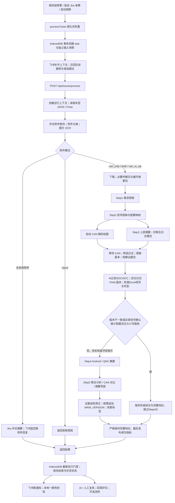

# 当前 Pipeline 工作流程与修改索引

核对日期：2026-10-30。本文依据当前 `src/` 实现整理，供后续修改分析流水线使用。范围包含分析前的任务创建、服务端分析、结果保存及后续复核；不改变现有行为。旧 Harness 文档中 `lib/` 路径、旧表名及迁移目标不能替代当前代码。

> 版本与 VHAL 检查已接入共享流水线，规则与验证边界见 [需求文档](requirements/pipeline-version-vhal-review.md)。

## 1. 整体流程



图中无附件路径实际有来源差异：飞书缺附件会在 OCR 之前直接结束。Step3 与 CAN 绘图并行，证据汇总等待二者；其他主阶段依次执行。

## 2. 入口与任务生命周期

| 环节 | 当前行为 | 代码 |
| --- | --- | --- |
| 筛票与批量入口 | Jira / 飞书筛票后生成待处理快照；指定 Jira 票号也复用统一分析 | [workflow](../src/features/workflow)、[direct-analysis](../src/features/direct-analysis) |
| 浏览器编排 | `processTicket` 防止同页重复请求，排队后创建任务；默认并发 3，可配置 `NEXT_PUBLIC_CONCURRENCY_LIMIT` | [process.ts](../src/features/tickets/services/process.ts)、[concurrency.ts](../src/shared/lib/concurrency.ts) |
| 事务创建 | `beginProcessAttempt` 创建新的 process 快照与 task；重跑归档旧结果，保留原始结果；飞书同步 assignment | [process-repository.ts](../src/features/tickets/services/process-repository.ts) |
| 补齐输入 | 飞书调用 `/api/meegle/context` 取得描述、评论、附件；两来源召回 few-shot 和历史错误模式 | [process.ts](../src/features/tickets/services/process.ts)、[few-shot.ts](../src/features/tickets/services/few-shot.ts) |
| 统一服务端入口 | `/api/issues/process` 校验请求并调用 `processIssue`；当前页面的飞书分析直接使用此入口 | [route.ts](../src/app/api/issues/process/route.ts)、[request.ts](../src/server/pipeline/process/request.ts) |
| 兼容入口 | `/api/meegle/analyze` 仍保留，组装飞书上下文后转交共享分析接口 | [meegle analyze](../src/app/api/meegle/analyze/route.ts) |

请求携带 `source`、`issueKey`、`runId`、`rawData`、规则组 ID/名称、`prompts`、`basePaths`、`modelToFiles`、Jira 站点和历史样本。正常页面运行的 `runId` 等于 `ProcessTask.id`。

防重不只依赖内存：IndexedDB 事务还检查当前活动任务；完成时核对最新 task、assignment 和运行 ID，迟到响应不能覆盖新运行。默认 Jira 与 Bosch Jira 按快照站点隔离。

## 3. 服务端主流程：每一步做什么

主编排：[orchestrator.ts](../src/server/pipeline/process/orchestrator.ts) 中的 `processIssue` 与 `runStages`。

| 阶段 | 输入与处理 | 主要输出 / 条件 | 修改入口 |
| --- | --- | --- | --- |
| 创建上下文 | 从标题匹配规则组车型，判断台架/实车场景；建立运行目录、日志、指标，按场景过滤历史案例 | `ProcessContext`；飞书运行引用与回填凭据 | [context.ts](../src/server/pipeline/process/context.ts) |
| PREPARING | Jira 拉取最新评论/附件，失败回退快照；飞书使用预拉取数据。读取车型 JSON 和 Proto | 评论合并文本、完整解析后的配置项、Proto 文本 | [prepare.ts](../src/server/pipeline/process/prepare.ts) |
| 分类与 OCR | 补齐飞书评论附件元数据并暂存；选择最新 CAN/压缩包；图片 OCR 拼入评论文本 | 附件模式、`input_comments.txt`；评论总长截断为 8,000 字符 | [jira-attachments.ts](../src/server/pipeline/jira-attachments.ts) |
| DOWNLOADING / UNPACKING | 下载选中的 CAN 与日志包；支持分卷、嵌套压缩包；`can_in_zip` 在解压目录寻找 CAN | `canTracePath`、`extractDir` | [fetch-attachments.ts](../src/server/pipeline/process/fetch-attachments.ts)、[archive.ts](../src/server/pipeline/archive.ts) |
| AI_STEP1 | 使用评论合并文本提取需求 | `step1_requirements.md`；未配置提示词则跳过 | [signals-stage.ts](../src/server/pipeline/process/signals-stage.ts) |
| AI_STEP2 | 配置文本前 8,000 字符 + 评论 + Step1 结果交给模型提取信号 | `step2_signals.md`；未配置提示词则跳过模型调用 | [signals-stage.ts](../src/server/pipeline/process/signals-stage.ts) |
| 信号映射 | 从 Step2、标题、描述、评论及历史案例构建候选；精确匹配 → 模糊补救 → 模型自检补救；借助 Proto 映射 Property ID | `signals.json`、`signals_id.json` | [signals-stage.ts](../src/server/pipeline/process/signals-stage.ts)、[signals.ts](../src/server/pipeline/signals.ts) |
| CAN 读取与绘图 | 仅 Step2 直接提取并成功映射的信号进入 CAN；解析 ASC/BLF，结合 DBC 生成曲线与摘要 | 图片、信号值/区间、报文特性、trace 时间范围、交互曲线数据 | [signals.ts](../src/server/pipeline/signals.ts)、[plot_can_signals.js](../scripts/plot_can_signals.js) |
| AI_STEP3 | `both` / `can_in_zip` 模式下，将评论 + 需求 + 信号提取结果生成上层摘要；与绘图并行 | `step3_upper_summary.md` | [log-summary-stage.ts](../src/server/pipeline/process/log-summary-stage.ts) |
| 证据汇总 | 等待 CAN；确定评论/trace 时间窗；按时间与 Property ID 筛 Android/QNX 日志；提取版本与 hash；生成结构化证据包 | `extract.md`、`log-versions.json`、`evidence-packet.json`、Step4 输入 | [evidence-stage.ts](../src/server/pipeline/process/evidence-stage.ts) |
| AI_STEP4 | 对筛选后的 Android/QNX 输入做摘要 | `step4_android_qnx.md`；需配置提示词且输入非空 | [log-summary-stage.ts](../src/server/pipeline/process/log-summary-stage.ts) |
| VERSION_VHAL_CHECK | AI逐对比较 SOC/SCC；从 Android 最新编译日期 hash 追溯 project.json 来源提交，经 RTC 关联同项目同分支组 VS commit，再定位根目录/bak 归档；读取对应 Excel 的 Vehicle property ID、MCU UP、IVI DOWN 与 Project | 四份检查产物、完整响应 versionVhalCheck；未知/冲突提示后继续，版本不一致或全部缺少且无大小写差异才停止 | [version-vhal-stage.ts](../src/server/pipeline/process/version-vhal-stage.ts) |
| AI_STEP5 | 根据模式执行联合一致性分析、CAN 对比或摘要兜底；注入证据、场景、历史案例与错误模式 | 初步最终结论 | [conclusion-stage.ts](../src/server/pipeline/process/conclusion-stage.ts)、[step5.ts](../src/server/pipeline/step5.ts) |
| 结论修正 | 保存并剥离 think；对照证据检查断言，按需模型自修正；特定结论追加博世 MAIN_VERSION；加场景标签 | `evidence-grounding.json`、最终结论 | [step5.ts](../src/server/pipeline/step5.ts)、[version-extract.ts](../src/server/pipeline/process/version-extract.ts)、[finish.ts](../src/server/pipeline/process/finish.ts) |
| 保存与响应 | 完整响应先落盘，最后发布成功指标；正常成功及 Jira 无附件摘要成功路径调度 Docupedia 归档 | `process-response.json`、成功指标、`ProcessResponse` | [finish.ts](../src/server/pipeline/process/finish.ts)、[docupedia-archive.ts](../src/server/pipeline/docupedia-archive.ts) |

注意：Step3 名称虽为“上层日志摘要”，其直接输入实际上是工单评论、需求提取和信号提取结果；解压后 Android/QNX 文件在证据汇总阶段筛选，再进入 Step4。

## 4. 附件分支与提前结束

分类逻辑：[classifyAttachments](../src/server/pipeline/jira-attachments.ts)；阈值：[constants.ts](../src/server/pipeline/constants.ts)。CAN 与日志包各按附件创建时间选最新项，时间差不是日志内的故障时间。

| 条件 | mode | 后续处理 |
| --- | --- | --- |
| 没有可识别 CAN 或日志包 | `no_attachments` | Jira 基于评论做一次 AI 摘要；飞书返回固定补日志回复，不执行完整 Step1–5 |
| 只有独立 CAN | `can_only` | CAN 对比路径，无 Step3 上层摘要 |
| 只有日志压缩包 | `can_in_zip` | 解压后找 CAN，再走联合路径；找不到 CAN 时可能走摘要兜底 |
| CAN 与日志包创建时间绝对差 ≤ 90 分钟 | `both` | 下载二者，联合分析 |
| CAN 比日志包晚 > 120 分钟 | `can_only` | 只分析 CAN |
| 其他时间关系 | `reject` | 固定拒绝原因，提前结束 |

当前实现中，CAN 比日志包晚 **90–120 分钟（包含 120 分钟）也会 reject**；不能仅依据代码中的“ZIP 更新”注释理解此分支。

`reject` / 飞书缺附件会记录服务端 metrics 为 `rejected`，但接口返回的是正常结构化回复。客户端取得非空回复后仍可将处理任务置为 `completed`。因此“客户端任务完成”“证据分析成功”“允许回填”是不同状态。

解压失败会记录日志并尝试继续，绘图通常返回带错误信息的空结果；并非所有子阶段失败都会中断整条流水线。模型异常、严格成功产物保存失败等才会进入主错误处理。模型调用另有重试机制，不能把“5 个 AI 阶段”理解成恰好 5 次模型请求。

## 5. 配置、版本与证据的数据流

### 5.1 当前实际使用的配置

规则组提供：

- `base_paths.json_dir` + `model_to_files[车型].json`：信号映射配置。
- `base_paths.dbc_dir` + `model_to_files[车型].dbc`：CAN 解码所用 DBC，可为多个文件。
- `base_paths.proto_dir` + `model_to_files[车型].proto`：Property ID 映射。
- `base_paths.proto_dir/type.h`：当前配置 VHAL 版本；读取固定文件名，不是 `model_to_files.proto` 指定文件。

下载解压后先提取 SOC/SCC 并选择实际配置；JSON / Proto、DBC 和 type.h 均读取本次冻结副本。自动采用分支当前配置，失败回退用户路径并冻结其中可用文件，缺失项继续保留原有能力边界。

### 5.2 当前版本提取

| 信息 | 当前来源 | 用途 |
| --- | --- | --- |
| SOC | 递归查找解压目录的 Buildinfo.txt，读取 MAIN_VERSION | 与同目录 SCC 关联，保存运行版本信息 |
| SCC | 同一个 Buildinfo 目录下 `Scc-*.dlt` 的真实 DLT payload，提取 `[Vip-App]App:` 后版本 | 避免混用不同目录的版本 |
| VHAL | 当前规则组 Proto 根目录下 type.h 的 VER_PRO_CFG | 保存原始 8 位版本、平台、主次版本，例如 82552236 → 8255 / 22.36 |
| BoschVehicleHalHash | 解压文件中含此标记的完整行，去重最多 20 行，不受时间窗限制 | 并入 Android 输入并保存至 log-versions.json |

实现位于 [log-versions.ts](../src/server/pipeline/log-versions.ts)、[vhal-version.ts](../src/server/pipeline/vhal-version.ts)、[log-extract.ts](../src/server/pipeline/log-extract.ts)。版本信息追加到 extract.md 与 Android 输入末尾；不把版本元数据当作信号命中证据。

结论出现“信号不存在”或“报文不存在”时，还有一条独立的末尾处理：读取最大 `cycle_数字` 目录的 Buildinfo.txt，将 MAIN_VERSION 追加到最终回复。

### 5.3 与终端“同步全部项目”的关系

> 2026-10-31：已实现 [日志自动配置需求 v1.0](requirements/pipeline-auto-config-review.md)。下载解压后、Step2 前选择并冻结分支当前配置，失败整套回退用户配置；以下早期实现描述涉及读取时序的内容以此更新为准。

当前两条流程分别运行：

```text
终端同步 → configuration/项目/分支组/ 当前文件及 bak 归档
         → docs/project.json 的 commit → RTC 映射

分析流水线 → 规则组 base_paths + model_to_files 指向的实际文件
          → 评论 / CAN / 日志证据 → 最终结论
```

共享流水线已读取 project.json 的 commit/RTC 映射，根据 Android 原始日志 hash 与编译日期匹配来源提交，经 RTC 完整匹配关联同项目、同分支组 VS commit，再用 VS commit 定位 configuration 分支组根目录/bak 的版本归档，并选择问题所属版本的 VHAL Excel 做信号配置检查。冲突或无法定位时写入持久化提示并继续，不任取候选。规则组原 JSON/DBC/Proto 路径保持原义，同步不会自动改写规则组路径。

基础配置自动选择目前已前置到日志解压之后、Step2 之前：原始 SOC/SCC 只提取一次，日志身份和规则组完整别名共同确定配置；JSON、DBC、Proto 和当前配置 type.h 使用本次有效配置快照。自动采用分支当前快照，不复现历史整套配置；问题历史 VHAL Excel 仍按 hash → RTC → VS commit 独立追溯。无法唯一选择、文件不齐或清单无效时整套回退用户默认配置。

## 6. 最终结论、复核与回填的区别

Step5 根据附件模式分流：

- `both` / `can_in_zip`：有 `CONSISTENCY_SYSTEM` 且 CAN 预览文本非空时做联合分析，否则优先采用 Step4 / Step3 摘要，再降级。
- `can_only`：有 `COMPARE_CANTRACE` 且 CAN 预览文本非空时做 CAN 对比，否则用摘要提示词。
- 所有模式若仍无结论，再仅基于评论做兜底摘要。

正式 Step5 结论生成会加结构化输出要求：现象、证据、根因、结论、置信度。常规低温生成；识别高优先级时最多并行生成 3 份草稿再合并。最终再做证据断言自检，相关报告写入 `evidence-grounding.json`。摘要兜底不等价于具有完整 CAN 证据的联合分析。

浏览器保存结果后：

1. 尝试发送飞书群处理结果通知，失败只告警；随后执行本地一致性校验，写入 `validationRuns` / `validationChecks`。
2. 用户可显式执行 `/api/issues/review` AI 复核，或人工通过/驳回；驳回记录正确结论和错误类型，形成后续 few-shot。
3. 飞书 AI 复核只保存建议，不能替代人工复核门禁；Jira AI 复核沿用其已有审核状态逻辑。
4. 回填评论前事务领取；评论与可选飞书状态流转分别记账，流转失败重试不重复评论。

代码：[validation.ts](../src/features/tickets/services/validation.ts)、[review.ts](../src/features/tickets/services/review.ts)、[review/service.ts](../src/server/pipeline/review/service.ts)、[backfill.ts](../src/features/tickets/services/backfill.ts)。流水线内部证据自检、保存后的本地一致性校验和显式 AI 复核是三套不同操作。

## 7. 运行产物、恢复与失败处理

正常页面分析的日志目录：

```text
log/<规则组目录名>/<车型或 unknown>/<issueKey>/<runId>/
  input_comments.txt
  step1_requirements.md / step2_signals.md
  signals.json / signals_id.json
  can_signals.png
  can_signal_summary.txt / can_trace_extracted_result.txt
  step3_upper_summary.md
  extract.md / log-versions.json
  step4_android_qnx_input.md / step4_android_qnx.md
  evidence-packet.json / evidence-grounding.json
  final_reply_raw.md / final_reply.md
  stages.json / process-response.json / pipeline-metrics.json
  pipeline.log
```

文件按运行分支和成功条件生成，不保证每次都存在。模型阶段还可保存 raw / thinking 文件。附件保存在 `jira-issues/` 下：飞书按 runId 隔离；正常 Jira 分析使用默认/Bosch 站点隔离的附件缓存，日志仍按 runId 隔离。

成功发布顺序是：最终回复 → stages → 完整 process-response → flush 日志 → 带 `responseArtifactVersion: 1` 的 success metrics。飞书恢复必须验证原 run 的完整成功产物并重新签发引用/凭据，不能仅看到 final_reply.md 就恢复成功。

飞书忽略 HTTP 断开取消，刷新后通过 `/api/meegle/recover` 恢复；显式停止走 `/api/meegle/cancel`。Jira 使用 HTTP 请求的取消信号。运行结束/取消时统一收拢绘图等子进程。刷新恢复发现没有完整产物时，在未超过 2 小时的情况下仍可保持 running；Jira 没有相同的完整产物自动恢复路径。

结果主存储为浏览器 `IvacpDB` 的 snapshots、processTasks、processResults、analysisHistories、assignments 等统一表；MySQL 是镜像，服务器磁盘是分析过程产物。修改任一层不能假定其他层会自动同步其状态语义。

## 8. 后续修改时从哪里入手

| 要改的行为 | 优先修改 / 核对的位置 |
| --- | --- |
| 步骤先后顺序、新增阶段或条件跳转 | process/orchestrator.ts，必要时扩展 ProcessContext |
| 根据版本动态选择配置 | prepare.ts、context.ts、fetch-attachments.ts、evidence-stage.ts；同时核对 terminal/sync 产物约定 |
| 支持新附件格式或调整时间门槛 | jira-attachments.ts、constants.ts、fetch-attachments.ts、archive.ts |
| 信号漏提、匹配或 Property ID | signals-stage.ts、signals.ts |
| CAN 解码、曲线、信号区间 | signals.ts、scripts/plot_can_signals.js 及其实际调用的脚本 |
| 日志时间窗、筛选、hash、版本 | log-extract.ts、log-versions.ts、vhal-version.ts、evidence-stage.ts |
| 提示词内容与输入组成 | 规则组 prompts；signals-stage.ts、log-summary-stage.ts、conclusion-stage.ts |
| 最终结论与证据自检 | conclusion-stage.ts、step5.ts、domain/analysis 的证据规则 |
| 增加返回字段或修改结果结构 | domain/analysis/process-contracts.ts、pipeline/types.ts、finish.ts、process-repository.ts、恢复与详情展示 |
| 超时、停止、恢复与重跑 | process/runtime.ts、artifacts/analysis-run-registry.ts、features/tickets/services/process.ts、process-repository.ts |
| 回填条件、人工复核与历史样本 | review.ts、backfill.ts、few-shot.ts；不要仅修改主编排 |

建议先说明：在哪一阶段加入什么输入、怎样处理、输出什么，以及缺失/失败时继续还是停止。若改变阶段顺序，要同时核对取消、产物落盘、飞书恢复和历史重跑。

现有回归入口包括：`test/pipeline-orchestrator.test.ts`、`test/pipeline-api.test.ts`、`test/process-lifecycle.test.ts`、`test/pipeline-run-commit.test.ts`、`test/pipeline-cancellation.test.ts`、`test/pipeline-finish-cancel-race.test.ts`、`test/meegle-complete-recovery.test.ts`、`test/log-versions.test.ts`、`test/vhal-version.test.ts`、`test/backfill-lifecycle.test.ts`。

## 11. 版本与 VHAL 检查产物

当前 run 增加 soc-scc-version-check.json、vhal-version-resolution.json、vhal-signal-config-check.json、version-vhal-check.md；持久化来源、候选、逐信号行号/列名/Project 原文及未知/冲突/大小写差异提示。完整响应带可选 versionVhalCheck，保存至 IndexedDB 与重跑历史，飞书恢复重读同一 run，详情页可展开查看。Excel 读取器为 scripts/read-vhal-xlsx.py，使用 Python 3 标准库；可复用 CAN_PYTHON_BIN。Python 不可用或表无法可靠解析时记录 unknown 并继续。
