# 时序图文档

## IVACP 规则组管理实现（2026-10-27）

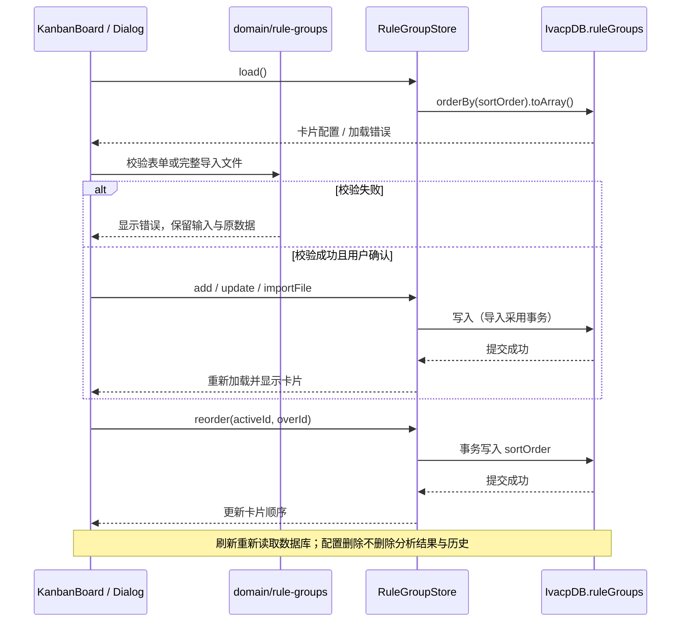

## IVACP 处理、恢复与回填实现

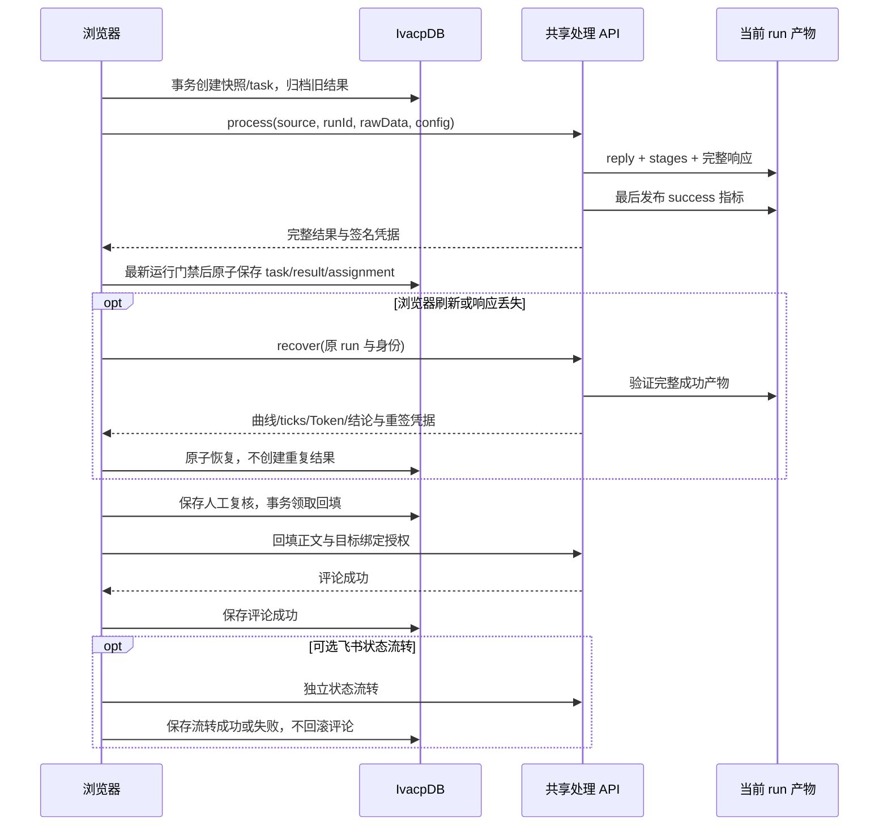

以下旧版流程图用于完整迁移对照；未接通模块不能因标记「已实现」就视为新仓库已验收。

## 本年度统计

```text
用户 -> 首页统计弹窗: 本年度统计 / 重新统计
弹窗 -> IndexedDB: 只读事务读取结果、历史及飞书身份
IndexedDB -> 聚合函数: 当前浏览器保留记录
聚合函数 -> 聚合函数: 结果 ID 去重、年度过滤、票据最新结果去重
聚合函数 -> 弹窗: 总票数、分析次数及分来源复核统计
IndexedDB -> 弹窗: 读取失败时显示错误并允许重试
```

## 主页统一规则组筛选

```text
主页规则组 -> 工作流编排层: 一键筛选
工作流编排层 -> Jira: JQL（并发）
工作流编排层 -> 飞书项目: MQL（并发）
Jira/飞书项目 -> 工作流编排层: 各自结果或错误
工作流编排层 -> IndexedDB: 分来源持久化
工作流编排层 -> 主页规则组: 独立状态与数量
```

> 项目：Jira 智能分析平台  
> 更新时间：2026-05

## 飞书项目筛票

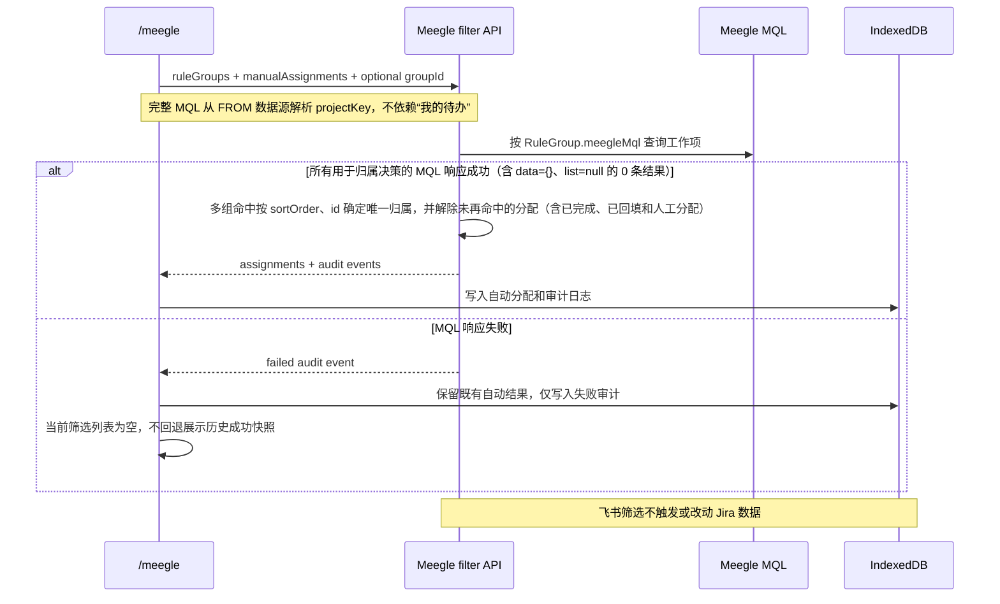

---

## 1. 规则组 CRUD 时序（已实现）

```
用户浏览器                    KanbanBoard              useRuleGroupStore         IndexedDB (Dexie)      API Route
    │                              │                          │                        │
    │  页面加载                     │                          │                        │
    │ ─────────────────────────► │                          │                        │
    │                              │  loadRuleGroups()        │                        │
    │                              │ ──────────────────────► │                        │
    │                              │                          │  db.ruleGroups         │
    │                              │                          │  .orderBy("sortOrder") │
    │                              │                          │ ──────────────────────► │
    │                              │                          │ ◄────────────────────── │
    │                              │  { ruleGroups: [...] }   │                        │
    │  render 规则组行列表           │ ◄────────────────────── │                        │
    │ ◄─────────────────────────── │                          │                        │
    │                              │                          │                        │
    │  点击"新建规则组"              │                          │                        │
    │ ─────────────────────────► │                          │                        │
    │  打开 RuleGroupDialog        │                          │                        │
    │ ◄─────────────────────────── │                          │                        │
    │                              │                          │                        │
    │  填写表单 → 点击"保存"          │                          │                        │
    │ ─────────────────────────► │                          │                        │
    │                              │  addRuleGroup(data)      │                        │
    │                              │ ──────────────────────► │                        │
    │                              │                          │  db.ruleGroups.add()   │
    │                              │                          │ ──────────────────────► │
    │                              │                          │ ◄────────────────────── │
    │                              │  loadRuleGroups() 刷新   │                        │
    │                              │ ──────────────────────► │                        │
    │  规则组行出现在列表中            │ ◄────────────────────── │                        │
    │ ◄─────────────────────────── │                          │                        │
    │                              │                          │                        │
    │  管理员调用后端接口              │                          │                        │
    │ ─────────────────────────────────────────────────────────────────────────► │
    │                              │                          │                        │ /api/rule-groups
    │                              │                          │                        │ ──► data/rule-groups.json
```

---

## 2. 拖拽排序时序（已实现）

```
用户浏览器                RuleGroupList (dnd kit)      useRuleGroupStore         IndexedDB
    │                           │                            │                       │
    │  开始拖拽 RuleGroupRow      │                            │                       │
    │ ─────────────────────── ► │                            │                       │
    │  拖拽到目标位置               │                            │                       │
    │  释放（DragEnd event）      │                            │                       │
    │ ─────────────────────── ► │                            │                       │
    │                           │  handleDragEnd(active, over)│                       │
    │                           │ ──────────────────────────► │                       │
    │                           │                            │  arrayMove()           │
    │                           │                            │  批量更新 sortOrder     │
    │                           │                            │ ─────────────────────► │
    │                           │                            │  db.transaction(rw)    │
    │                           │                            │  update each sortOrder │
    │                           │                            │ ◄───────────────────── │
    │  列表顺序即时更新             │                            │                       │
    │ ◄──────────────────────── │                            │                       │
    │  （刷新页面后顺序仍保留）        │                            │                       │
```

---

## 3. 筛票任务时序（待实现）

```
用户                  RuleGroupRow           API Route             IndexedDB
  │                       │              /api/filter-tasks             │
  │  点击"筛票"按钮          │                    │                       │
  │ ──────────────────► │                    │                       │
  │                       │  POST /api/filter-tasks                   │
  │                       │  { ruleGroupId }   │                       │
  │                       │ ─────────────────► │                       │
  │                       │                    │  创建 FilterTask       │
  │                       │                    │  (status: PENDING)    │
  │                       │                    │ ─────────────────────► │
  │  显示"筛票中..."         │                    │                       │
  │ ◄────────────────── │                    │  异步执行 JQL 查询        │
  │                       │                    │  Jira REST API        │
  │                       │     Store 更新任务状态 │                       │
  │ ◄──────────────────────────────────────── │                       │
  │  显示筛票结果（快照数量）   │                    │                       │
```

---

## 4. AI 分析处理时序（已实现）

飞书项目进入共享处理路由后，会先预取评论中的不透明附件 URL，以下载结果补齐真实文件名、MIME 和大小；评论时间与附件插件 `uploadedAt` 一起进入既有最新 CAN / 日志包选择。选中的评论附件复用预取文件。若合并后没有 CAN trace 或日志压缩包，则直接返回固定补件结论；Jira 的无附件处理不变。

Docupedia 后台归档的月度统计独立于浏览器结果持久化：

```text
归档服务 -> Docupedia: find-or-create 实际文本文章
Docupedia -> 归档服务: created / existing
归档服务 -> 月度记录器: 正文 text.length > 500 时记录
月度记录器 -> 本地 JSONL: 同进程串行读取、同月按标题去重、追加明细和 monthlyTotal
月度记录器 -> 服务终端: 更新后累计数；写入失败仅告警
归档服务 -> pipeline.log: 原有逐篇进度（统计失败不改变上传状态）
```

```
用户           RuleGroupRow       API Route            Qwen API       IndexedDB       Docupedia
  │                │         /api/process-tasks              │              │              │
  │  点击"一键处理"  │                │                         │              │              │
  │ ───────────► │                │                         │              │              │
  │               │  检查最新筛票任务    │                         │              │              │
  │               │  issueCount=0/未筛票 │                         │              │              │
  │ ◄─────────── │  按钮禁用            │                         │              │              │
  │               │                │                         │              │              │
  │               │  读取最新成功筛票快照 │                         │              │              │
  │               │ ──────────────────────────────────────────────────────► │              │
  │               │                │                         │              │              │
  │               │  逐票串行处理        │                         │              │              │
  │               │                │ ──── PREPARING ──────►  │              │              │
  │               │                │ ──── DOWNLOADING ────►  │              │              │
  │               │                │ ──── UNPACKING ──────►  │              │              │
  │               │                │ ──── PARSING ────────►  │              │              │
  │               │                │  解码 CAN 信号并输出      │              │              │
  │               │                │  仅回放 Step 2 提取并匹配到的信号（含 PascalCase）；候选信号只落盘 │      │
  │               │                │  can_trace_extracted_result.txt / traceData │        │
  │               │                │                         │              │              │
  │               │                │  MODEL_INFERENCE        │              │              │
  │               │                │  一致性分析输入包含       │              │              │
  │               │                │  CAN Trace提取结果       │              │              │
  │               │                │ ───────────────────────► │              │              │
  │               │                │ ◄─── AI 分析结论 ──────── │              │              │
  │               │                │                         │              │              │
  │               │                │ ──── SAVING_RESULT / 服务端成功响应完成 ────────────────► │              │
  │  浏览器收到成功响应后独立保存 IndexedDB；Next.js `after` 仅上传当前 run logRoot，二者互不等待；失败不影响结果/复核/回填 ─► │
  │               │                │                         │              │              │
  │  显示分析结论    │ Store 更新；详情页以共享绝对时间 X 轴展示交互式散点信号图 │              │              │
  │  锁定当前视口    │ POST /api/issues/save-screenshot 覆盖 log/.../can_signals.png │      │              │
  │  回填 Jira       │ POST /api/jira/comment 上传同一个 can_signals.png 附件 │        │              │
  │ ◄───────────────────────────── │                         │              │              │
```

---

## 5. AutoCycle 本地调度时序（已实现）

```
用户浏览器          RuleGroupRow        useAutoCycleStore       IndexedDB        KanbanBoard
  │                    │                       │                    │                │
  │  点击 自动OFF/ON     │                       │                    │                │
  │ ─────────────────► │                       │                    │                │
  │                    │ toggleAutoCycle()     │                    │                │
  │                    │ ────────────────────► │                    │                │
  │                    │                       │ db.autoCycleStates │                │
  │                    │                       │ .put(isActive)     │                │
  │                    │                       │ ─────────────────► │                │
  │                    │  行内显示自动状态       │ ◄───────────────── │                │
  │ ◄───────────────── │                       │                    │                │
  │                    │                       │                    │                │
  │                    │                       │                    │ setInterval    │
  │                    │                       │                    │ 每 30 秒检查    │
  │                    │                       │                    │ ◄──────────────│
  │                    │                       │                    │                │
  │                    │                       │                    │ runDueAutoCycles()
  │                    │                       │                    │ 检查 nextRunAt │
  │                    │                       │                    │ ─────────────► │
  │                    │                       │                    │                │
  │                    │                       │                    │ runUnifiedFilter() │
  │                    │                       │                    │ 保存分来源本轮状态/快照/分配，并返回来源汇总 │
  │                    │                       │                    │ ─────────────► │
  │                    │                       │                    │                │
  │                    │                       │                    │ processRuleGroup(sourceSummary) │
  │                    │                       │                    │ Jira 用当次成功快照；飞书当次筛选成功时处理该组当前全部 pending/failed（含人工分配），失败不派发 │
  │                    │                       │                    │ ─────────────► │
  │                    │                       │ markAutoCycleRun() │                │
  │                    │                       │ 更新 last/nextRunAt │                │
  │                    │                       │ ─────────────────► │                │
```

---

## 5.0.1 Pipeline Metrics 与黄金样本基线时序（已实现）

```
Issue Process API              File System                         Baseline Script
      │                              │                                    │
      │  处理 Jira 工单               │                                    │
      │ ───────────────────────────► │                                    │
      │  写入 pipeline.log            │                                    │
      │  写入 stages.json             │                                    │
      │  写入 pipeline-metrics.json   │                                    │
      │  写入 evidence-packet.json    │                                    │
      │                              │                                    │
      │                              │ ◄───────────────────────────────── │
      │                              │   npm run baseline:golden          │
      │                              │                                    │
      │                              │ ─────────────────────────────────► │
      │                              │   递归读取 log/**/pipeline-metrics.json
      │                              │                                    │
      │                              │ ◄───────────────────────────────── │
      │                              │   docs/golden-baseline/golden-baseline.json
      │                              │   docs/golden-baseline/golden-baseline.md
```

---

## 5.0.2 Evidence Packet 与错误归因评测时序（已实现）

```
Issue Process API              File System                         Eval Script
      │                              │                                  │
      │  生成结构化证据包              │                                  │
      │ ───────────────────────────► │                                  │
      │  写入 evidence-packet.json    │                                  │
      │                              │                                  │
      │  Step 5 prompt 注入 <结构化证据包>                                 │
      │ ───────────────────────────────► Qwen API                         │
      │                              │                                  │
      │                              │ ◄─────────────────────────────── │
      │                              │  npm run eval:accuracy           │
      │                              │ ───────────────────────────────► │
      │                              │  优先读取 evidence-packet.json    │
      │                              │ ◄─────────────────────────────── │
      │                              │  输出 errorCategories/categoryCounts
```

### 台架 / 实车场景时序

Store 调用 `/api/issues/process` 前，`fetchFewShotSamples` / `fetchErrorPatterns` 先用 `detectIssueScene(标题)` 过滤同场景样本；Process API 入口再兜底过滤一次，Step 5 合并提示加入 `<问题场景>`，生成结论后经 `applyIssueSceneReplyTag` 加场景前缀，再返回 Store 保存 / 回填。

### Phase 3 评测集覆盖与证据精召回时序

Phase 3 中，Eval Script 额外调用 `eval-set-coverage.ts` 生成覆盖报告，输出 `eval-set-coverage.{json,md}`，报告人工真值覆盖比例；Issue Process API 在 Step 5 前使用 Evidence Packet 对 few-shot 案例重排（二段式 RAG），并在结论生成后进行最多 3 轮的自愈自批判重写和接地率回滚保护（Rollback Guard）。在线 U3 与离线 Eval 均向 `computeGrounding()` 传入 `evidence_packet`、`can_signal_summary`、`can_trace_extracted_result`、`signals_id`、`extract` 五类具名可信证据源，统一归一化时间、键值断言、标识符和 Property ID。缺失或错误来源进入审计；无法判定的 `unknown_missing_evidence` 票从平均 EGR 排除。校准结果只作为人工复核辅助，保持 advisory / non-blocking，不阻断 Jira 回填。Evidence Packet 真实时间窗 overlap 计算替代原来的字段存在判定。

---

## 5.1 AI 复核验证模型时序（已实现）

```
用户浏览器          IssueDetail / Store       Review API Route       Qwen 验证模型
  │                       │                         │                      │
  │  点击"AI 复核"          │                         │                      │
  │ ───────────────────► │                         │                      │
  │                       │  读取 IssueProcessResult │                      │
  │                       │  + FilteredIssueSnapshot │                      │
  │                       │  + IssueReviewSample     │                      │
  │                       │ ───────────────────────► │                      │
  │                       │  POST /api/issues/review │                      │
  │                       │  replyText + Jira 描述/评论/原始快照             │
  │                       │  + CAN 信号摘要 + ruleGroupName                 │
  │                       │                         │  读取 log/<规则组>/<车型>/<IssueKey>/
  │                       │                         │  Step1-5 / signals / extract / final_reply
  │                       │                         │ ───────────────────► │
  │                       │                         │  VALIDATE_QWEN_MODEL │
  │                       │                         │  VALIDATE_API_KEY    │
  │                       │                         │ ───────────────────► │
  │                       │                         │ ◄── verdict/reason ─ │
  │                       │ ◄─────────────────────── │                      │
  │  更新复核状态            │                         │                      │
  │ ◄──────────────────── │                         │                      │
```

---

## 5.2 结构化证据校验与 prop/signal RAG 时序（已实现）

```
Jira / Meegle Store          IndexedDB                 Issue Process / Validation
      │                          │                                  │
      │  处理前读取同规则组正负样本   │                                  │
      │ ────────────────────────► │  IssueReviewSample               │
      │                          │  sampleKind + evidence fingerprint│
      │ ◄──────────────────────── │                                  │
      │  Embedding 召回；失败回退标题；车型/prop/signal/Property ID 混排    │
      │  无车型或结构化证据重合的 approved 样本过滤                         │
      │                          │                                  │
      │  POST /api/issues/process + 最多 3 条候选                        │
      │ ────────────────────────────────────────────────────────────► │
      │                          │  生成 Evidence Packet             │
      │                          │  二次稳定重排并再次执行正样本门槛     │
      │                          │  分区注入 <历史纠错案例>/<历史正确案例>│
      │                          │  历史事实不得覆盖当前票证据           │
      │                          │                                  │
      │                          │  返回 replyText/signalSummary     │
      │                          │  + reviewEvidence                 │
      │ ◄─────────────────────────────────────────────────────────── │
      │  保存来源专用 ProcessResult                                  │
      │ ────────────────────────► │                                  │
      │                          │                                  │
      │  人工通过/驳回：同一事务更新结果与统一样本，覆盖同票旧类型并清 Embedding │
      │ ────────────────────────► │                                  │
      │                          │                                  │
      │  validateStructuredEvidence(replyText, signalSummary)         │
      │ ────────────────────────────────────────────────────────────► │
      │                          │ ◄──────────────────────────────── │
      │  保存 IssueValidationRun + IssueValidationCheck               │
      │ ────────────────────────► │                                  │
      │  详情页展示 advisory 证据校验结果；不阻断回填                     │
      │ ◄──────────────────────── │                                  │
```

---

## 6. 飞书项目工作台与附件插件时序（已实现）

```
用户              /meegle             Meegle API/CLI       IndexedDB        附件插件             共享分析流水线
 │                   │                      │                  │                 │                       │
 │  打开工作台         │                      │                  │                 │                       │
 │ ────────────────► │  mywork todo         │                  │                 │                       │
 │                   │ ────────────────────► │                  │                 │                       │
 │ ◄──────────────── │  当前用户待办卡片      │                  │                 │                       │
 │  拖入规则组队列      │                      │                  │                 │                       │
 │ ────────────────► │  保存 assignment     │                  │                 │                       │
 │                   │ ─────────────────────────────────────► │                 │                       │
 │  点击处理            │                      │                  │                 │                       │
 │ ────────────────► │  comment list        │                  │                 │                       │
 │                   │ ────────────────────► │                  │                 │                       │
 │                   │  /api/files/list     │                  │                 │                       │
 │                   │ ───────────────────────────────────────────────────────► │                       │
 │                   │ ◄─────────────────────────────────────────────────────── │  附件元数据             │
 │                   │  浏览器直接 POST /api/issues/process（评论 + 评论附件 + 插件附件 + 规则组配置 + task runId）│
 │                   │ ────────────────────────────────────────────────────────────────────────────────► │
 │                   │                                                        │  /api/files/download/{id}│
 │                   │                                                        │ ◄──────────────────────── │
 │                   │ ◄──────────────────────────────────────────────────────────────────────────────── │
│                   │  服务端成功响应完成；浏览器收到响应后独立保存 snapshot/task/result + artifactRef；发送飞书项目通知 │                 │                       │
│                   │  Next.js `after` 异步归档当前 run 日志；不等待 IndexedDB，失败不回滚结果、复核或回填 │                 │                       │
│                   │  若浏览器持久化前中断：下次首页/详情按 task runId 校验 success 产物，重建 result 并标记 completed │                 │                       │
 │                   │ ─────────────────────────────────────► │                 │                       │
 │ ◄──────────────── │  完成卡可查看结果       │                  │                 │                       │
 │  打开结果详情       │                      │                  │                 │                       │
 │ ────────────────► │  IndexedDB 恢复结果/历史/验证            │                 │                       │
 │                   │ ─────────────────────────────────────► │                 │                       │
 │                   │  GET /api/meegle/artifacts?artifactRef  │                 │                       │
 │                   │ ────────────────────► │                  │                 │                       │
 │  结果页修改经办人  │  GET /api/meegle/workitem → users 搜索 → authorize → assignee │                 │                       │
 │  确认重新分析      │  processAssignment → history(旧 result) → 新 snapshot/task/result │                 │                       │
 │  AI 复核 / 人工复核 │                      │  保存独立复核状态    │                 │                       │
 │ ────────────────► │ ─────────────────────────────────────► │                 │                       │
 │  明确授权飞书回填    │                      │                  │                 │                       │
 │ ────────────────► │  comment list(marker)│                  │                 │                       │
 │                   │ ────────────────────► │                  │                 │                       │
 │                   │  attachment +upload / comment add       │                 │                       │
 │                   │ ────────────────────► │                  │                 │                       │
 │                   │  立即保存 comment=succeeded             │                 │                       │
 │                   │ ─────────────────────────────────────► │                 │                       │
 │                   │  可选 transition-state│                  │                 │                       │
 │                   │ ────────────────────► │                  │                 │                       │
 │                   │  单独保存 transition 结果               │                 │                       │
 │                   │ ─────────────────────────────────────► │                 │                       │
```

评论附件先从 Markdown、`file_url` 和 `file_urls` 规范化，再与插件附件合并；其没有文件级时间时使用评论创建时间，随后与插件 `uploadedAt` 共同决定最新 CAN / 日志包。被选中的评论附件通过 Meegle `attachment +download` 下载，插件附件继续使用插件下载地址。插件列表不可用时，适配器记录告警并继续可用评论附件分析。Meegle 持久化主链路由浏览器直接调用共享分析路由，不经过 `/api/meegle/analyze` 的服务端 HTTP 回环；只有收到完整成功响应后才原子保存 completed task、result 和 assignment latest IDs。若该响应已生成成功产物但浏览器未完成事务，首页和结果详情只按该 processing task 的不可变 runId 检查完整 success 产物，校验通过才重建 result、签名 artifactRef 与回填凭据，并标记 completed；无完整产物时恢复接口以 HTTP 200 返回 `recoverable: false`，创建未满 2 小时的任务保持处理中，超过 2 小时的 task 与 assignment 原子标记 failed。结果页经办人修改继续使用详情凭据、目标绑定授权和二次读取，不触发评论或 workflow；重新分析先归档旧 result，再创建新 snapshot/task/result，失败时保留旧结果。共享成功路径只归档当前 run 日志，Meegle 成功或失败都会在本地结果状态落定后发送来源明确的飞书通知；两类外部失败都不回滚处理结果。共享下载器只向 `JIRA_SERVER` 主机发送 Jira Basic Auth，不向飞书评论或附件插件主机发送 Jira 凭据。AI 复核为 advisory；只有人工复核解除回填门禁。评论成功和状态流转分别持久化，后者失败不回滚或重复前者。

---

## 7. Jira 状态流转时序（已实现）

```
用户浏览器          IssueDetail           API Route                         Jira Server            IndexedDB
  │                    │        /api/rule-groups/{id}/processed-issues/{issueKey}/transition          │
  │  点击"状态流转"      │                    │                                │                    │
  │ ─────────────────► │                    │                                │                    │
  │                    │  GET 可用 transitions+人员候选 │                         │                    │
  │                    │ ──────────────────► │                                │                    │
  │                    │                    │  GET /rest/api/2/issue/{key}/transitions             │
  │                    │                    │ ─────────────────────────────► │                    │
  │                    │                    │ ◄───────────────────────────── │                    │
  │                    │                    │  GET /rest/api/2/issue/{key}?fields=*all              │
  │                    │                    │ ─────────────────────────────► │                    │
  │                    │                    │ ◄───────────────────────────── │                    │
  │                    │                    │  GET /rest/api/2/issue/{key}/watchers（可选）          │
  │                    │                    │ ─────────────────────────────► │                    │
  │                    │                    │ ◄───────────────────────────── │                    │
  │  弹窗展示可选流转和相关人员 │ ◄────────────── │                                │                    │
  │                    │                    │                                │                    │
  │  选择 transitionId  │                    │                                │                    │
  │  可选选择 targetUser │                    │                                │                    │
  ## 7. 远程终端连接时序

  ```
  浏览器 -> Next.js: GET /api/terminal/targets
  Terminal Gateway -> .env: load REMOTE_SHELL_TARGETS_JSON
  浏览器 -> Terminal Gateway: WebSocket connect(targetId)
  Terminal Gateway -> SSH Server: SSH + PTY
  SSH Server -> Terminal Gateway: shell output
  Terminal Gateway -> 浏览器: output
  浏览器 -> Terminal Gateway: input / resize / disconnect
  ```

  项目操作扩展：

  ```
  浏览器 -> Next.js: GET /api/terminal/projects
  Next.js -> docs/project.json: read projectName / branches / repos
  浏览器 -> Terminal Gateway: input("cd mainPath")
  浏览器 -> Terminal Gateway: input("cd repo && git checkout branchName || git stash push -u && git checkout branchName")
  浏览器 -> Terminal Gateway: input("cd repo && git checkout .")
  浏览器 -> Terminal Gateway: input("cd repo && git pull")
  浏览器 -> Terminal Gateway: input("cd mainPath/scriptPath")
  浏览器 -> Terminal Gateway: projectGitStatus(sessionId, project, branch)
  Terminal Gateway -> SSH Server: cd repo && git status --short --branch
  Terminal Gateway -> 浏览器: gitStatus(statuses)
  浏览器 -> Terminal Gateway: uploadFile(sessionId, uploadKind, fileBase64)
  Terminal Gateway -> SSH Server: mkdir -p targetDir && write file
  浏览器 -> Terminal Gateway: packageFiles(sessionId, project, branch)
  Terminal Gateway -> SSH Server: zip script files && base64 zip
  Terminal Gateway -> 浏览器: fileDownload(zipBase64)
  浏览器 -> Terminal Gateway: packageChecklist(sessionId, project, branch)
  Terminal Gateway -> SSH Server: base64 VHAL_SIGNAL_CHECKLIST_s.xls
  Terminal Gateway -> 浏览器: fileDownload(xlsBase64)
  浏览器 -> Terminal Gateway: gitAdd(sessionId, repoPath, files)
  Terminal Gateway -> SSH Server: cd repo && git add files
  Terminal Gateway -> SSH Server: cd repo && git status --short --branch
  Terminal Gateway -> 浏览器: gitStatus(statuses)
  浏览器 -> Terminal Gateway: gitCheckout(sessionId, repoPath, files)
  Terminal Gateway -> SSH Server: cd repo && git checkout -- files
  Terminal Gateway -> SSH Server: cd repo && git status --short --branch
  Terminal Gateway -> 浏览器: gitStatus(statuses)
  浏览器 -> Terminal Gateway: gitReset(sessionId, repoPath, files)
  Terminal Gateway -> SSH Server: cd repo && git reset HEAD files
  Terminal Gateway -> SSH Server: cd repo && git status --short --branch
  Terminal Gateway -> 浏览器: gitStatus(statuses)
  浏览器 -> Terminal Gateway: signalConfigFiles(sessionId, project, branch)
  Terminal Gateway -> SSH Server: cd repo && find tools/json -name config_*.json
  Terminal Gateway -> 浏览器: signalConfigFiles(configs)
  浏览器 -> Terminal Gateway: checkoutSignalConfigFiles(sessionId, repos)
  Terminal Gateway -> SSH Server: cd repo && git checkout -- tools/json/config_*.json
  Terminal Gateway -> SSH Server: cd repo && git status --short --branch
  Terminal Gateway -> 浏览器: gitStatus(statuses)
  ```

## 8. OpenAPI / Swagger 文档时序（已实现）

```
浏览器 -> Next.js: GET /api/docs
Next.js -> 浏览器: Swagger UI HTML
Swagger UI -> Next.js: GET /api/openapi
Next.js -> lib/openapi/spec.ts: read openApiSpec
Next.js -> Swagger UI: OpenAPI 3.0 JSON
Swagger UI -> 浏览器: 渲染已实现 API Routes 文档
```

## 9. Geely2 专项页面（IVACP 已移除，以下为旧系统记录）

```
浏览器 -> Next.js: GET /geely2
Next.js -> 浏览器: Geely2Dashboard Client Component
Geely2Dashboard -> IndexedDB: read ruleGroups
Geely2Dashboard -> IndexedDB: filter Geely / 吉利 ruleGroups
Geely2Dashboard -> IndexedDB: read completed issueProcessTasks + issueProcessResults
Geely2Dashboard -> 浏览器: render result overview

浏览器 -> Next.js: GET /geely2/results/:id
Next.js -> 浏览器: Geely2ResultDetail Client Component
Geely2ResultDetail -> IndexedDB: read IssueProcessResult by id
Geely2ResultDetail -> IndexedDB: read task / snapshot / ruleGroup / histories
Geely2ResultDetail -> 浏览器: render AI conclusion and analysis context
```

## 10. 登录与 API 鉴权时序（已实现）

```
浏览器 -> Next.js: GET /geely2
proxy.ts -> Cookie: read jira_analyzer_session
proxy.ts -> 浏览器: 302 /login?next=/geely2

浏览器 -> Next.js: POST /api/auth/login
Auth API -> docs/login.json: match username/password
Auth API -> Auth Session: sign token
Auth API -> 浏览器: Set-Cookie jira_analyzer_session
浏览器 -> localStorage: save token

浏览器 -> Next.js: GET /api/jira/filter
proxy.ts -> Cookie: verify token
proxy.ts -> Permission: canAccessPath(path, method, role)
proxy.ts -> API Route: allow

浏览器 -> Next.js: GET /api/jira/filter (no token)
proxy.ts -> 浏览器: 401 JSON
```

## 11. 规则组后端 API 与权限时序（已实现）

```
管理员浏览器 -> Next.js: POST /api/rule-groups
proxy.ts -> Permission: canAccessPath(/api/rule-groups, POST, admin)
API Route -> lib/server/rule-groups.ts: createRuleGroup(payload)
RuleGroup Service -> data/rule-groups.json: write
API Route -> 管理员浏览器: 201 { ruleGroup }

普通分析员 -> Next.js: PUT /api/rule-groups/:id
proxy.ts -> 普通分析员: 403 JSON

未登录用户 -> Next.js: GET /api/rule-groups
proxy.ts -> 未登录用户: 401 JSON
```

## 12. Jira / 飞书项目共享 CAN 时序图（已实现）

```
/api/issues/process -> Python CAN 解码: traceData + ticks
Python CAN 解码 -> Playwright Chart.js: 绘制静态 can_signals.png
Playwright Chart.js -> 静态绘图器: 页面错误/图表数量校验
静态绘图器 -> Python fallback: 浏览器渲染失败时保留可用图片

IndexedDB -> Jira/飞书结果详情: traceData + ticks + chartImage
Jira/飞书结果详情 -> CanSignalChart: 统一渲染参数
CanSignalChart -> Chart.js: 多信号散点图 + 共享 X 轴
用户 -> CanSignalChart: 缩放/平移/重置
用户 -> CanSignalChart: 锁定当前视口
CanSignalChart -> /api/issues/save-screenshot: 合并 Canvas + chartImagePath
/api/issues/save-screenshot -> log/.../can_signals.png: 覆盖回填图片
```

## 13. IndexedDB 服务器镜像（MySQL）时序（已实现）

```
NavBar -> /api/backup/status: 登录后检查 MYSQL_URL 与数据库可用性
NavBar -> lib/db/backup: installAutoSync() 注册 Dexie 钩子
（首次启用）lib/db/backup -> /api/backup/push: 完整备份分批上传（backupRunId）
lib/db/backup -> /api/backup/finalize: 标记本浏览器已不存在的记录删除

业务代码 -> IndexedDB: put / update / delete
Dexie 钩子 -> 待推送队列(localStorage): (表, id)
3 秒去抖 -> IndexedDB: bulkGet 当前值
lib/db/backup -> /api/backup/push: upsert 或 deleted=true
/api/backup/push -> MySQL idb_records: 按 session username 写入

新电脑浏览器 -> 数据备份弹窗: 从服务器恢复
数据备份弹窗 -> /api/backup/pull: 按表分页拉取
数据备份弹窗 -> IndexedDB: 补齐缺失记录（抑制钩子，不回推）
```

### 自动周期调度

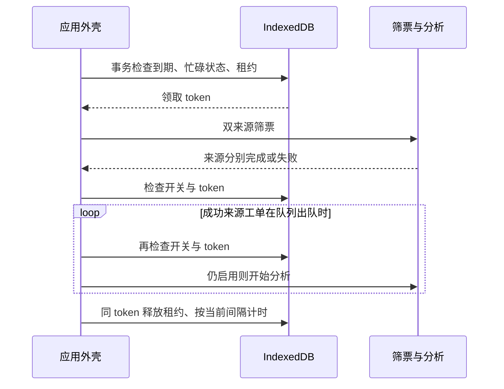

### 原子恢复

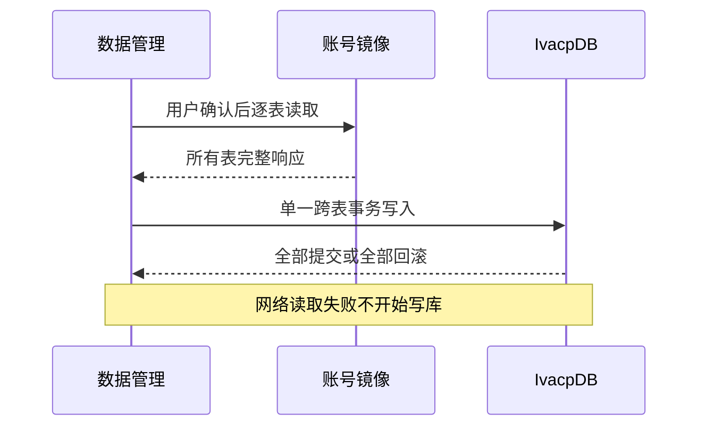

### 标注工作台：读取、建议、独立保存与导出

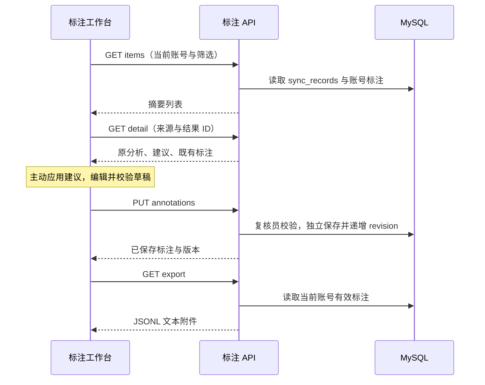

### 本地 API 文档读取

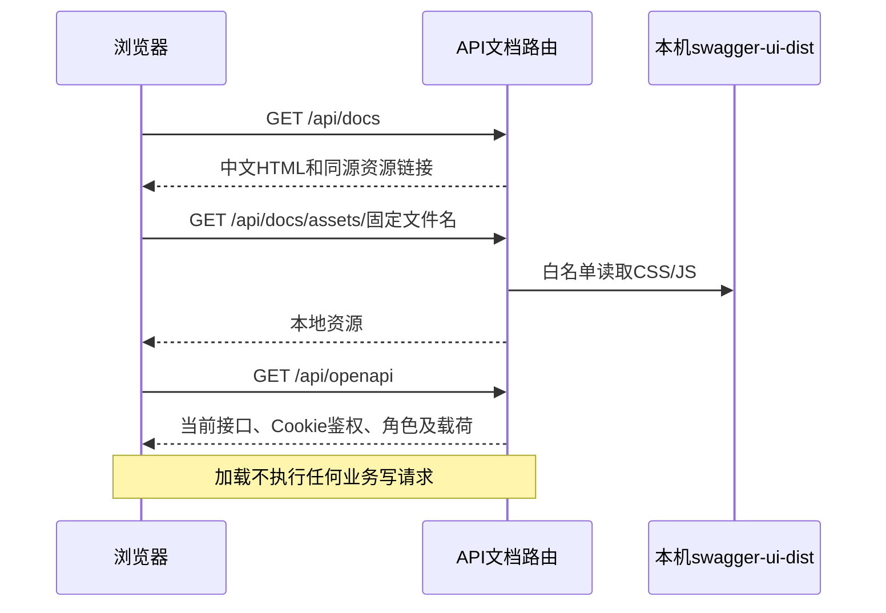

### 终端关联与清理

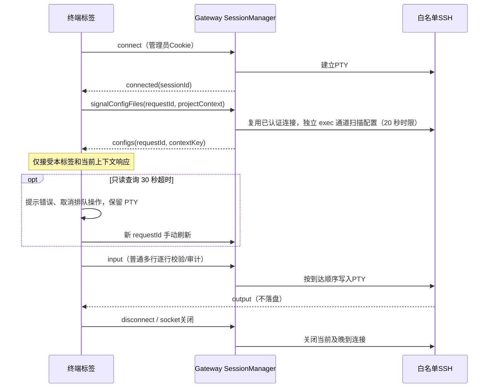

### 指定票号直接分析

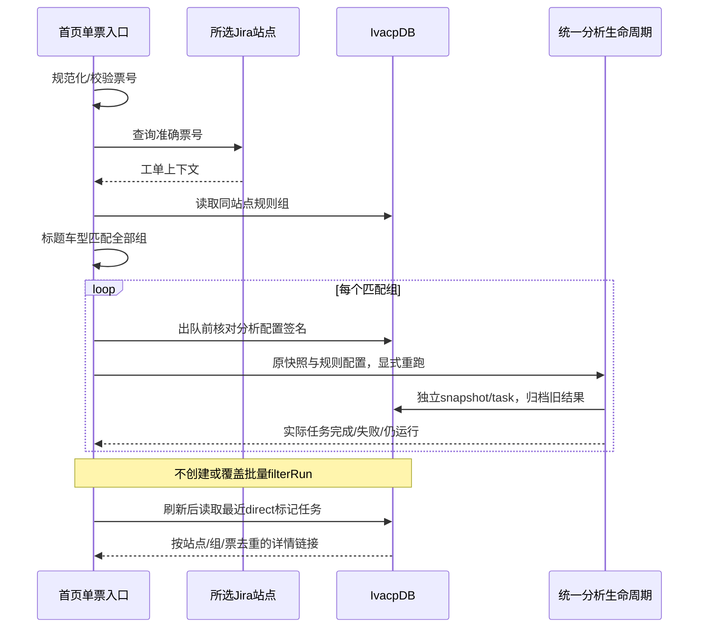

### Jira运行证据复核

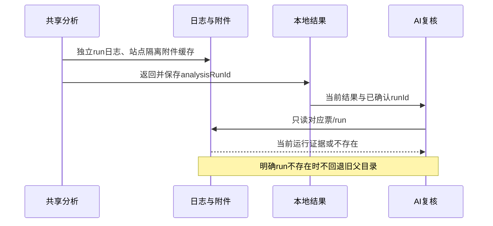

## 当前统计身份关联（2026-10-28）

```text
用户 -> /statistics: 查询本地年份与月份
页面 -> Dexie只读事务: 结果 + 历史 + 快照 + 分配
事务 -> 统计提取: 结果snapshotId / 历史sourceSnapshotId
统计提取 -> 飞书身份: 原快照优先，缺失时分配，再回退分配ID
统计提取 -> 年度聚合: 按完整身份取范围内最后一次成功运行
用户 -> 团队统计API: 相同已查询范围
API -> sync_records: 结果/历史投影 + 不限创建时间的身份投影
API -> 年度聚合: 按owner分别关联身份后合计
API -> 页面: 仅聚合数字 / 错误
页面 -> 复制按钮: 请求失败禁用，重试成功后启用
```

## 团队模板校验与删除失败处理（2026-10-28）

```text
用户 -> 模板库: 从文件应用
模板库 -> parseTemplate: JSON 及模板元信息
parseTemplate -> parseModelFiles: 共享车型字段校验 / 旧格式规范化
parseModelFiles -> 模板库: 配置或中文错误
模板库 -> IndexedDB: 仅校验成功后添加新规则组
用户 -> 删除确认框: 确认删除团队模板全部版本
确认框 -> 模板服务: DELETE /api/templates/[key]
模板服务 -> 确认框: 失败保留错误与重试 / 成功刷新并关闭
```

## 智能助手关闭重开与笔记并发（2026-10-28）

```text
用户 -> ChatPanel: 发送
ChatPanel -> 账号运行服务: 同账号单次运行门禁
运行服务 -> IndexedDB: 保存用户消息并递增version
运行服务 -> 检索服务: 文档 + 未归档笔记 + 记忆
用户 -> 抽屉: 关闭 / 重开
ChatPanel -> 账号运行服务: 重新订阅同一运行 / 停止
运行服务 -> chat API: 流式回复
chat API -> 运行服务: delta / done / error
运行服务 -> IndexedDB: 仅完整且未取消时保存助手回复
运行服务 -> 记忆服务: 后台抽取，并通知面板刷新
笔记编辑器 -> 向量服务: 事务外生成分片向量
笔记服务 -> Dexie短事务: 核对打开时和保存前的原记录
Dexie短事务 -> 编辑器: 基线变化则拒绝并保留草稿 / 一致则保存
```

## 运维与评测（2026-10-28）

```text
运维CLI -> 本地工作目录: 日志 / 指标 / 评测集
目录收集器 -> 候选运行: 旧父目录 + 新run目录
目录收集器 -> 成功提交标记: 排除失败、取消、缺失完整响应
目录收集器 -> 评测服务: 每票最新完整运行
评测服务 -> 共享领域校验: 接地率 / 错误归因 / 时钟
评测服务 -> docs/golden-baseline: JSON + Markdown报告
真值CLI -> sync_records: 按owner只读reviewSamples与ruleGroups
真值服务 -> 本地目录: 匹配规范化组名/车型/票
真值服务 -> eval-set.json: dry-run不写；执行时保留手写条目后合并
独立CAN回放 -> 流水线Python模块: 共用解码/周期/图形实现
```

## 归档统计失败隔离（2026-10-28）

```text
归档器 -> HTTPS适配: find-or-create合并后的Step文章
HTTPS适配 -> 重试器: 瞬时错误退避 / 永久错误立即失败
归档器 -> 月度记录器: 仅成功文章，原始正文长度>500
月度记录器 -> 月份文件队列: 同月按标题去重并追加累计值
月度记录器 -> 归档器: 统计失败仅告警，不改变已成功文章
归档器 -> 后续文章: 保留节流；单篇失败仍继续
```

## 模板并发门禁（2026-10-28）

```text
成员/进程 -> 模板发布: 解析并校验配置
发布/删除/迁移 -> 模板门禁: 取得专用连接，读取数据库排序权重
模板门禁 -> MySQL: GET_LOCK(标识权重哈希,10秒)
MySQL -> 模板门禁: 获得锁 / 超时503
模板门禁 -> 同一连接: 作者核对、版本分配、写入及回读
模板门禁 -> MySQL: RELEASE_LOCK
模板门禁 -> 连接池: 正常归还 / 锁状态不确定则销毁
模板门禁 -> 调用方: 原业务结果或异常
```

## 日志软件版本提取（2026-10-29）

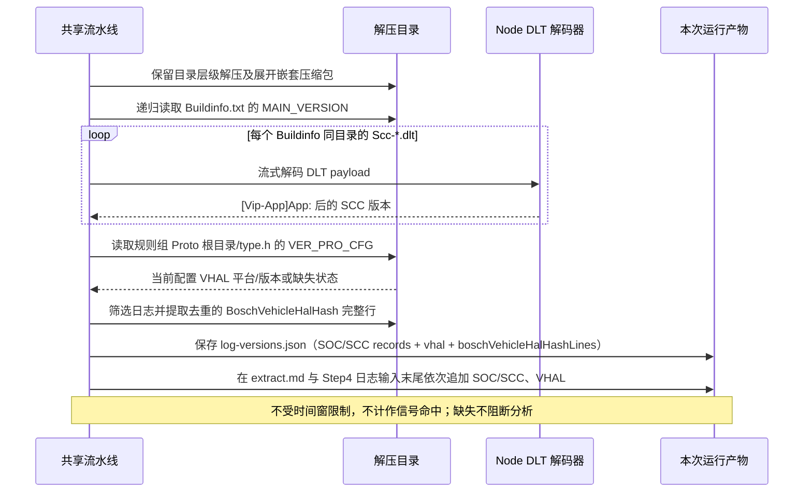

## 远程终端同步（已实现，2026-10-29）

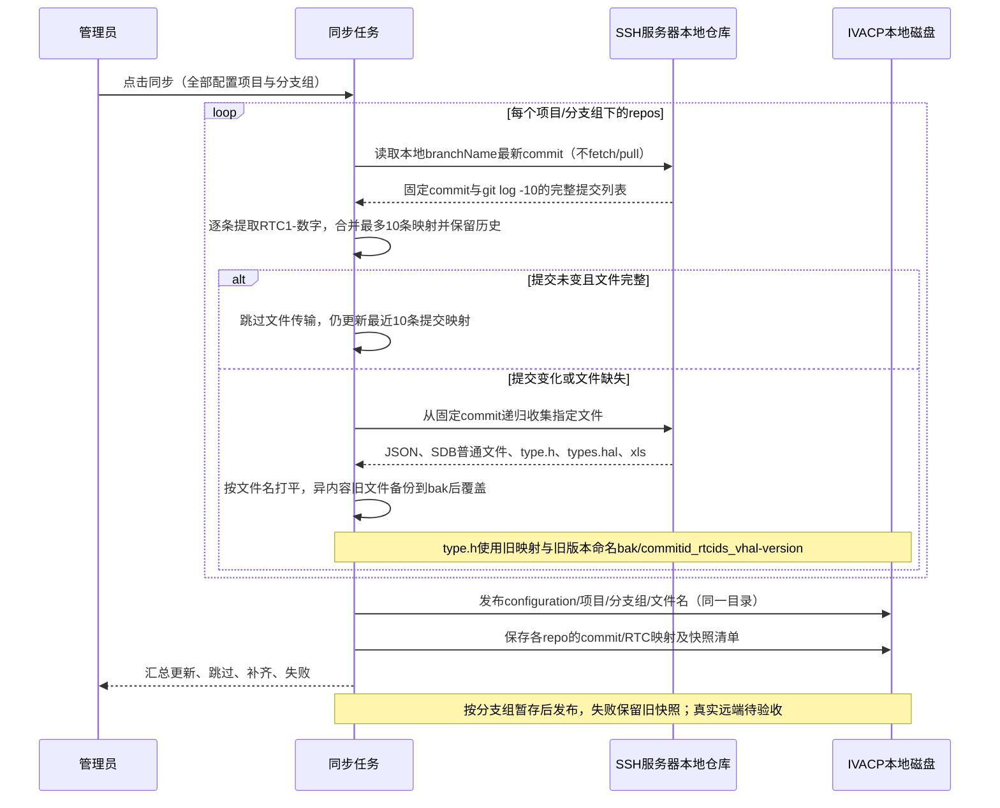

### 同步 VHAL 标签更新（2026-10-29）

2026-10-31 更新：每次同步将最终生效的 type.h 同时保存为 `<完整commitid>_<RTC列表>_<8位VHAL编码>`（无扩展名），并按用户确认保留同内容 `type.h` 兼容副本。身份来自实际来源仓库的当前固定提交；提交或 RTC 变化时即使内容相同也更新名称，旧命名文件保留到 bak。清单新增可选 headerFile 并校验两个文件，旧快照下次同步自动补齐；同名异内容拒绝发布。详情见 [同步需求 v0.5](requirements/terminal-sync-review.md#62-当前-typeh-按提交身份命名2026-10-31)。

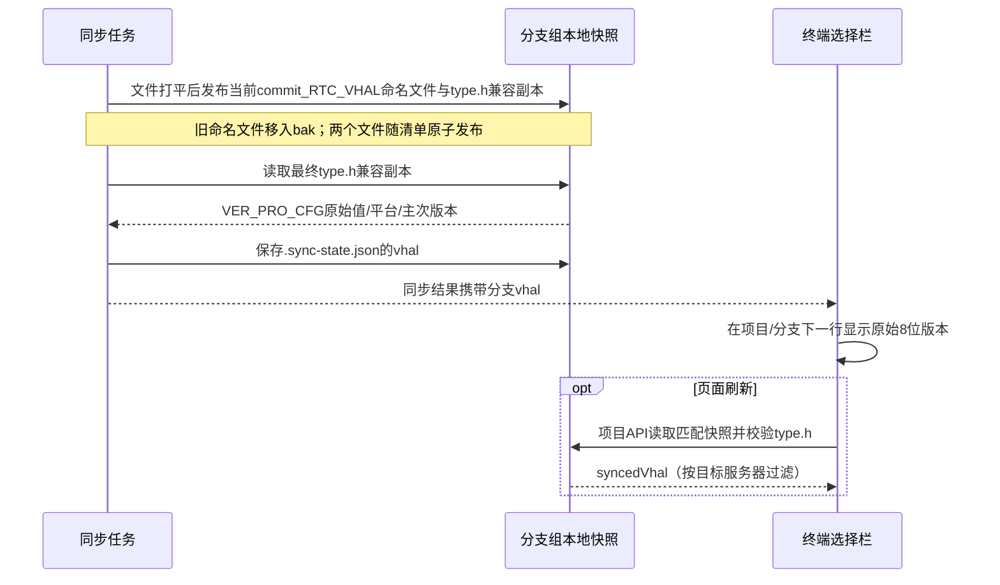

## Pipeline 版本与 VHAL 检查（已实现，2026-10-30）

2026-10-31 更新：来源 commit 前缀命中后，以 RTC 完整匹配关联同项目、同一 branches 条目中唯一的 `vs` 仓库提交，再使用 VS commit 搜索版本归档。多 RTC 归并同一 VS commit 后继续；多个不同 VS commit 或多个 VS 仓库条目记歧义。部分 RTC 未匹配时留档提示；来源提交与 VS 提交分别保存在结构化结果与详情证据，旧结果兼容。规则与验收见 [RTC 关联 VS 提交需求](requirements/pipeline-vhal-vs-rtc-review.md)。

已确认覆盖所有共享流水线来源（普通 Jira、Bosch Jira、飞书及共享的单票/批量/周期入口）。证据整理后先由 AI 比对 SOC/SCC，版本不一致立即保存结论并停止后续分析；再按 Android hash 后最新编译日期选择完整短 hash（如 `6a5d61b`），追溯提交并同时搜索分支组根目录和 `bak/`。`82552235` 对应 `V2.2.35`。

车型以当前工单确认的 DBC 为准，保留 D01_OS_APA、D01_HW、T1L_FL1 等车型组成部分；Excel 查 Vehicle property ID、MCU UP、IVI DOWN（通常 I/S/T 列），Project（通常 E 列）按 `/` 分割后匹配完整车型。仅非空待查信号列表全部确认缺少配置且无大小写差异豁免时提前结束；部分缺少仍继续 Step4/5。详情、DBC 映射和验收场景见 [需求审核稿 v0.4](requirements/pipeline-version-vhal-review.md)。已接入共享编排、完整结果持久化、刷新恢复、历史及详情展示；特殊表语义等剩余边界按未知提示继续。SOC/SCC unknown、hash/版本/Excel 无法定位或读取均不阻断；同 commit 跨分支组、短 hash 冲突、最新日期并列不同 hash 时，将全部候选与冲突原因写入持久化日志作为提示，继续分析，不强选唯一版本。信号区分大小写（A 与 a 不同），不自动映射别名；仅大小写不匹配时留档提示并继续，即使只有一个待查信号也不因此停止。

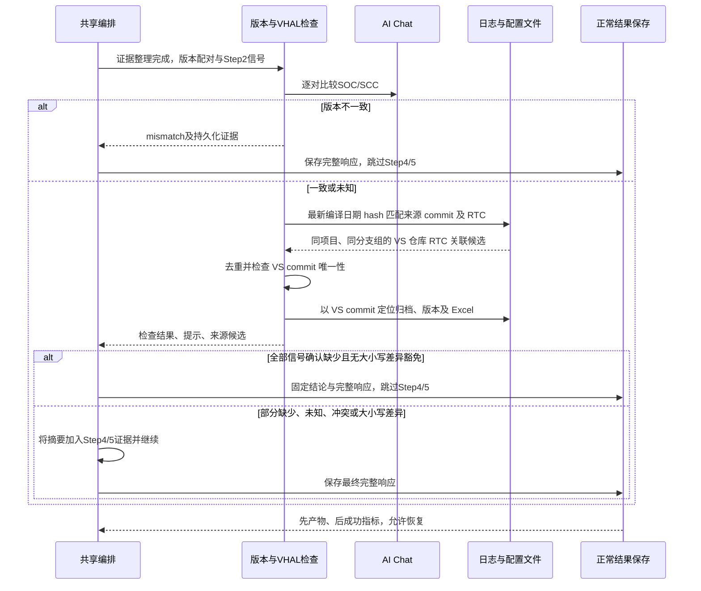

## 飞书筛选超时恢复（2026-10-30）

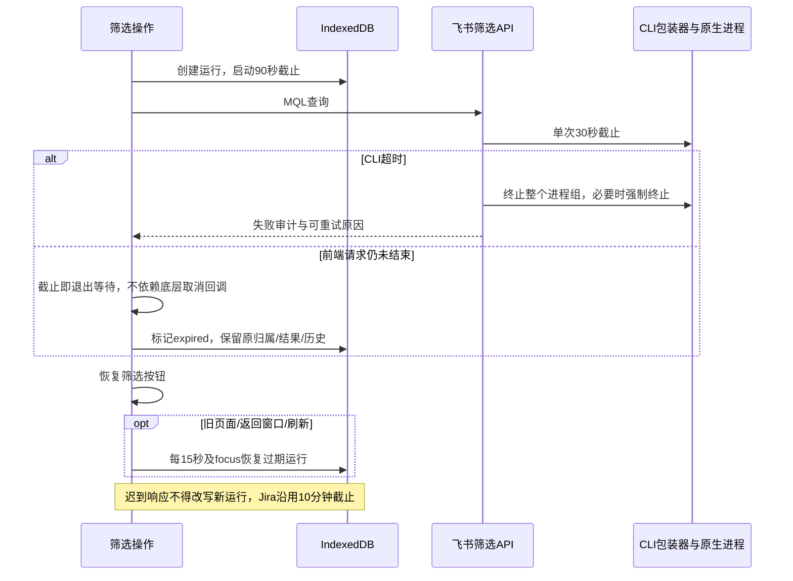

## 日志自动匹配基础配置（已实现，2026-10-31）

[需求 v1.0](requirements/pipeline-auto-config-review.md) 已按最终确认实现：默认在下载解压后、Step2 前提取 SOC / SCC，并以 project.json 分支及可用 Android hash 消歧；车型完整匹配当前规则组 `aliases` 后，使用所属车型 JSON / 全部 DBC / Proto 清单。自动成功时冻结分支当前配置，配置文件、同步清单、DBC 解析任一失败均整套回退用户默认配置，不混合来源或强选候选。

新增规则组车型别名输入，贯通备份、模板和请求。回退也冻结可用用户文件并保持缺失原能力；运行目录、原始车型、runId 和恢复签名不变。JSON / Proto / DBC / 当前配置 VHAL 使用同一有效配置；明确日志身份冲突时，VHAL 检查记未知而不能用冲突上下文触发全部缺少提前结束。SOC/SCC 提取警告同样触发配置回退，原版本不一致停止规则保留。

本次运行的 `effective-config-resolution.json`、`effective-config-check.md` 与可选 configurationResolution 响应保存原始配置、全部候选、实际配置及文件摘要，内容冻结在 run/effective-config/。IndexedDB、重跑历史、飞书完整响应恢复及详情展示保存同一份决定；旧结果不补造字段，无数据库索引升级。问题历史 VHAL 与分支当前配置仍分别记录，历史整套配套未验证。

同步已增加 api-public 固定提交根文件 com.bosch.cm.platform.vehicle.proto，原名发布至对应 configuration 项目 / 分支组，沿用 blob 校验、补齐、普通 bak、删除及原子发布门禁。没有自动发起远程同步或真实工单分析；部署 / 真实目标验收见交接记录。

## VHAL 属性名称列匹配修复（2026-10-31）

共享信号检查增加按表头定位的 Vehicle property ID 名称列（通常 I 列），与 MCU UP / IVI DOWN 一起做大小写敏感的精确匹配，再检查命中行 Project 的完整车型。读取器保留只有属性名、没有上/下行 CAN 信号的行；旧表没有属性列仍兼容原两列。证据保存 column=Vehicle property ID，不做模糊或后缀猜测，不改变大小写差异 / unknown 继续以及全部确认缺少才停止的规则。7147061892 的四个属性在实际 VHAL 2.2.36 中均可匹配 T1J_FL3；未自动重跑或改写旧结果。
