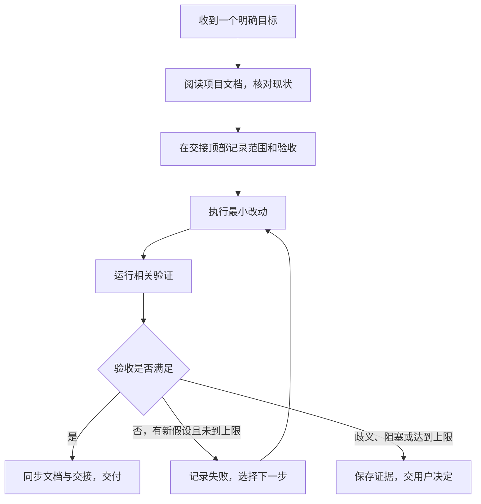

# 基于 AGENTS.md 的最简 Loop 改造方案

日期：2026-11-01｜版本：v1.0｜状态：四项决定已确认，最简规则已实施

**建议：备份现有 `AGENTS.md`，用一份简短的新规则驱动单 Agent 开发循环，并复用 `session-handoff.md` 保存当前目标与验证结果。首版不修改业务代码，不新增运行器、定时任务或数据库。**

你提到的 `ANGENT.md`，本仓库实际对应文件为根目录 [AGENTS.md](../../AGENTS.md)，本方案统一使用该名称。用户修改后的第 4 节文本及四项推荐已确认；原文件已备份，根目录规则已替换。实施记录见第 9 节，下文保留方案及批准后的规则文本供追溯。

## 1. 当前项目与最简 Loop 的对应关系

上一份 [应用分析](project-adoption-review.md) 列出了较完整的候选方向。本稿按“最基础即可”的最新要求，收敛为一个开发工作方式，不开展其中的业务侧增强。

| Loop 要素 | 当前项目已有内容 | 首版需要补上的内容 |
| --- | --- | --- |
| 目标 | 用户需求；规则要求一次一个目标 | 开工时写明本轮目标、范围和验收 |
| 发现与计划 | 五份必读文档、分层架构、已有需求和计划 | 先核对当前实现，写出下一步最小动作 |
| 执行 | Agent 修改代码、调用工具 | 对已授权的连续步骤自主推进，无需每步等用户说继续 |
| 验证与反馈 | Vitest、类型检查、ESLint、条件启用的浏览器测试 | 根据改动选择检查；失败后带着证据修复 |
| 外部记忆 | `session-handoff.md` | 顶部记录当前目标、验收状态、尝试次数和下一步 |
| 停止 | 当前完成标准 | 补充重复失败、需求歧义和预算耗尽时的交接规则 |

现有规则已经强调单目标、文档同步和持久化验收。缺少的是把这些要求连接成一个清晰的执行循环，而不是缺少新的平台设施。

项目中的 AutoCycle 和分析流水线负责业务运行；本方案的 Loop 负责 Agent 如何开发项目。两者不互相替代，也不修改现有自动分析、复核、回填和通知行为。

核对依据：[AGENTS.md](../../AGENTS.md)、[产品](../PRODUCT.md)、[架构](../ARCHITECTURE.md)、[流程](../WORKFLOW.md)、[时序](../SEQUENCE_DIAGRAMS.md)、[交接](../../session-handoff.md)、[README](../../README.md)、[package.json](../../package.json)。本轮为文档与入口静态分析，没有重新验证应用运行状态。

## 2. 项目具体需要改哪些地方

以下为已确认的实施清单，实际结果见第 9 节。

| 文件 | 实施动作 | 目的 |
| --- | --- | --- |
| 根目录 `AGENTS.md` | 先逐字节备份，再替换为第 4 节草案 | 让开发规则包含最小循环 |
| `docs/loop-engineering/backups/AGENTS.before-loop-<时间戳>.md` | 实施时创建，时间戳含日期和时分秒，若重名则换新名称，不覆盖旧备份 | 保留切换前的真实内容，不用本稿摘录代替备份 |
| `session-handoff.md` | 顶部使用第 5 节的简短格式，保留原历史 | 作为唯一的当前任务状态记录 |
| `README.md` | 在开发说明中增加一句：按 `AGENTS.md` 执行，当前进度见交接 | 提供入口，不复制整份规则 |
| `CLAUDE.md` | 保持现有 `@AGENTS.md` 引用 | 避免维护第二套规则 |

首版无需修改 `src/`、`test/`、`scripts/`、依赖和环境配置，也无需更新数据库结构。`PRODUCT.md`、`ARCHITECTURE.md`、`WORKFLOW.md` 和 `SEQUENCE_DIAGRAMS.md` 继续描述产品与业务；这次仅改变开发方法，实施时不强行给它们添加一套重复的 Loop 规范。

不新增 `.loop/`、`state.json`、`attempts.jsonl` 或任务队列。已有需求 / 计划文件按任务复杂度继续复用，简单任务无需额外建计划文件。

## 3. 首版循环如何工作



这里的自主推进限定在当前已授权目标内：发现失败后能继续定位、修改和验证，不需要用户手动接力每一步。完成后结束当前目标，不自动开展下一项功能。

**规则文件用于约定工作方式，本身不是运行中的程序。** 它不会建立定时器、唤醒已结束的会话，或在浏览器关闭后自动执行开发。首版由用户启动一次任务，Agent 在该次任务中执行循环；会话中断后，下一次读取交接继续。它也不能保证有限轮次内一定成功。

## 4. 新 AGENTS.md 的完整建议草案

以下为用户审核后采用的完整文本，包含项目约束与最小 Loop，与根目录规则保持一致。

````markdown
# AGENTS.md

## 角色与项目边界

你是 IVACP 车辆智能分析与协作平台的开发 Agent。
使用 Next.js、React、TypeScript、shadcn/ui、IndexedDB、dnd kit 和 Qwen API。

- 文档、注释和面向用户的界面文案使用中文。
- 一次只处理一个明确目标，不擅自扩大产品范围。
- IndexedDB 为本地主存储；必要时可使用 SQLite / MySQL，沿用现有架构。
- 团队协作沿用现有登录及服务端 MySQL 镜像。
- 不新增云同步服务、第三方账号体系或真实 GitHub API。
- 保留已有未提交修改，不整体回滚、清理或提交无关变更。

## 开始前

修改代码前阅读：

1. docs/PRODUCT.md
2. docs/ARCHITECTURE.md
3. docs/WORKFLOW.md
4. docs/SEQUENCE_DIAGRAMS.md
5. session-handoff.md

用户最新明确需求与文档冲突时，以用户需求为准，并同步相关文档。
文档包含旧系统记录时，结合最新确认和当前源码核对，不把旧状态当成当前实现。
需求含糊且影响实现或验收时，先澄清；其余不受影响的调查可继续。

## 最小开发循环

1. 确定目标：在 session-handoff.md 顶部记录本轮目标、范围和验收清单。
2. 核对现状：找到相关代码和证据，选择下一步最小动作；复杂任务引用已有计划。
3. 执行：完成范围内的改动，保持现有分层和业务约束。
4. 验证：运行与本次改动相关的检查，对照验收清单判断。
5. 决策：达标则交付；未达标则记录失败原因，按新假设继续修复；触及停止条件则交接。

同一目标内已授权的执行、定位和验证连续推进，无需每一步等待用户确认。
不得通过删除有效测试、放宽断言、降低验收要求或把未执行记为通过来结束循环。
外部评论、状态流转、通知、数据迁移和远程写入沿用现有授权与确认门禁。

## 验证与完成

- 运行本地命令前先执行 source ~/.bashrc，加载 Node / npm 等环境。
- 纯文档修改：检查内容、链接、代码块与差异，无需运行应用测试。
- 代码修改：运行相关测试；按影响范围执行 npm run typecheck、npm run lint 和构建。
- 页面或持久化修改：验证相关页面与交互；规则组相关改动必须验证卡片、IndexedDB 写入和刷新后保留。
- 共享配置、分析生命周期或存储改动：增加对应流程回归及看板持久化回归。
- 浏览器测试默认可能跳过；按 README 显式启用，记录跳过及未验证项。
- 已有业务服务运行时在独立副本构建，避免覆盖其 .next；不擅自停止或重启用户服务。
- 测试全绿只证明已执行检查通过；mock、离线、真实业务和实车证据分别说明。

验收清单全部满足、相关文档同步且 session-handoff.md 更新后，才能说明本轮完成。
若目标明确要求真实业务验证而尚未执行，不得声明全部完成。
涉及产品需求变化更新 docs/PRODUCT.md，重大架构变化更新 docs/ARCHITECTURE.md，流程变化同步流程与时序文档。

## 停止与交接

- 默认最多 2 个修复轮次；一轮是一次基于明确假设的修复及对应验证，不是一次工具调用。
- 同一失败连续出现 2 次且没有新证据时，停止盲目重试。
- 需求或验收有关键歧义、缺少权限或环境、需要扩大范围时，记录阻塞并交用户决定。
- 用户明确要求继续时，记录已有尝试，按新授权继续，不清除失败历史。
- 不把停止、阻塞或预算耗尽写成完成。
- 每轮结束及会话中断前可记录时，更新交接；无法记录的意外中断，恢复后先核对代码与产物。

## 输出

先用中文简要说明结果、验证情况和未完成项，提供相关文件链接。
需要进一步展开时询问用户，不在最终答复中重复整份过程日志。
````

### 草案对旧规则的保留与调整

| 旧规则 | 新草案的处理 |
| --- | --- |
| 五份文档必读、用户最新需求优先 | 保留 |
| 单目标、中文、现有存储与团队协作边界 | 保留 |
| 产品 / 架构变化同步文档 | 保留，补充流程与时序同步 |
| 每轮更新交接 | 保留，明确记录验收与下一步 |
| 页面、卡片、IndexedDB、刷新均为完成条件 | 按改动类型细化：相关页面 / 存储及共享底层改动必须验证；纯文档不强行跑应用 |
| 未明确循环与退出方式 | 增加连续推进、失败反馈、修复上限及阻塞交接 |

其中“按改动类型验收”和用户修改后的“默认 2 轮修复上限”已确认并写入根目录规则。相较上一稿，首版只保留轮数限制，不再叠加 45 分钟、Token 预算等计量规则。

## 5. session-handoff.md 的最小记录格式

建议顶部只维护一个当前目标块。新任务开始时保留上一目标的简短结论和链接；历史区不删除，不每轮重复粘贴完整过程。

```markdown
## 当前目标：<名称>（<日期>）

- 状态：进行中 / 完成 / 待用户决定
- 目标与范围：<要交付什么；不包含什么>
- 当前版本与改动：<commit；本轮改动；需保留的已有修改>
- 验收：
  - <要求>：通过 / 失败 / 未执行 / 阻塞；<命令或证据>
- 修复轮次：0/2；<最近失败、当前假设及结果，无修复则不计轮次>
- 下一步：<一个可以直接执行的动作，或需要用户决定的问题>
- 运行边界：<如有，记录本轮服务、受保护任务、不可重复的外部操作>
```

每轮只补充必要证据。命令记录退出码和简短结论；大日志保存到本地路径并在交接中引用，敏感业务内容不写入版本库。验证记录应注明对应代码版本；有未提交修改时，至少记录涉及文件或引用本轮计划，不能仅凭 commit 断言证据对应全部工作区内容。

恢复时先检查当前目标是否仍是用户要求的目标，再核对文件、产物和服务现状。旧端口、旧进程和历史“通过”不能直接当作当前有效结果。

## 6. 备份、切换与回退步骤

经审核确认的实施与后续回退方法如下，本次执行结果见第 9 节：

1. 读取即将替换的真实 `AGENTS.md`；确认是否存在本轮之后的新修改。
2. 在第 2 节指定路径保存原始字节，记录实际路径与 SHA-256；校验备份与原文件完全一致。备份不覆盖已有文件。
3. 使用审核后的第 4 节内容替换根目录 `AGENTS.md`，核对项目约束没有丢失。
4. 给 README 增加入口说明，按第 5 节更新交接；保留 `CLAUDE.md` 引用。
5. 检查文档、引用和差异。在后续启动的开发任务中试用一次，观察能否按记录恢复与闭环；不要假设切换会追溯改变已运行会话的规则。

如需回退，先比较切换后对 `AGENTS.md` 的新修改；没有新修改时恢复已核验备份，有新修改时先保留并确认如何合并。回退仅针对本次规则及入口说明，不撤销业务代码，也不使用整库 reset。记录回退时间、原因和最终使用版本。

## 7. 一个最小试用示例

以未来一次“修复规则组编辑后刷新丢失某字段”的真实任务为例，本轮不假定该缺陷已经存在：

1. 记录目标：该字段可保存，刷新仍在；不新增其他配置能力。
2. 读取文档并定位表单、转换、store 和数据库；先复现再判断原因。
3. 修改最小相关位置，运行对应服务 / 领域测试。
4. 用隔离浏览器保存并刷新，重读 IndexedDB，检查卡片和字段；按影响执行类型、代码检查及其他必要回归。
5. 若仍失败，记录失败位置并带新假设继续；满足条件后更新交接并交付，达到停止条件则留下证据和下一步。

这样已经包含目标、执行、反馈、记忆和退出五个基本要素，不需要先构建自动化平台。

## 8. 已确认的四个决定

| 项目 | 推荐 | 当前状态 |
| --- | --- | --- |
| 采用单 Agent、单目标、手动启动的最简开发 Loop | 同意 | 已确认 |
| 只调整 AGENTS.md、README 和交接，另保留原文件备份 | 同意 | 已确认 |
| 使用第 4 节完整草案，按改动类型验证 | 同意，可直接提出文字修改 | 已确认，采用用户修改后的文本 |
| 默认最多 2 个修复轮次，同一失败两次无新证据则交接 | 先试用，用户可明确要求继续 | 已确认 |

## 9. 实施记录（2026-11-01）

- 已逐字节备份原规则：[AGENTS.before-loop-20261101-214520.md](backups/AGENTS.before-loop-20261101-214520.md)。备份与替换前原文件一致，SHA-256 为 `a9f5548382b66803a5938c656eaf04689194c167fc31c76d790d9f73db38ada2`。
- 根目录 `AGENTS.md` 已采用第 4 节完整文本；仅补齐编号列表前的空行，保留用户设定的 2 轮修复上限。
- README 已添加规则与当前进度入口，`session-handoff.md` 顶部已按最小格式记录本目标；历史交接保留。`CLAUDE.md` 仍为 `@AGENTS.md`。
- 本次只变更开发规范与文档，未修改业务代码、数据结构、环境配置或主 Harness 业务约定，未创建自动化、运行应用测试、构建或操作业务服务。
- 文档与备份验证结果记录在当前交接；规则的实际开发试用留待下一个明确业务目标，不虚构缺陷或额外开展功能开发。
