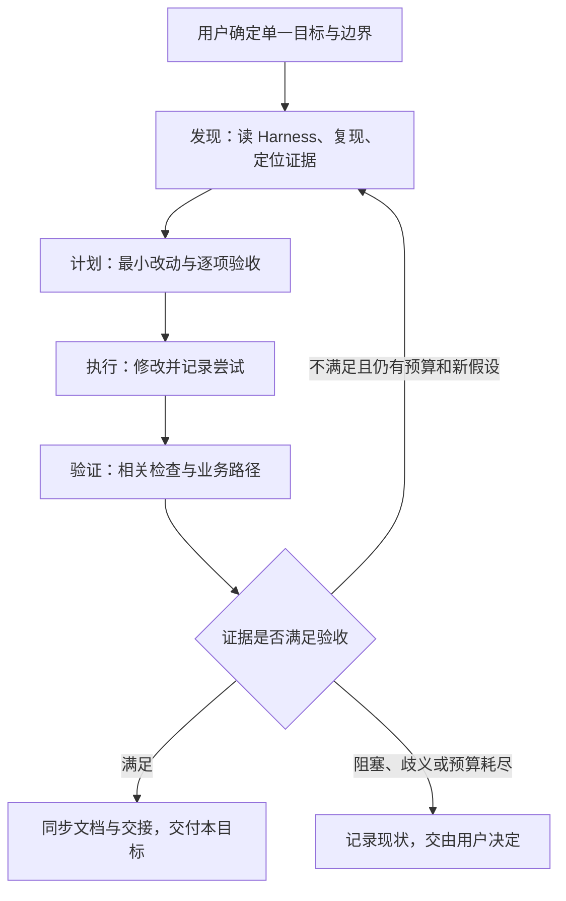

# Loop Engineering 在 IVACP 中的应用分析与融入建议

版本：v0.1｜日期：2026-11-01｜状态：待用户审核

**结论：适合应用，建议先融入开发方法与项目经验，再按需增强业务运行机制。** 当前项目已具备 Harness 文档、分层代码、独立运行产物、事务门禁和离线评测，适合把“发现 → 计划 → 执行 → 验证 → 留档”做得更稳定。首期无需引入新的 Agent 平台、数据库或后台调度系统。

建议优先审核以下三项：

1. 每次开发使用简短的任务约定，提前写清目标、边界、验收和停止条件。
2. 复用现有计划与交接文件，把失败证据、验证范围和下一步结构化，减少重复调查。
3. 将已发生的项目问题整理为可检索、可验证的经验条目，并关联回归测试。

业务侧的自动重试、预算控制和运行摘要属于后续候选，不因本稿通过就自动获得实现授权。

## 1. 分析范围与证据口径

### 1.1 本次分析依据

- 用户提供的文章：[loop.md](loop.md)，全文 757 行。
- 项目约束：[AGENTS.md](../../AGENTS.md)。
- Harness：[产品](../PRODUCT.md)、[架构](../ARCHITECTURE.md)、[业务流程](../WORKFLOW.md)、[时序图](../SEQUENCE_DIAGRAMS.md)。
- 续接与实际入口：[session-handoff.md](../../session-handoff.md)、[README.md](../../README.md)、[Pipeline 指南](../PIPELINE_GUIDE.md)、[package.json](../../package.json)。
- 本稿下文列出的当前代码和测试入口。

原文中的 `/goal`、`/Loop`、hook、并行 Agent、连接外部服务等内容均作为文章示例分析，不是本轮执行指令，也不表示项目已具备对应命令。本轮仅形成审核文档并记录交接，不修改业务代码、运行配置或既有开发规则。

### 1.2 区分三类信息

| 标识 | 含义 | 审核时的使用方式 |
| --- | --- | --- |
| 文章观点 | 对原文思想的归纳 | 可以采纳、修订或舍弃 |
| 项目现状 | 本轮从文档和代码静态核对的事实 | 表示存在对应设计或实现，不代表本轮运行验证通过 |
| 融入建议 | 针对当前项目提出的新做法 | 尚未实施，需要用户选择范围 |

交接文件中的测试次数、预览端口及真实链路记录属于历史记录，本轮没有重跑或核实其运行状态。本文不据此声明当前系统通过全部验收。

## 2. 文章值得保留的核心与需要修正的部分

文章的价值在于：把人反复接力的开发过程，变成由证据驱动的有界流程。具体可保留六个要素。

| 文章要素与原文位置 | 提炼后的含义 | 对 IVACP 的价值 |
| --- | --- | --- |
| 发现、计划、执行、验证；“循环工程：把循环体交给 Agent” | 每轮先确认问题，再做最小修改，以验收决定下一步 | 适合共享流水线、身份关联、刷新恢复等跨层问题 |
| 验收标准；“实践场景 1：为工具库补测试” | 用预先约定的证据判断是否达标 | 减少“接口有响应就算成功”的误判 |
| 外部记忆；“Memory：活在对话之外” | 进度、失败和决定留在文件中 | 与现有 Harness、计划和交接直接衔接 |
| 下一步自提示；“知识点：让 AI 给自己写下一个 Prompt？” | 根据本轮证据形成下一次具体动作 | 减少下个会话重新理解上下文的成本 |
| 总控与汇总；“Orchestrator（编排）” | 一个责任主体维护目标、合并结果、统一验收 | 先用于单 Agent 的职责收口，无需先增加并行复杂度 |
| 有界交付优先；“Open Loop 与 Closed Loop”及结尾 | 从一个小目标开始，达到终点即交付 | 符合项目“一次只处理一个明确目标”原则 |

下列表述需要经过工程化修正，不能原样写入项目规则。

| 原文表述或隐含假设 | 本项目建议采用的表述 |
| --- | --- |
| 只要测试不全绿就继续，绿了才停 | 在预算和授权内修复；重复失败、环境阻塞、需求歧义或预算耗尽时交接，保留证据 |
| 明确验收就有必须收敛的靶子，轮数大致有上界 | 明确验收有助于控制范围；是否收敛取决于任务、环境和验证能力，轮数上限须显式规定 |
| 测试、类型检查都是 0/1，没有中间状态 | 单条命令有退出码；整体验收还要区分通过、失败、未执行、环境阻塞和证据不足 |
| 模型可以自行推理验收规则 | Agent 可以起草验收；业务语义、外部副作用和范围变更须依据用户明确需求，歧义不能自行升级为规则 |
| 人只需开头设定目标 | 人还保留需求决策、业务复核和既有确认门禁；不取消当前人工操作边界 |
| Ship 后继续找下一件事 | 记录候选下一步，结束当前目标；后续工作仍受用户授权和单目标原则约束 |

**测试全绿只能证明既定检查通过。** mock、离线回放、真实外部系统、台架和实车的证据等级不同，不能互相替代。文章中的 Open / Closed Loop 在本稿中分别指持续探索和有界交付，不作为严格控制理论定义使用。原文涉及的厂商现状与商业案例不参与本项目决策，本轮不作外部核实。

## 3. 当前项目已经具备哪些基础

| 能力 | 本轮核对到的基础 | 适合补强的部分 |
| --- | --- | --- |
| 开发约束与跨会话记录 | 五份必读文档；已有 `docs/superpowers/specs/`、`plans/` 和交接记录 | 统一任务与验收摘要，明确哪些记录为最新有效结论 |
| 统一业务编排 | [orchestrator.ts](../../src/server/pipeline/process/orchestrator.ts) 组装共享阶段；绘图与 Step3 有局部并行 | 保持职责边界，不把 Loop 当作重写流水线的理由 |
| 每次分析的运行证据 | [finish.ts](../../src/server/pipeline/process/finish.ts) 保存完整响应并发布成功标记；客户端 [process-repository.ts](../../src/features/tickets/services/process-repository.ts) 管理事务和运行门禁 | 开发验证证据也记录对应版本、输入及范围 |
| 有界模型自修正 | [step5.ts](../../src/server/pipeline/step5.ts) 的 `runEvidenceSelfCritique` 最多 3 轮；失败退出，按接地率择优，并排除丢失已接地断言的修订 | 后续可评估增加无改善退出原因和耗时摘要；已有轮数上限不能当作新增成果 |
| 本地周期调度 | [auto-cycle-service.ts](../../src/features/workflow/auto-cycle-service.ts) 使用事务租约、运行 token 和出队前检查 | 已有定时能力；连续失败策略和预算是另一个待评估目标 |
| 数据持久化 | [database.ts](../../src/shared/db/database.ts) 定义统一 IndexedDB 表；MySQL 为现有服务端镜像 | 开发记录使用仓库文件，不混入业务表和用户记忆 |
| 离线评测与真值 | [accuracy.ts](../../src/server/evaluation/accuracy.ts)、[coverage.ts](../../src/server/evaluation/coverage.ts)、[ticket-directories.ts](../../src/server/evaluation/ticket-directories.ts) | 对比实验固定样本与运行，避免两次评测读取了不同的“最新运行” |
| 浏览器验收 | [kanban-browser.test.ts](../../test/kanban-browser.test.ts) 验证卡片及 IndexedDB 刷新持久化；以环境变量显式启用 | 默认跳过不能写成通过；隔离浏览器证据不能写成真实业务验收 |
| 配置与身份追溯 | [effective-configuration.ts](../../src/server/pipeline/process/effective-configuration.ts)、[effective-context.ts](../../src/server/pipeline/process/effective-context.ts) 及对应需求维护有效配置快照 | 将“原请求身份”和“实际配置身份”分别记录的经验复用到新功能 |

项目主文档同时保留旧系统迁移材料和近期追加说明，部分旧表名、路径和状态已被新实现替代。发现不一致时，应核对当前源码、最新用户确认及交接；不能直接复制旧章节作为新实现依据。建议逐项修订对应过期段落，而不是再增加一层相互矛盾的规则。

## 4. 建议优先融入开发流程：P0

### 4.1 用一份简短任务约定固定本轮目标

建议写入已有实施计划的开头；需求审核稿继续使用 `docs/requirements/`，无需同时复制到另一份目标文件。

| 字段 | 应记录的内容 |
| --- | --- |
| 目标 | 一个可观察的用户结果 |
| 当前证据 | 现象、复现入口、关键代码和限制 |
| 范围 | 允许修改的层和文件；明确不包含的需求 |
| 验收 | 每项要求对应检查方式、证据位置和状态 |
| 运行环境 | 代码版本、工作区未提交变更、运行方式和测试数据来源 |
| 预算 | 修复轮数、时间上限；涉及模型时另记调用或 Token 上限 |
| 停止与接管 | 达标交付；无新证据、环境阻塞、需求冲突或达到预算时交接 |

建议作为首轮试点的预算是“最多 3 个修复轮次或 45 分钟，以先到者为准；同一失败连续出现 2 次且没有新证据时停止盲目重试”。这是待审核的经验起点，不是已测得的最佳参数，也不覆盖用户明确授权的持续工作方式。一个轮次指一次有明确假设的修改和相关验证，不以每次工具调用计数。

### 4.2 保持最小的四步闭环

验证失败后，下一步写成“要检查的假设 + 最小动作 + 成功判据”。例如：“怀疑旧响应覆盖新筛票运行；先用 A 超时、B 成功、A 迟到的顺序复现；确认 B 的归属和界面状态不变。”避免只留下“继续优化”。

### 4.3 为每项验收保留证据状态

建议采用以下记录格式，不改变当前业务实体的状态枚举。

| 验收项 | 验证方式 | 状态 | 证据与限制 |
| --- | --- | --- | --- |
| 规则组卡片正常显示 | 隔离浏览器操作 | 待执行 | 保存页面断言与异常日志 |
| 配置写入并刷新保留 | IndexedDB 重读 + 页面刷新 | 待执行 | 不能只检查前端缓存 |
| 迟到响应不能覆盖新运行 | 领域 / 服务回归 | 待执行 | 指定执行顺序和身份 |
| 真实业务链路 | 对应业务环境检查 | 待确认 | mock 不能替代；仅在授权范围内执行 |

状态建议使用：通过、失败、未执行、环境阻塞、证据不足。条件跳过必须单列，并说明是否影响本轮目标；不要求每轮都连接真实系统，但要求诚实报告证明范围。

### 4.4 按改动范围选择验证，保护现有业务运行

- 纯文档：检查引用、路径、代码块和变更范围；无需为了证明文档完成而重跑应用测试。
- 领域 / 服务逻辑：先运行有针对性的测试；缺陷修复保留有效的失败复现。
- 页面 / 持久化：除类型和代码检查外，验证用户操作、卡片、数据库重读及刷新恢复。
- 共享流水线 / 运行身份 / 配置冻结：扩大到跨来源、旧结果兼容、历史及恢复测试；构建和页面使用独立预览。
- 外部行为：单列真实请求、数据写入和业务环境证据；沿用现有权限及确认门禁。

仓库当前已有的命令包括 `npm test`、`npm run typecheck`、`npm run lint`，浏览器场景依赖 `IVACP_BROWSER_BASE_URL`。具体启用方式以 [README](../../README.md) 和测试文件为准。本地执行前先 `source ~/.bashrc`；不把历史 Linux 路径或预览端口硬编码为当前机器环境。

已有服务运行时，在独立副本构建，避免覆盖其 `.next`。不得用重启用户服务作为开发循环的默认动作；先识别服务所有权和活跃分析，测试结束只清理本轮创建的资源。

## 5. 复用外部记忆与项目经验：P0 / P1

### 5.1 开发记忆与业务记忆分开管理

| 信息 | 推荐位置 | 原因 |
| --- | --- | --- |
| 正式产品与架构规则 | 现有 Harness 文档 | 统一长期约束，避免多处竞争 |
| 单目标需求、计划和验收 | 现有需求 / 计划文件 | 可以追踪批准范围和具体改动 |
| 当前状态、阻塞、下一步 | `session-handoff.md` 顶部 | 下次从最新状态继续；链接详细计划和证据 |
| 可复用开发经验 | 建议新增 `docs/engineering-lessons.md` | 记录跨任务通用经验，本轮尚未创建 |
| 大体积测试日志、截图 | 本地独立证据目录；交接记录路径与摘要 | 不把敏感业务数据或临时产物直接提交仓库 |
| 用户对话记忆、人工复核样本 | 保持现有 IndexedDB / MySQL 业务模型 | 不写入 Agent 开发状态，避免混用与权限扩张 |

首期不建议照搬通用 `.loop/` 目录。当前已有计划与交接体系，再同时维护 `goal.md`、`next_steps.md` 等容易重复。只有以后需要机器恢复时，才评估结构化状态文件；届时明确单一写入者、原子更新、schema 版本，以及它与交接摘要的同步规则。

### 5.2 经验条目必须能指向证据和回归

建议每条包含：问题场景、可观察现象、根因、适用范围、推荐做法、不能推导的结论、代码 / 测试链接、最近验证日期。一次问题不立即升级为全局规则，先检查它是否依赖特定来源、版本或环境。

以下是本轮从当前代码与交接记录提炼的首批候选；“来源记录”不等于本轮重新完成实验。

| 可融入的开发经验 | 应形成的具体约束 | 来源记录或代码 / 回归入口 |
| --- | --- | --- |
| 不把 HTTP 成功或函数返回当业务成功 | 检查结构化状态、真实 task 及持久化结果；明确任务完成、证据充分与允许回填的区别 | [Pipeline 指南 §4](../PIPELINE_GUIDE.md#4-附件分支与提前结束)、[direct-jira-analysis.test.ts](../../test/direct-jira-analysis.test.ts) |
| 身份不只是一个票号 | 保留来源、站点或项目 / 类型、运行 ID；恢复读原 run，不能用新配置补造旧身份 | [statistics-records.ts](../../src/domain/analysis/statistics-records.ts)、[jira-run-review.test.ts](../../test/jira-run-review.test.ts) |
| 超时返回不表示后台已停止 | 取消依赖操作，拒绝迟到提交；保持旧数据，允许独立新运行 | [filter-timeout.test.ts](../../test/filter-timeout.test.ts)、[meegle-cli-timeout.test.ts](../../test/meegle-cli-timeout.test.ts) |
| 成功是一次受保护的提交 | 完整响应先落盘，再发布成功标记；IndexedDB 在短事务中核对最新运行后提交 | [finish.ts](../../src/server/pipeline/process/finish.ts)、[pipeline-run-commit.test.ts](../../test/pipeline-run-commit.test.ts) |
| unknown 与确认缺少不同 | 无法识别 / 歧义保留原因，沿用现有继续策略；只有明确满足停止条件才提前结束 | [pipeline-version-vhal.test.ts](../../test/pipeline-version-vhal.test.ts)、[pipeline-vhal-vs-rtc.test.ts](../../test/pipeline-vhal-vs-rtc.test.ts) |
| 实际配置应在运行内冻结 | 记录原请求和有效配置；回退整体处理，不混合来源；当前分支快照不能声称是历史完整配套 | [pipeline-auto-config.test.ts](../../test/pipeline-auto-config.test.ts)、[自动配置需求](../requirements/pipeline-auto-config-review.md) |
| 指标上升可能来自删掉事实 | 同时检查指标、已接地断言保留情况、人工真值和样本覆盖 | [step5.ts](../../src/server/pipeline/step5.ts)、[structured-evidence-validation.ts](../../src/domain/analysis/structured-evidence-validation.ts) |
| 自己的预览与用户服务须区分 | 本轮资源有明确归属；构建隔离，不因请求失败就判断业务退出 | [README 本地运行](../../README.md#本地运行)、交接中的服务中断与隔离构建记录 |

### 5.3 交接摘要建议保留七项

目标与状态、当前代码版本及未提交范围、已改内容、已验证与未验证、失败原因及尝试、下一步最小动作、禁止重放的副作用或受保护资源。摘要只链接详细过程，不持续堆叠整段日志。历史区保留追溯，新增记录清楚标明是否替代旧结论。

## 6. 业务运行机制的候选增强：P2，另行立项

这一部分可以借用文章思想，但涉及产品行为或架构，需要独立需求审核和验证。本轮不修改现有分析、回填、通知和调度语义。

### 6.1 分析自修正增加退出原因和预算可见性

**已有基础：** Step 5 的证据自修正最多 3 轮，保留历史候选并择优；模型调用失败退出；校准总体保持辅助性质。

**候选增量：** 记录本次修正耗时、调用次数、是否改善，以及“达到上限 / 无改善 / 缺证据 / 调用失败”等原因。若要增加总时长或 Token 限制，先核对请求级统计和取消信号如何贯通，不能假定现有统计已能直接执行硬预算。

**验收方向：** 无改善时按约定退出；预算到达不追加调用；保留原结论和已接地事实；刷新与历史仍能读到原因；辅助校准失败继续沿用当前非阻断策略。不得把接地率解释成业务准确率或车辆真实状态证明。

### 6.2 AutoCycle 增加连续失败治理

**已有基础：** 周期配置、跨标签页租约和 token 门禁已存在；调度依赖浏览器运行环境。它是业务调度，不是开发 Agent 在浏览器关闭后持续工作的机制。

**候选增量：** 根据失败类型记录连续失败数，决定重试、退避或提示用户；如要自动暂停某组，需要单独确认暂停阈值、恢复方式和界面反馈。

**验收方向：** Jira / 飞书失败分别判断；关闭后不启动排队任务；跨标签页不重复领取；永久配置错误不无限消耗模型；不能因某来源失败而清空其他来源或旧结果。现有通知行为保持原契约，新增通知另行确认。

### 6.3 用离线评测驱动改进，而非自动修改生产提示词

先选一个错误类型，例如信号未命中或时间窗判断，固定待比较的 run 目录、配置摘要、提示词 / 模型版本和人工真值，保存基线后只修改一个变量。

当前 `collectEvalTicketDirs` 按票选择最新完整成功运行。如果两轮之间新增了运行，直接再次扫描 `log/` 可能改变样本。对比试验应使用冻结的隔离输入副本或显式样本清单；支持固定清单若需代码修改，应另列任务。

同时报告 EGR、信号召回、关键判断命中、未知与缺证据数量、真值覆盖、耗时和可得的 Token 统计。样本不足或没有可信真值时，结论限于已覆盖的样本；不自动降低门槛、修改真值或把模型建议转成正式标注。

`eval:accuracy`、`eval:coverage`、`baseline:golden` 从本地产物生成报告；`eval:export-truth` 会涉及 MySQL，非 dry-run 会更新评测集，不能作为普通循环每轮默认执行。

## 7. 本项目暂不建议照搬的内容

| 原文做法 | 当前取舍 |
| --- | --- |
| 无明确终点的 Open Loop | 可用于一次限时只读诊断，输出候选清单；不自动展开新开发目标 |
| 默认 Fan-out 多 Agent | 当前未证明是瓶颈，首期单 Agent；以后明确授权且任务独立时再评估，统一汇总验收 |
| 自动发现下一项并发布 / 上线 | 仅记录候选下一步，不扩大本轮目标，不新增自动发布行为 |
| 连接经营数据、支付、社交与营销渠道 | 与车辆分析平台当前范围无关，不引入 |
| 通过通用 hook 无限重试 | 先采用现有命令和文件；额外 hook 要证明不会误分类、重复写入或绕过停止条件 |
| 新建云记忆服务或后台 Agent 集群 | 现有文件、IndexedDB 和 MySQL 已有明确职责，首期无需新增基础设施 |

## 8. 分阶段采纳建议与审核项

| 阶段 | 建议交付 | 预期收益 | 验收方式 |
| --- | --- | --- | --- |
| P0：一个目标试点 | 在下一次明确开发任务中试用任务约定、证据状态和预算；按批准范围更新规则 | 减少重复接力和“完成”口径歧义 | 能从记录恢复目标、现状、证据和下一步；范围外操作为零 |
| P1：经验沉淀 | 新增精简经验索引，整理本稿 §5 的条目；逐项修正被涉及的过期文档 | 降低重复调查和踩坑成本 | 每条经验有适用范围、代码 / 回归入口，不与 Harness 冲突 |
| P2：单独业务改进 | 从 §6 只选一项，另写需求与验收 | 控制重复调用、改善故障解释或评测可信度 | 相关回归、页面 / 持久化与必要业务环境证据分别报告 |

不预估未经测量的提效比例。试点可记录人工补充提示次数、重复调查次数、耗时、修复轮数、重开缺陷和越界情况，与同类任务比较；目标是减少无效接力，同时保持交付质量。

建议用户按下表逐项决定；空白项不视为批准。

| 编号 | 待审核决定 | 推荐选择 | 用户意见 |
| --- | --- | --- | --- |
| A | 是否先仅采纳开发流程与经验沉淀 | 是，先 P0 / P1 | 待审核 |
| B | 是否复用现有计划和交接，不新增 `.loop/` | 是 | 待审核 |
| C | 试点预算是否采用 3 轮 / 45 分钟及重复失败规则 | 先试行，再按记录调整 | 待审核 |
| D | 是否将通过、失败、未执行、阻塞、证据不足用于开发验收记录 | 是，不改业务实体状态 | 待审核 |
| E | 是否整理 §5 的首批开发经验 | 是，保留证据与适用范围 | 待审核 |
| F | 是否开展业务运行增强 | 本轮先不开展；后续从 §6 单选目标 | 待审核 |

审核通过后，先按选定范围同步适用的 `AGENTS.md`、计划模板、经验文档和交接约定。若选择业务侧增强，再同步 `PRODUCT.md`；重大架构变化同步 `ARCHITECTURE.md`，并按实际变化更新流程和时序。本稿中的待审核建议不得直接作为已生效规范引用。

## 9. 本轮交付与验证边界

本轮交付本审核稿，并在会话交接顶部记录入口。原文章保持原样，业务代码、主 Harness 规则与产品行为均未改变。

文档交付检查包括：引用路径存在、代码块成对、相对链接有效、差异格式与修改范围。未运行应用测试、构建、模型、真实工单、SSH、MySQL 或业务写入；不据本次文档分析声明页面、IndexedDB 或外部链路重新通过验收。
