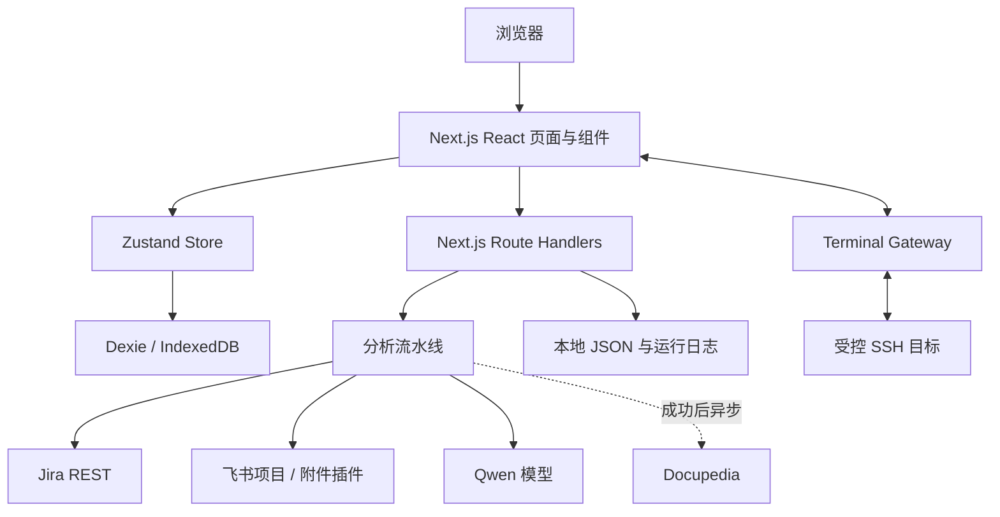
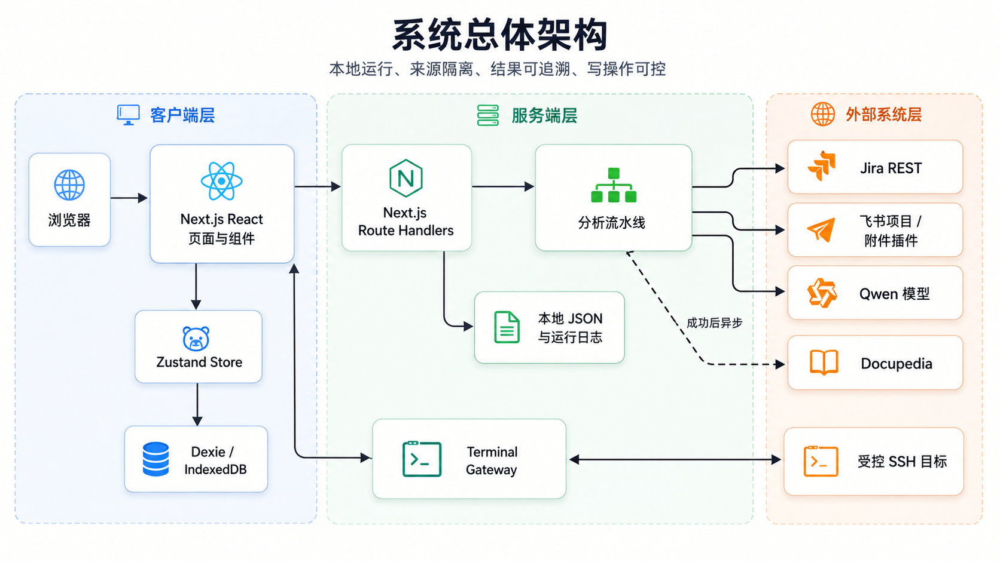
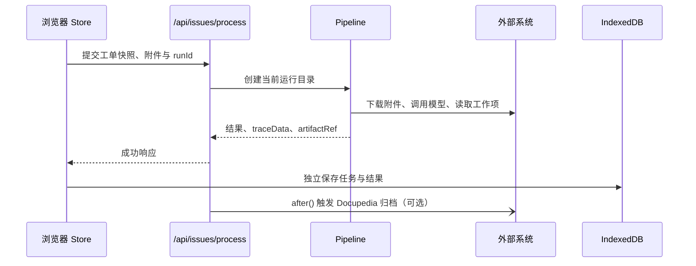
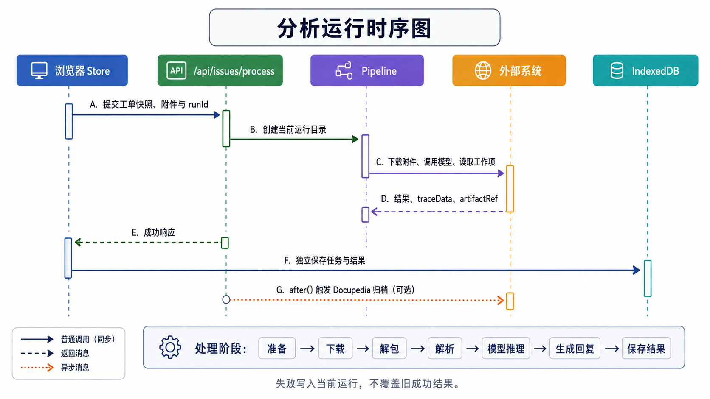

# 架构文档

## 1. 架构目标

系统以本地可运行、来源隔离、结果可追溯和写操作可控为核心。Next.js App Router 同时承载 React 前端和 Route Handler；浏览器负责工作状态与 IndexedDB 持久化，服务端负责外部系统适配、分析流水线和当前运行产物。

## 2. 分层与职责

| 层 | 主要组成 | 职责 |
|---|---|---|
| 展示层 | `app/`、`components/`、shadcn/ui、dnd kit | 渲染看板、详情、图表、复核与终端工作台。 |
| 客户端状态层 | `stores/`、`lib/db/schema.ts` | 维护规则组、筛票、处理、校验和飞书专属生命周期；通过 Dexie 刷新后恢复。 |
| API 适配层 | `app/api/**/route.ts` | 校验输入，封装 Jira、飞书、Qwen、Docupedia、终端配置等调用。 |
| 分析与证据层 | `/api/issues/process`、`lib/analysis/`、`lib/server/` | 组织附件、CAN 解析、证据包、模型推理、运行日志和归档。 |
| 外部集成层 | Jira、飞书项目 CLI / API、附件插件、Qwen、Docupedia、SSH | 仅由服务端或 Gateway 访问，凭据不下发浏览器。 |

## 3. 来源隔离与持久化

Jira 使用 `FilterTask`、`FilteredIssueSnapshot`、`IssueProcessTask`、`IssueProcessResult`、历史和校验等客户端表。飞书项目使用 `MeegleAssignment`、筛选审计、快照、处理任务、结果、历史和校验专用表。两条来源可共享分析算法、复核算法、证据模型和通知逻辑，但不得共享或覆盖对方的生命周期记录。

规则组 CRUD 的服务端接口使用项目内 `data/rule-groups.json`；运行日志和大文件产物存放在 `log/<规则组>/<车型>/<工单>/<runId>/`。飞书运行产物经过 opaque `artifactRef`、白名单、`realpath` containment 和大小截断保护后才可只读访问。

## 4. 分析运行架构

处理阶段依次为准备、下载、解包、解析、模型推理、生成回复和保存结果。每个运行记录阶段耗时和证据产物；失败写入当前运行，不覆盖旧成功结果。

## 5. 安全与可靠性

- 客户端不保存 Jira、飞书项目、Qwen、Docupedia 或 SSH 密钥。
- 飞书经办人变更使用详情凭据、目标授权和二次读取；回填操作需人工授权。
- Docupedia 仅归档当前 `logRoot` 的文本产物，上传重试前重新查询，单篇失败不阻断其他文章。
- Jira Basic Auth 仅发送给 `JIRA_SERVER` 主机，附件插件主机不能获得 Jira 凭据。
- 终端 Gateway 读取 `REMOTE_SHELL_TARGETS_JSON` 白名单，审计命令并对风险命令执行守卫；自动化 Git 操作使用独立 SSH exec，交互 PTY 不混入后台命令输出。

## 6. 运行配置

Node.js 使用本地 Node 20 环境。关键配置包括 Jira 服务器和用户名、Qwen 文本 / 图片 / 校验模型、飞书项目 CLI 凭据与附件插件地址、`ENABLE_DOCUPEDIA`、代理变量、远程终端目标与 Gateway 地址。配置值由 `.env` 和本地运行环境提供，不应写入文档、浏览器持久化或日志。
