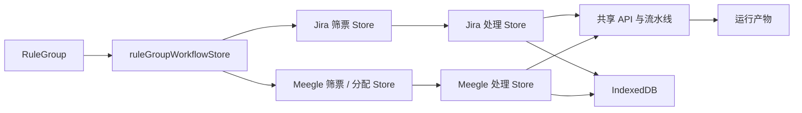

# 概要设计

## 1. 模块划分

| 模块 | 主要文件 / 入口 | 职责 | 依赖 |
|---|---|---|---|
| 统一看板 | `app/page.tsx`、`components/rule-group/` | 展示规则组，编排跨来源筛选和处理。 | 规则组与工作流 Store。 |
| Jira 生命周期 | `filterTaskStore`、`processTaskStore` | 维护 JQL 快照、处理任务、结果、历史、回填和 Jira 状态流转。 | Jira API、Dexie。 |
| 飞书生命周期 | `meegleFilterTaskStore`、`meegleAssignmentStore`、`meegleProcessStore` | MQL 筛选、分配审计、工作项快照、结果恢复、历史和回填。 | 飞书 API / CLI、Dexie。 |
| 分析详情 | `IssueDetail`、`MeegleResultDetail`、`CanSignalChartClient` | 呈现证据、阶段、结论、复核、图表和运行产物。 | 处理 Store、artifact API。 |
| 共享分析流水线 | `/api/issues/process`、`lib/analysis/` | 附件、CAN、证据、模型推理、回复生成和运行指标。 | Jira / 飞书附件、Qwen、文件系统。 |
| 规则组与认证 | `ruleGroupStore`、`/api/rule-groups`、`lib/auth/` | 本地规则组管理、Session 与角色边界。 | JSON、Cookie。 |
| 远程终端 | `TerminalWorkbench`、`TerminalPane`、`lib/terminal/` | WebSocket 终端、项目上下文、命令守卫与 SSH 自动化。 | Gateway、SSH、`docs/project.json`。 |

## 2. 核心数据流



统一工作流 Store 输出来源摘要和处理计划，不直接混写 Jira / 飞书表。共享 API 接收来源已规范化的工单、附件和运行信息，返回结果后由对应 Store 写入专属表。

## 3. 状态机

### 3.1 筛票与处理

```text
筛票：PENDING → RUNNING → SUCCESS
                      ├→ FAILED
                      └→ EXPIRED

处理：PENDING → RUNNING → SUCCESS
                      └→ FAILED
```

处理成功后可进行 AI 复核、人工复核、自动校验和回填。重新分析不就地覆盖旧结果，而是将其记录为历史，当前任务回到待处理状态。

### 3.2 飞书回填

```text
人工复核未满足 → 禁止写回
人工复核满足 → 评论待提交 → 评论成功
                                  └→ 可选状态流转成功 / 失败
```

评论成功不依赖状态流转成功；失败状态持久化，后续重试只补偿缺失步骤。

## 4. 设计决策

- **本地优先：** Dexie 承载浏览器工作状态，减少后端数据服务复杂度；规则组 JSON 仅用于管理员配置接口。
- **来源隔离：** Jira 与飞书项目使用不同表和 Store，避免来源失败或数据变更互相污染。
- **不可变运行：** 每次飞书分析使用独立 `runId` 与 artifact 引用，便于恢复和审计。
- **证据优先：** 结论校验依赖具名证据源；候选信号和模型建议不直接扩大可视化范围。
- **写入受控：** 评论、工作流和经办人变更均独立授权；服务端写接口不由自动任务隐式触发。
- **异步归档：** Docupedia 从成功路径解耦，保证外部归档故障不影响用户主流程。

## 5. 失败处理原则

接口边界将外部错误转换为可显示错误或审计记录；本地旧成功结果优先保留。MQL 失败不清空人工分配，Docupedia 失败不改变处理状态，飞书流转失败不重发已成功的评论，artifact 访问不满足白名单与路径约束时直接拒绝。
