# 流程文档

## 1. 统一筛票与处理

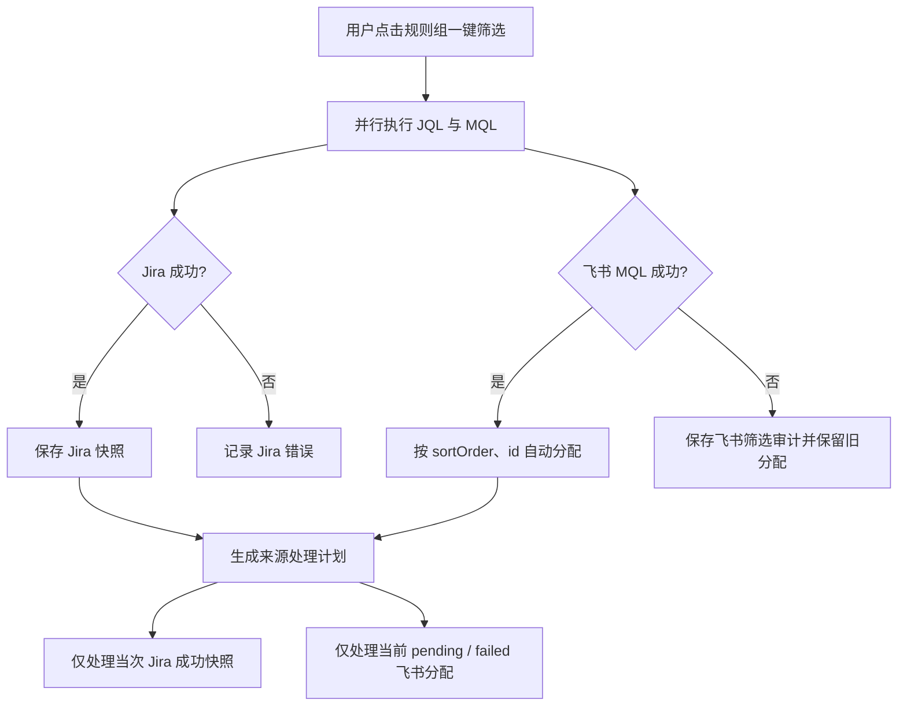
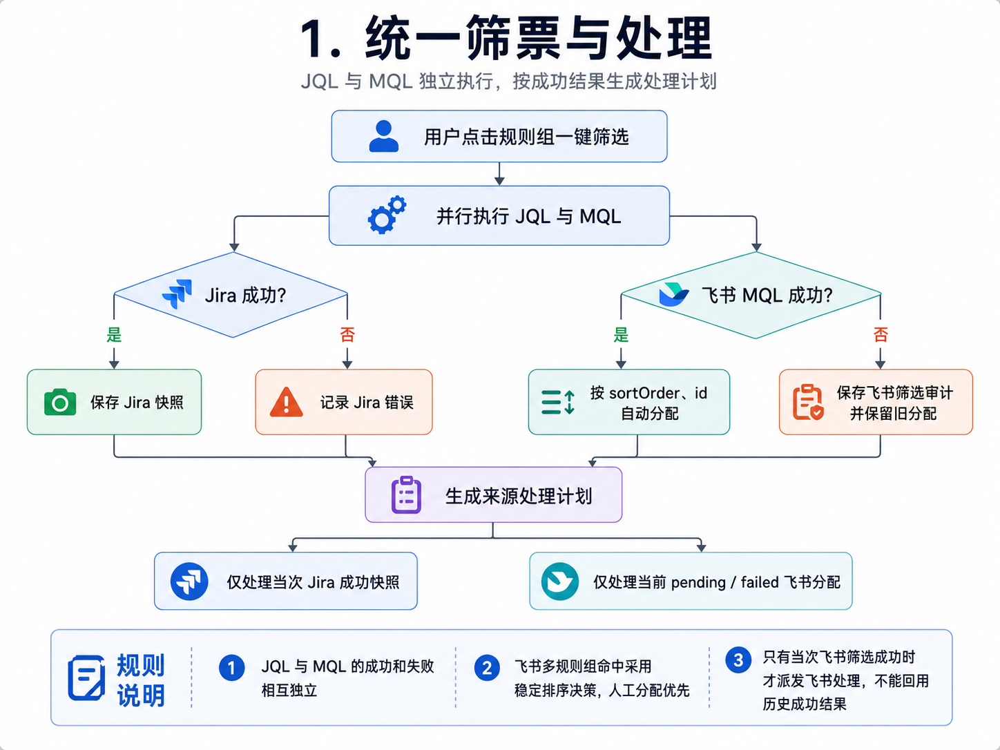

JQL 与 MQL 的成功和失败相互独立。飞书多规则组命中采用稳定排序决策，人工分配优先。自动周期沿用同一规则：只有当次飞书筛选成功时才派发飞书处理，不能回用历史成功结果。

## 2. Jira 分析流程

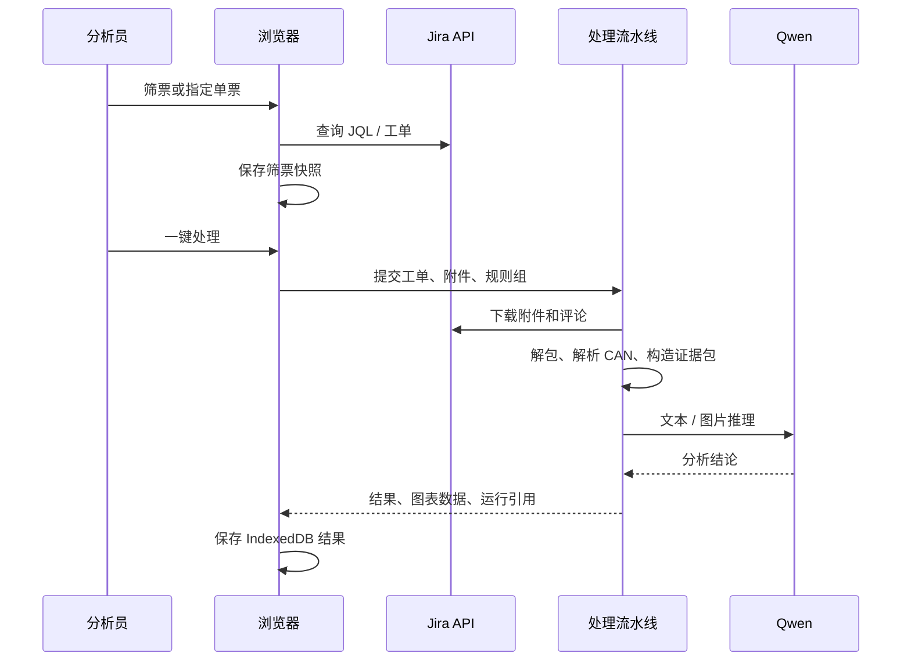
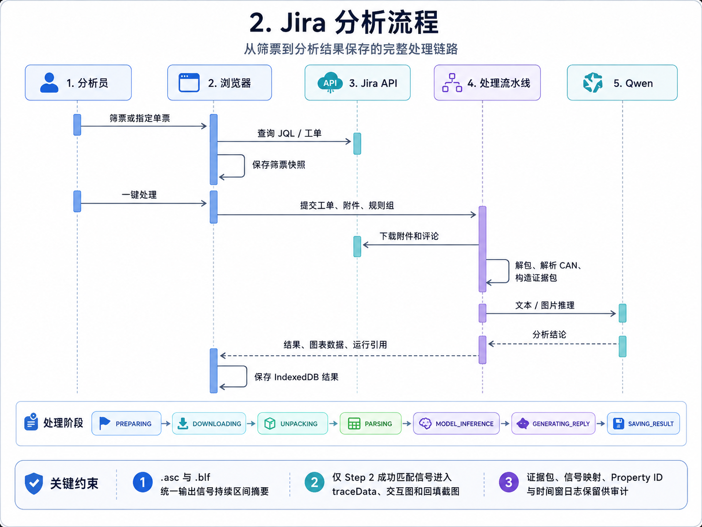

处理依次经过 `PREPARING`、`DOWNLOADING`、`UNPACKING`、`PARSING`、`MODEL_INFERENCE`、`GENERATING_REPLY` 与 `SAVING_RESULT`。`.asc` 和 `.blf` 统一输出信号持续区间摘要；解析后仅允许 Step 2 成功匹配信号进入 `traceData`、交互图和回填截图。证据包、信号映射、Property ID 与时间窗日志保留在运行产物中供审计。

## 3. 飞书项目分析与恢复

飞书项目的主入口是主页统一规则组看板；`/meegle` 保留为跳转兼容入口，结果详情仍使用 `/meegle/issues/{workItemId}/result`。分析流程由「筛选与归属」「快照与任务」「共享流水线」「客户端落库」「恢复与历史」五段组成。

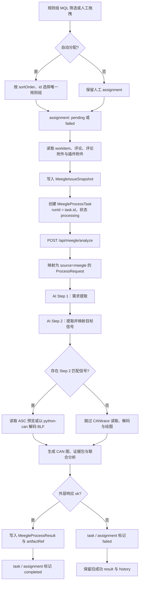
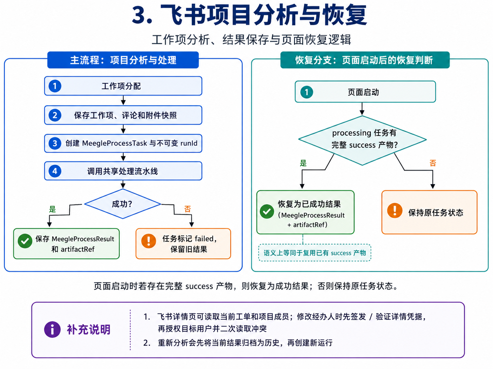

### 3.1 筛选、归属和待处理判定

1. 用户在主页规则组触发统一筛选，服务端以每个规则组独立的 `meegleMql` 查询工作项；该字段为空时，飞书来源是未配置状态而不是筛选失败。
2. 同一工作项命中多个规则组时，系统按规则组 `sortOrder`、再按 `id` 选择唯一自动归属；对低优先级规则组会比较高优先级 MQL 命中，存在高优先级命中时记录冲突审计而不强行分配。
3. `assignmentSource=manual` 的人工分配不可被自动筛选覆盖。无法确定归属、输入不合法或比较查询失败的工作项保留在待分配列表。
4. MQL 成功结果写入飞书筛选审计和专属 assignment 表；某规则组 MQL 失败时，保留该组既有自动分配、完成记录和历史，只写入失败审计，不影响 Jira 的快照或任务。
5. 统一工作流仅在当次飞书筛选成功时，选择该规则组当前状态为 `pending` 或 `failed` 的 assignment 进行处理。

### 3.2 创建快照与分析任务

1. `useMeegleProcessStore.processAssignment()` 先读取当前工作项、评论和附件上下文；附件包含评论附件及附件插件服务返回的文件列表。
2. 系统将工作项原文、评论、附件元数据、项目标识、规则组信息写入 `MeegleIssueSnapshot`，使后续结果不依赖工单在线状态。
3. 若当前 assignment 已有成功结果且用户确认重新分析，旧 `MeegleProcessResult` 先转存为 `MeegleAnalysisHistory`；失败重试不会删除旧成功结果。
4. 创建 `MeegleProcessTask` 后，以任务 ID 作为不可变 `runId`。运行目录为 `log/<规则组>/<车型>/meegle-<workItemId>/<runId>/`，任务状态首先为 `processing`。
5. 浏览器向 `/api/meegle/analyze` 提交工作项名称、描述、项目、原始数据、规则组 Prompt / CAN 配置、`projectKey`、`workItemTypeKey` 与 `runId`。客户端只有收到该外层 HTTP 成功响应后，才写入 completed 结果。

### 3.3 共享流水线与结果落库

`/api/meegle/analyze` 将请求规范化为共享 `/api/issues/process` 的 `ProcessRequest`：`issueKey` 使用工作项标识，`source` 固定为 `meegle`，并保留 `runId`、规则组和快照原始数据。共享流水线先执行 AI Step 1 需求提取和 AI Step 2 信号提取 / 配置映射；只有 Step 2 中提取且成功映射的代表信号存在时，才读取 ASC 预览或以 `python-can` 解码 BLF，并启动 CAN 绘图。没有映射信号时跳过 CANtrace 读取、解码和绘图，随后继续证据包、模型推理和回复生成。

分析成功时，`meegleProcessStore` 将结论、阶段、模型、耗时、`traceData`、CAN 图、信号信息和 `artifactRef` 写入 `MeegleProcessResult`，随后将 task 与 assignment 标为 `completed`。结果详情通过 opaque `artifactRef` 读取白名单内产物；服务端不向浏览器暴露真实运行路径。Docupedia 归档发生在共享流水线成功响应之后，是不阻塞该客户端写入的异步任务。

分析失败、超时或外层 `/api/meegle/analyze` 返回非成功状态时，task 和 assignment 标记为 `failed`，保留失败原因及已有成功结果；不得仅依据服务端 `[DONE]` 日志或 `pipeline-metrics.json` 的 success 判断客户端已完成。

### 3.4 启动恢复、详情与后续操作

页面启动时只检查 IndexedDB 中仍为 `processing` 的飞书任务。若同一不可变 `runId` 已有完整 success 运行产物，系统恢复 `MeegleProcessResult`、签发新的安全引用并将任务标记为 completed；运行仍在进行或产物不完整时保持原状态，避免把未完成运行误判为成功。

飞书详情页可读取当前工单和项目成员；修改经办人时先签发 / 验证详情凭据，再授权目标用户并二次读取冲突。人工复核满足门槛后才可写评论或流转状态；重新分析会先将当前结果归档为历史，再创建新运行。

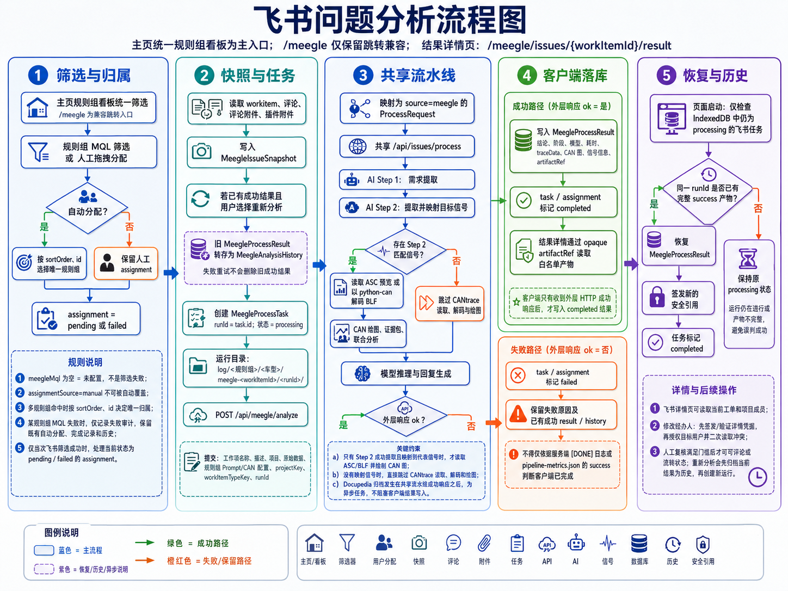
## 4. 人工复核与受控回填

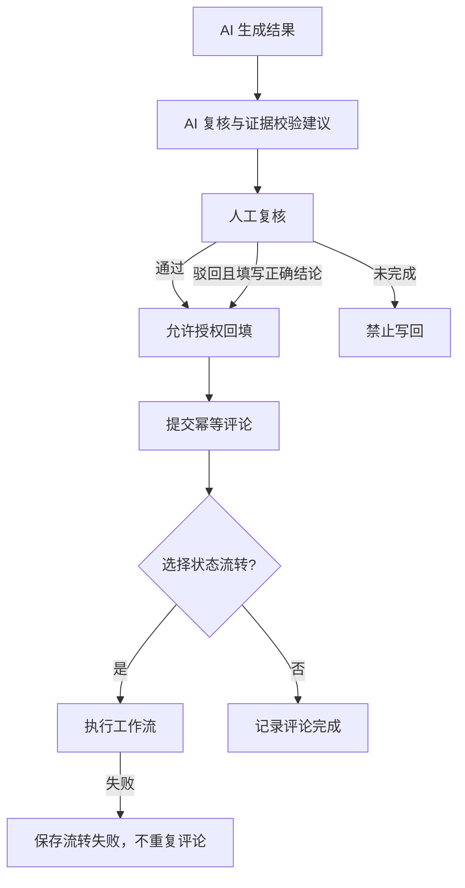
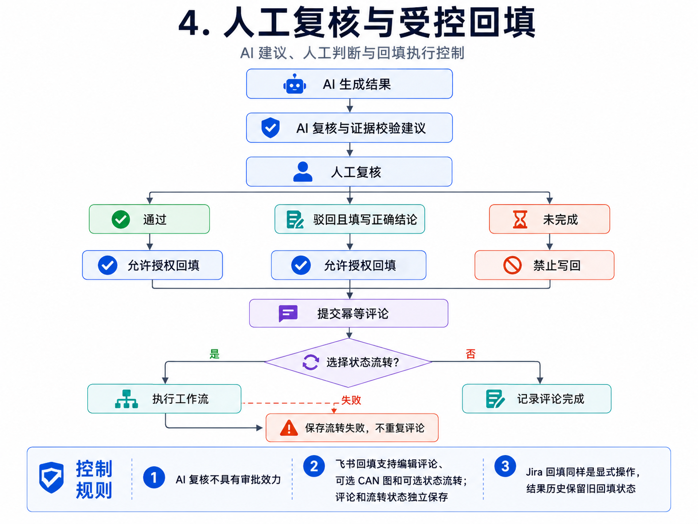
AI 复核不具有审批效力。飞书回填支持编辑评论、可选 CAN 图和可选状态流转；评论和流转状态独立保存。Jira 回填同样是显式操作，结果历史保留旧回填状态。

## 5. Docupedia 归档

成功响应先返回浏览器，浏览器独立持久化结果。仅在 `ENABLE_DOCUPEDIA=1` 时，Next.js `after()` 对当前运行的 `logRoot` 发起异步归档；文本日志按 Step 聚合，二进制文件和 `input_comments.txt` 不上传。请求出现超时、连接错误、429 或 5xx 时按策略重试并重新查询，单篇最终失败只记录日志，不阻断结果、复核、评论或后续工单。

## 6. 远程终端流程

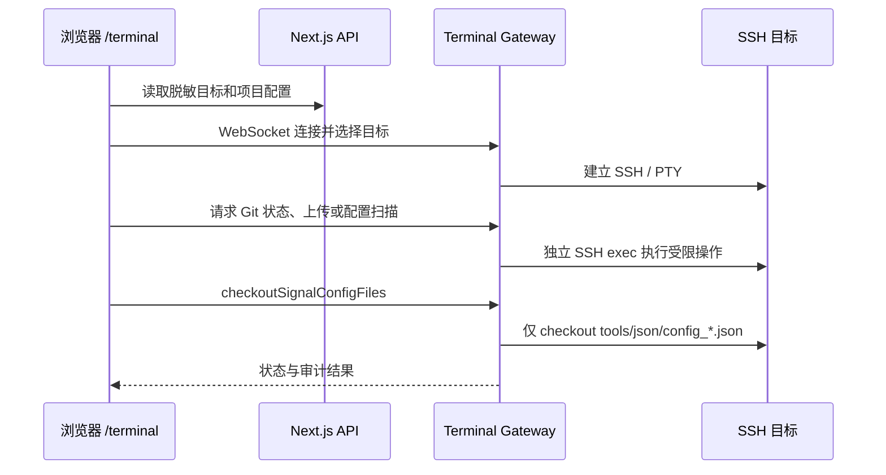
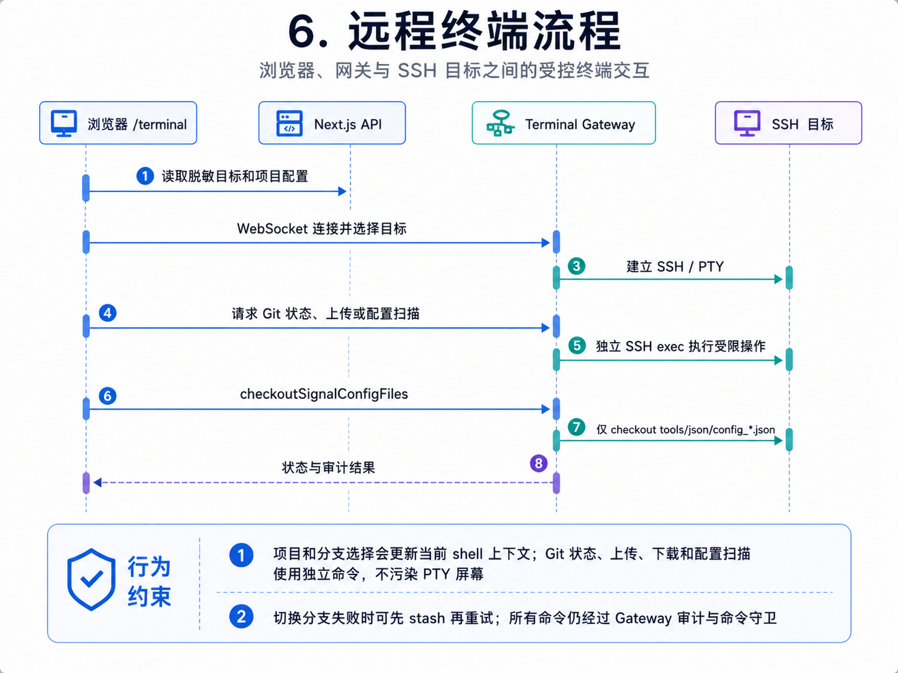
项目和分支选择会更新当前 shell 上下文；Git 状态、上传、下载和配置扫描使用独立命令，不污染 PTY 屏幕。切换分支失败时可先 stash 再重试；所有命令仍经过 Gateway 审计与命令守卫。
