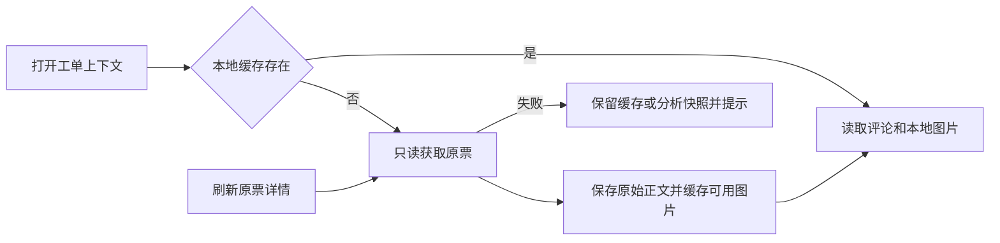

# 飞书工单上下文与图片缓存

以 meegle-7148399110 为验收示例，工单上下文保留评论的段落、换行、列表、强调、链接、代码与图片位置，按作者和时间分条显示。描述使用相同的富文本展示方式；普通附件仍提供链接。沿用当前详情页布局，不增加评论编辑或回填行为。

图片下载到服务端按 projectKey / issue / workItemId 隔离的持久化目录。页面仅引用登录后可读取的本地图片；刷新优先读缓存，“刷新原票详情”重新读取并补齐图片。下载仅接受飞书文件地址，通过已配置 CLI 权限读取，保留原 URL。图片失败显示占位提示，评论继续展示。远端读取失败保留已缓存内容，无缓存时展示分析快照。旧快照保持兼容，不改写原分析结果。

验收：示例票的图片评论可在原位置查看并打开大图；重载页面复用服务端文件。Markdown / HTML 基本排版可读，脚本、事件和危险链接不执行；图片不绕过服务端鉴权、不成为任意网址代理。不透明文件 URL 可下载，工单页面链接保持链接。跨项目或跨票无法引用另一票的图片。单图、评论接口或整个上游失败不清空既有缓存。Jira 上下文、经办人签名凭据和现有分析流程保持兼容。
