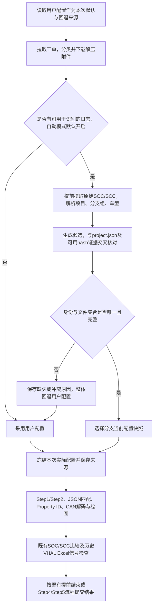

# Pipeline：根据日志自动匹配基础配置需求审核稿

版本：v1.0 · 日期：2026-10-31 · 状态：用户已确认使用分支当前配置并授权实施；已接入代码，验证记录见 session-handoff.md。

## 1. 审核结论

**可以实现。** 下载并完整解压日志后，从 SOC / SCC 原始版本信息识别项目、分支组和车型，再选择 `configuration/<项目>/<分支组>/` 中的配置，作为本次分析的实际配置；前台保存的用户配置继续保留。

需要解决三个问题：配置选择必须早于 Step2 和 CAN 解码；日志名称与项目 / 分支组 / 车型文件名之间需要可验证的映射；分支当前配置与日志历史版本必须分别记录。仅替换一个目录字符串，无法保证所有分析阶段采用同一套配置。

本稿区分已确认规则与剩余边界。自动模式、规则组车型别名完整匹配、车型文件来源、失败整体回退及 Proto 同步范围已经确认；历史版本策略已最终确认为分支当前配置。实现只影响新运行，不自动重跑真实工单或改写旧结果。

## 2. 已明确的目标与本稿范围

用户明确要求：

1. 保留前台「CAN 配置与车型文件」中的用户配置。
2. 在下载日志后，根据日志解析出的项目、分支和车型信息，尝试自动匹配本地基础配置。
3. 工单 7147061892 应能从 SOC / SCC 识别出 `chery-8255 / t1x-sop / T1J_FL3` 的候选配置上下文。
4. 先讨论可行性并输出需求文档供审核。

### 2.1 本轮已确认

- **自动模式默认开启**，不采用 v0.1 中“已有组默认仅用户配置”的建议。规则组没有新增模式字段时，也按默认自动模式理解；是否另提供手动关闭入口属于界面设计，不影响此默认行为。
- **用户配置始终保留为完整回退来源**。SOC / SCC 解析不出足够的身份信息时，启用本次请求中的用户配置；不能因为开启自动模式而导致原有无版本日志无法分析。
- **同时选择目录、配置车型和明确文件集合**，不能只换目录后继续沿用另一车型的文件名。
- **车型与文件映射继续来自当前规则组**：规则组为车型提供别名；工单中提取的车型名按别名完整匹配，日志识别所需的车型标识采用同一套规则。唯一命中后使用所属车型的 JSON、DBC、Proto；未命中则用用户默认路径与配置分析。不另建规则组之外的别名库，不按文件前缀猜组合，不借用其他规则组。
- **整体成功或整体回退**：身份冲突、解析失败、文件不齐时，保存证据、整体回退用户配置并继续现有能力；不混合自动 / 用户来源，不强选候选。标题或规则组车型与日志明确冲突也回退。
- **补齐 Proto 同步**：仅从 `repoName=api-public` 的仓库根路径 `mainPath/repoPath/com.bosch.cm.platform.vehicle.proto` 同步该文件到对应 configuration 项目 / 分支组目录，详细要求见第 5.4 节。

“保留用户配置”指不自动修改已保存的规则组路径、车型文件映射、排序或归属。自动选择只改变本次运行的实际配置；回退使用分析请求开始时的完整用户配置快照，不重新从已变更的前台状态拼接文件。

已确认范围：按日志选择**分支当前已同步的配置快照**。不扩大为下载历史 Git 提交的整套配置，不自动发起远程同步，也不把已有工单结果批量重新分析。

## 3. 当前实现与需要调整的时序

已核对代码：

| 内容 | 当前行为 | 新方案建议 |
| --- | --- | --- |
| 车型 | `context.ts` 根据标题包含前台车型键来识别，创建运行目录与引用 | 保留原始业务 / 运行身份，另记录日志车型和实际配置车型 |
| JSON / Proto | `prepare.ts` 的 `loadModelConfig` 在下载日志前加载 | 自动模式下延迟到日志识别与配置选择完成后加载 |
| SOC / SCC | `collectEvidence` 中提取，发生在 Step2、信号映射、CAN 绘图之后 | 将原始版本提取前置到解压后，复用提取结果，避免二次读取不同文件 |
| JSON 信号映射 | Step2 提示词和后续信号匹配均依赖它 | 二者统一使用实际选中的 JSON |
| DBC | 绘图阶段从请求的 `basePaths / modelToFiles` 拼接 | 解码、预览与绘图统一使用实际选中的 DBC 集合 |
| Property ID | 由当前 Proto 内容解析 | 使用同一配置清单确定的 Proto，不隐式读取另一目录 |
| 当前配置 VHAL | 从用户 Proto 根目录固定 `type.h` 读取 | 自动成功时来自实际配置快照的 type.h；回退时保持用户配置来源 |
| 问题所属 VHAL Excel | 日志 hash → RTC → VS commit → 版本文件 → 版本 Excel | 保留既有追溯链，和基础配置自动选择相互校验，不能混成同一版本 |

源码入口：`src/server/pipeline/process/{context,prepare,orchestrator,evidence-stage,signals-stage,version-vhal-stage}.ts`。

仅原始 SOC / SCC 提取前置；既有 SOC / SCC 的 AI 版本比对、确认不一致即停止、unknown 提示后继续等规则保持原义，不因本次路径选择而改成另一种判定。

## 4. 工单 7147061892 的实际样例

### 4.1 日志证据与候选映射

| 项目 | 当前本地可核对的内容 | 审核意见 |
| --- | --- | --- |
| SCC | `ES11_T1X_SOP_2026.44.5_T1JFL3` | 提取车型标识 T1JFL3，在当前规则组车型别名中完整匹配；唯一命中后取所属车型文件条目，不根据文件名推断车型键 |
| SOC | `rb-chery-idcpro_hqx4560-es11_t1x-sop_release_2026.44.5` | 去除已识别的构建版本后，可对应 project.json 中 api-public 的 `branchName=rb-chery-idcpro_hqx4560-es11_t1x-sop_release` |
| 项目与分支组候选 | 同一 api-public 分支在 project.json 中被 `chery-8255 / t1x-sop` 和 `chery-8255 / d01p-int-sop` 两个分支组引用 | SOC 完整匹配仍有两项，必须进一步消歧；这不代表配置错误，只表明该仓库分支被复用 |
| Android hash 交叉证据 | `82c3bd1 → RTC1-3103705 → a0ffcea…` | 可将本例分支候选收敛到 `chery-8255 / t1x-sop`，问题所属 VHAL 为 `2.2.36` |
| 候选目录 | `configuration/chery-8255/t1x-sop/` | 当前存在，能够作为分支候选目录 |

`hqx4560` 不是可以直接推导出 `8255` 的通用规则；项目必须来自 project.json 的唯一匹配或审核后的明确映射。本例的两项 SOC 候选属于同一项目，所以项目可确定、分支组仍待消歧。SCC 的 `T1X_SOP` 可以作为候选辅助证据，但是否允许据此映射分支组也须明确，不把车型名称自动当作唯一分支证明。

### 4.2 文件核对结果

以下保留 v0.1 编制时的本地只读检查结果。文件选择规则现已确认以规则组配置为准；目录中的候选文件不能替代该配置清单：

| 文件类型 | 目录内候选 | 仍需确定 |
| --- | --- | --- |
| 信号配置 JSON | `config_T1J_FL3.json` | 仅当规则组匹配车型的 JSON 字段包含该文件时使用；不自动加入其他 JSON |
| DBC | `car_T1J_FL3.dbc`、`car_T1J_FL3_IC2.dbc`；另有 `car_T1J_FL3_FUEL.dbc` | 使用规则组匹配车型的完整 DBC 列表，不自行决定采用前两个或并入 FUEL |
| Proto | v0.1 核对时未发现 `.proto` 文件，包括该目录及其 bak | 已明确通过 api-public 仓库根文件补齐同步；匹配车型所配置 Proto 仍须在目标目录实际存在，否则整体回退 |
| HAL | 存在 `types.hal`，包含 `enum VehicleProperty` | 当前 Proto 解析器寻找 `enum Property_ID`，不能直接把 types.hal 当作兼容 Proto 使用 |
| 当前配置 VHAL | 存在 `type.h` 兼容副本及以 `..._82552238` 结尾的当前版本文件 | 必须与日志追溯出的历史 VHAL `2.2.36` 区分展示 |

因此，本例**在结合唯一 hash 证据或审核后的明确映射后，可确定候选目录和车型；仅 SOC 不足以唯一定位，也不能据此断言整套基础配置已能自动切换成功**。Proto 已纳入同步功能；实际服务器文件是否就绪仍由已发布清单及文件校验决定，未同步或缺失时回退。

### 4.3 分支匹配与历史版本的区别

SOC 中的 `2026.44.5` 是软件版本信息；VHAL `2.2.36` 是另一条版本链。匹配到 `t1x-sop` 目录，只表示采用该分支当前同步的 JSON / DBC / Proto，不能证明这些文件正是日志录制时使用的文件。

现有 bak 是按文件保留的历史备份，并非每个 Git commit 的完整配置集合。即使可以找到某个历史 type.h，也不能据此把当前 JSON、旧 bak DBC 和另一目录 Proto 拼成“历史配套版本”。若要求精确复现日志时的全套配置，需要独立设计完整提交快照和各仓库的配套关系，建议另期处理。

## 5. 建议的匹配规则

### 5.1 识别项目与分支

- 以原始 SOC 字符串、project.json 的项目 / 分支组 / repos[].branchName 为主要依据；按明确规则剥离构建版本后做完整匹配或审核后的别名匹配。
- 首先生成候选，再要求唯一；不以文件夹存在、候选排列顺序、任意字符串包含或“最长看起来相似”直接定案。
- `t1x-sop_release → t1x-sop` 必须由实际 project.json 归属或明确规则确认，不做全局 `_release` 删除后猜目录。
- 日志 hash 能定位时，交叉检查项目 / 分支组是否一致；没有 hash 不自动等于失败，但仍需其他证据唯一匹配。有相互矛盾的明确证据时，建议回退用户配置并保存冲突。
- SOC 与 SCC 必须保留当前按 Buildinfo 同目录配对的关系。多个 cycle 解析出的项目 / 分支 / 车型一致时可以归并；不一致时保留候选，首期建议不自动挑选某个 cycle。

### 5.2 规则组别名完整匹配与文件选择（已确认）

车型别名由当前规则组提供，并绑定到该规则组的车型配置条目；JSON / DBC / Proto 文件集合仍取该条目现有映射。业务规则为：

1. 从工单提取车型名；自动日志识别中取得的车型标识也使用同一份规则组别名表进行匹配。
2. 提取出的车型名与**当前规则组中的别名完整相等**才算命中，不进行包含、前缀、模糊匹配，不自动删除分隔符 / 平台号 / 变体后缀，也不自动折叠大小写。
3. 命中后映射回别名所属的车型键，再使用该车型的 JSON、全部 DBC、Proto 清单；别名本身不作为目录名或文件名。
4. 无别名、别名未命中、一个别名指向多个不同车型，均记录原因并整体回退用户默认配置。同一车型重复登记同一别名不制造多个车型候选。
5. 工单与日志均取得车型且完整匹配到不同车型时，按已确认的身份冲突规则整体回退，不强制使用日志覆盖工单。
6. 项目 / 分支组已唯一确定时，自动根目录使用 `configuration/<projectName>/<branchGroupName>/`，再拼接所匹配车型配置的文件相对名；整套文件校验通过才启用。

本例的规则组配置可表达为以下示意，别名必须由用户配置，系统不自动生成：

```text
规则组车型键：T1J-FL3-8255
该车型的别名：T1JFL3
工单 / 日志提取车型：T1JFL3
匹配结果：完整匹配别名，使用 T1J-FL3-8255 条目的文件集合
JSON：modelToFiles["T1J-FL3-8255"].json
DBC：modelToFiles["T1J-FL3-8255"].dbc 全部文件
Proto：modelToFiles["T1J-FL3-8255"].proto
自动候选根目录：configuration/chery-8255/t1x-sop/
```

若配置了别名 `T1JFL3`，提取值为 `T1JFL3_FUEL`、`T1J_FL3` 或 `t1jfl3`，都不能当作该别名命中；需要支持的其他名字须明确配置为别名。提取车型原文和匹配使用的名称均须保留，不能由模型自行改写成一个“可命中”的别名。

**默认路径的含义：** 回退到本次请求原有的用户 `basePaths`、`modelToFiles` 及原默认车型处理上下文，继续既有分析能力；不是读自动候选目录的 default.json，也不是系统另设一个硬编码目录。用户默认配置自身缺项时如实保留原能力边界，不伪造文件或已完成解码。

已增加车型条目可选 `aliases: string[]`，贯通表单、保存 / 读取、请求、备份与模板等配置链路；不建立规则组外的新别名服务。旧规则组无别名时不据车型键猜测自动命中，使用用户默认配置。

### 5.3 选择与回退

**已确认：完整自动方案成功才整体使用，否则整体回退用户配置。** 完整性以当前规则组匹配车型的 JSON、全部 DBC、Proto 清单为依据：JSON / DBC 各须有非空文件列表，Proto 须有有效文件名，且目标文件全部存在并可读取。车型条目未配置某一类别也按自动方案不齐处理并整体回退；不跳过 Proto，不改读手动 Proto。此完整性门槛只决定能否自动切换，不新增手动分析的阻断条件。

- 项目、分支组、车型、文件集合唯一且校验通过：本次运行使用自动配置。
- 无日志、CAN-only 无可用 SOC / SCC、版本解析失败或不足以确定完整身份、歧义、文件缺失 / 不可解析、同步快照不完整：记录原因并整体回退用户配置。只解析出一方且仍无法确认项目 / 分支 / 车型时同样回退，不强行启用自动目录。
- 明确禁止组合“自动 JSON + 手动 DBC / Proto”；当前需求不设混合来源模式。
- 用户配置自身缺失时，不伪造有效配置；按既有手动分析能力处理并保留缺失信息，不能宣称已经完成正常解码。是否新增阻断条件不在本稿中擅自决定。
- 自动匹配失败与“信号未配置”是不同状态；前者不能触发“全部信号缺少配置”的提前结论。

### 5.4 Proto 同步扩展（已实现）

| 项目 | 规则 |
| --- | --- |
| 同步入口 | 沿用终端“同步全部项目”，分析流水线不自动触发远程同步 |
| 来源仓库 | 仅处理配置中的 `repoName: "api-public"` 仓库 |
| 远端逻辑路径 | `<mainPath>/<repoPath>/com.bosch.cm.platform.vehicle.proto`，位于仓库根目录 |
| Git 读取方式 | 沿用该仓库配置的 branchName 固定提交；读取该提交根路径中的文件，不切换分支，不读取未提交工作区内容 |
| 本地路径 | `<项目根目录>/configuration/<projectName>/<branchGroupName>/com.bosch.cm.platform.vehicle.proto` |
| 命名 | 保留文件原名，不加 commit 前缀，不改成 types.hal，不递归复制其他 Proto |
| 选择文件 | 自动分析仍使用匹配车型原先配置的 proto 字段；若该字段不是上述文件且目标文件缺失，整体回退，不自动改写字段 |
| 持久化 | 文件纳入现有来源记录、Git blob 校验、发布清单、完整性检查及缺失补齐，不单独在发布后临时拷贝 |
| 更新与备份 | 沿用普通文件规则：同内容复用，不同内容先保留 bak 后覆盖；读取 / 传输 / 校验失败不发布该分支组半份快照 |
| 源文件不存在 | 明确记录缺失，不伪造本地文件；沿用现有同步缺失与删除语义，不继续把旧托管文件冒充本次提交内容。自动分析遇到必需文件缺失时整体回退 |

Proto 必须与该分支组其他文件在同一轮暂存、校验和原子发布中提交。没有 api-public 仓库的分支组，不从其他项目或分支组借用 Proto；是否能够自动分析仍由文件完整性决定。

## 6. 建议流程与配置一致性



图中不改变既有拒绝 / 无附件的提前分支；这些分支的行为实施时须按现有契约回归。

配置一致性建议：

1. 运行中区分“原始用户配置”和“实际配置”，后续阶段只读取同一份实际配置对象，不再各自回到请求里拼路径。
2. 自动目录校验真实路径必须位于本项目 configuration 内；日志只能用于匹配配置中的合法名称，不直接作为路径片段执行或读取任意目录。
3. 选定后，在本次 run 内固定 JSON / DBC / Proto / type.h 的内容和校验值；建议保存独立配置快照供本次分析使用，目录命名在实施时确定。
4. 自动同步目录在读取期间可能整体发布新版本：读取前后核对 manifest 身份与文件 blob；变化时重试或回退，不能拿到前后两代文件后仍标记为一套配置。
5. 后续同步或前台规则组修改，不得改变已经开始分析的实际配置。配置快照的保留周期沿用已有运行产物策略，不另建同步服务。

## 7. 车型、运行身份及 VHAL 的关系

- 保留前台 / 标题识别的原始车型，新增日志车型和实际配置车型。名称等价由当前规则组配置的别名完整匹配证明。
- 已确认：日志车型与标题或规则组当前工单车型明确冲突时，整体回退并提示；不使用日志强制覆盖。规则组存在多个车型条目本身不算冲突，须比较本次工单身份与唯一匹配条目。
- 运行目录、runId、artifactRef 和飞书恢复凭据在下载前已创建，不因配置车型变化而中途搬目录、重签或改变工单归属。展示时分别标明原始身份和实际配置身份。
- CAN 解码、实际配置版本读取、Excel 检查中的车型匹配应使用已确定的实际配置上下文，不能一边用自动 DBC，另一边继续按原手动车型校验。
- 问题所属 VHAL Excel 仍按日志 hash → RTC → VS commit 定位；SOC / SCC 的基础配置匹配与该追溯冲突时保存冲突，不静默互相覆盖。
- 分别展示“本次基础配置：t1x-sop 当前快照 / 当前配置 VHAL”和“问题所属 VHAL：2.2.36”。首期允许采用当前分支配置时，应明确历史配套关系未验证，后续模型不得描述成已确认历史整套配置一致。

## 8. 持久化与前台反馈建议

沿用当前运行目录与结果 / 历史链路，已增加 `effective-config-resolution.json` 与 `effective-config-check.md` 审计产物，至少包含：

| 类别 | 保存内容 |
| --- | --- |
| 原始配置 | 本次请求的用户路径、车型及其别名和文件映射快照 |
| 识别证据 | 工单车型、SOC / SCC 原文、来源文件、cycle / 配对、实际命中别名及所属车型、分支匹配规则 |
| 选择过程 | 全部项目 / 分支 / 车型候选、hash 交叉结果、歧义与回退原因 |
| 实际配置 | 来源 manual / auto、项目 / 分支组 / 配置车型、逐文件原路径和快照路径、校验值 |
| 同步来源 | manifest 指纹、同步时间、各来源仓库 commit、headerFile、可用目标标识 |
| 版本边界 | 分支当前配置、问题历史 VHAL 及是否已证明配套 |

响应字段为可选 `configurationResolution`，保存原始请求配置、实际配置及文件 SHA256；原始用户路径保持在 requested。文件内容冻结到本次 run 的 effective-config/<本次冻结UUID>/{json,dbc,proto}/，配置失败时仅冻结用户可用文件，不借用自动文件；兼容旧结果，不要求旧运行补造字段。

详情建议显示：

```text
本次基础配置：日志自动匹配 / 用户配置 / 自动匹配失败后回退
识别：chery-8255 / t1x-sop / T1J_FL3
目录：configuration/chery-8255/t1x-sop/
文件：实际 JSON、DBC、Proto 清单
版本说明：使用分支当前快照，历史配套关系未验证
原因与证据：可展开
```

回退时明确显示具体原因，不显示“自动配置成功”。新运行、刷新恢复与重跑历史均保留当次决定，不根据后来变化的规则组 / 目录重算旧结果。

## 9. 异常与边界建议

| 情况 | 建议处理 |
| --- | --- |
| 只有 CAN、没有 SOC / SCC | 使用用户配置，不阻止已有 CAN-only 能力 |
| 多个项目共享近似分支名 | 保留候选并回退，不按目录存在或首项选择 |
| 多 cycle 车型 / 分支冲突 | 保留所有配对和候选，回退；如何限定有效日志范围另行确认 |
| 提取车型不能完整匹配当前规则组别名，或命中多个不同车型 | 保存原因，整体回退用户默认配置，不按车型键 / 文件名猜测，不合并不同变体 |
| 缺少某个已声明必需的 DBC / JSON / Proto | 整体回退，不以“少读一个文件”冒充完整方案 |
| 规则组配置了 Proto，但只有 types.hal、没有对应 Proto | 整体回退；通过 api-public 根文件同步补齐，不把 types.hal 当替代 |
| 标题 / 规则组本次工单车型与日志明确不同 | 保存证据，整体回退用户配置，不强制覆盖 |
| 自动目录与用户目录恰好相同 | 仍保存识别和选择依据，实际文件仅冻结一次 |
| 同步正在发布、manifest 与文件不符 | 不使用半份自动配置；重试或回退并记录 |
| 日志 hash 与 SOC 匹配到不同分支 | 保存冲突并回退，问题 VHAL 维持未知或冲突状态 |
| 分支当前配置版本高于日志版本 | 明示版本边界；不自动拼接 bak 文件或宣称历史配套 |
| 取消、迟到响应、新旧运行竞争 | 沿用当前门禁，不发布旧结果或半份成功产物 |

## 10. 验收条件（按最终确认策略实施）

1. 本例 SOC 在当前 project.json 中须保留 t1x-sop 与 d01p-int-sop 两个候选；工单 / SCC 车型标识仅完整匹配当前规则组配置别名并映射到所属车型键，结合唯一 Android hash 证据后才收敛到 chery-8255 / t1x-sop。没有足够消歧证据时回退；文件方案未补齐前不得断言自动整套配置成功。
2. 文件方案补齐并有效时，JSON、DBC、Proto、配置 VHAL 和 Excel 车型校验采用同一份实际配置上下文；Step2 不先使用手动 JSON 后只切换自动 DBC。
3. T1JFL3 不误配 T1J_FL3_FUEL；SOP 不误配其他分支；无法唯一确定时不选首项。
4. 没有日志、解析失败、缺失必需文件、歧义及冲突时，按审核后的回退策略运行并持久化原因；前台原配置保持不变。
5. 覆盖分支匹配成功但规则组所配 Proto 缺失、多个 DBC、相似车型和跨项目同分支等真实边界；缺任一已声明文件时整套回退，不能混合自动 / 手动来源。
6. 同步或前台配置在运行中变化时，已经冻结的配置不变；选择期间出现混代文件时不得进入分析。
7. 刷新、飞书完整响应恢复、重跑历史保留当次原始配置与实际配置；旧结果可读，run 目录和恢复凭据不漂移。
8. 保留普通 Jira、Bosch Jira、飞书及共享单票 / 批量 / 周期入口；既有无附件 / reject、SOC/SCC 不一致停止、全部信号缺少停止、unknown 继续与取消门禁均回归。
9. 工单 7147061892 的日志历史 VHAL `2.2.36` 与目录当前配置 VHAL 分别记录；不能把分支匹配成功解释为整套历史版本已验证。
10. 自动模式默认开启，包括无新增模式字段的旧规则组；SOC / SCC 无法解析或身份信息不足时仍能回退，不能要求用户先手动补模式字段。
11. 覆盖别名精确命中、无匹配、大小写 / 分隔符不同、同车型重复别名、同别名跨车型冲突、工单与日志命中不同车型、旧规则组无别名；不匹配 / 歧义 / 冲突时使用用户默认路径与文件集合。修改规则组别名和 JSON / DBC / Proto 清单后，新运行使用新配置，历史仍保留原快照。
12. 同步实际读取 api-public 固定提交根路径的 com.bosch.cm.platform.vehicle.proto，验证原名落盘、清单来源与校验、缺失补齐、变更备份、源缺失 / 删除、传输失败回滚及非 api-public 不误复制。
13. 实施时使用 Vitest 覆盖决策与流水线时序，浏览器验证默认模式 / 详情、IndexedDB 刷新与历史；真实工单验证需单独记录，不能以 mock 结果代替。

## 11. 确认记录与剩余边界

### 11.1 本轮已消除的歧义

| 原编号 | 已确认规则 |
| --- | --- |
| A | 自动模式默认开启；SOC / SCC 解析失败或身份不足时回退完整用户配置，不采用“旧组默认手动” |
| B | 同时选择目录、配置车型及明确文件集合，所有阶段统一使用本次实际配置 |
| C / R1 | 规则组提供绑定车型的别名，工单 / 日志提取车型按别名完整匹配；唯一命中后使用所属车型的 JSON / DBC / Proto 清单，无匹配则回退用户默认配置。不另建规则组外的别名或文件库 |
| D | 增加 api-public 根路径 com.bosch.cm.platform.vehicle.proto 的同步，原名保存至对应 configuration 项目 / 分支组目录；已声明 Proto 缺失时整套回退 |
| E | 冲突、解析失败、文件不齐（包括匹配车型没有配置某一必需文件类别）：保留证据，整体回退用户配置并继续现有能力；不混合、不强选，标题 / 规则组身份明确冲突也回退 |
| H 的失败处理 | 无法唯一确定项目 / 分支组时回退，不任取候选；可用 hash 的交叉证据继续保留 |

### 11.2 最终版本策略

车型等价规则与版本策略均已确认：

| 编号 | 剩余问题 | 本稿保留的处理建议 |
| --- | --- | --- |
| R2（原 F） | 使用分支当前配置 | 用户明确确认；冻结分支当前完整快照并标明历史整套配套未验证，不从 bak 拼装历史全套配置 |

配置冻结、审计和保持原运行身份作为本稿实现设计约束保留；具体字段、目录和界面控件在实施时设计，不自动修改用户规则组或已有结果。已实现自动匹配、Proto 同步及持久化展示；真实外部业务验收与用户服务重启独立记录。
