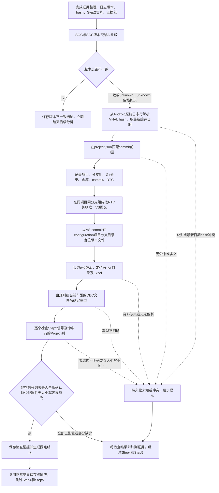

# Pipeline：版本验证与 VHAL 信号配置检查需求审核稿

> 2026-10-31 已实现增量：[经 RTC 关联 VS 提交定位 VHAL 版本](pipeline-vhal-vs-rtc-review.md)。更新第 4.2、4.3 节：来源 commit → RTC → 同项目、同分支组的 VS commit → 版本归档。该增量已接入共享流水线，以下基线涉及直接使用来源 commit 定位归档的描述，以增量需求为准。

> 2026-10-31 已按工单 7147061892 的核对结果增加 Vehicle property ID 名称列精确匹配，三列均按同行 Project 判定车型；属性独占行保留，大小写与提前结束规则不变。

版本：v0.4 · 日期：2026-10-31 · 状态：已按确认规则实现；剩余边界采用未知提示并继续，真实模型/业务工单验收未执行。

本文记录三个功能的已确认行为、实现边界与验收要求。共享流水线已接入检查、结果保存/恢复与详情展示，不自动修改业务配置或已有分析结果。当前流程见 [Pipeline 工作流程](../PIPELINE_GUIDE.md)。

## 1. 目标与范围

在流水线完成“证据整理”之后、进入 Step4 Android/QNX 日志摘要之前，依次增加：

1. **SOC / SCC 版本验证**：由 AI Chat 比较版本号，判断是否配合刷入。
2. **问题所属 VHAL 版本定位**：从 Android 日志中的 VHAL hash 追溯项目、分支、仓库、commit 和 RTC，再定位对应版本的 VHAL Excel。
3. **VHAL 信号配置检查**：检查 Step2 提取的每个信号是否存在于该 Excel，且是否配置给当前 DBC 对应车型；全部待查信号均确认缺少配置时输出更新 VHAL 表的结论，终止后续问题分析；部分缺少时继续。

覆盖所有共享流水线来源，包括普通 Jira、Bosch Jira、飞书，以及复用该流水线的单票、批量与周期分析入口。检查统一放在共享编排，不能仅为某个来源接入。现有无附件/拒绝提前结束分支尚未到达证据整理；是否改变这些分支仍作为独立边界待确认。

## 2. 插入位置与流程



新增检查位于原 CAN 绘图与证据整理之后，因此“提前终止”指跳过后面的 Step4、Step5 及相应模型自检；不是撤销之前已经完成的下载、Step1–3 或 CAN 绘图。

## 3. 功能一：SOC / SCC 版本验证

### 3.1 输入与判定

- 使用本次运行已提取的 `log-versions.json.records` 中 SOC 与 SCC 原始版本字符串。
- **版本是否一致必须由 AI Chat 判定，不写正则提取版本后比较、字符串相等或数值规则作为替代判定。** 程序只负责配对输入、校验 AI 返回结构与持久化。
- 只比对版本号，不要求 SOC / SCC 原始字符串完整相同。
- 版本号一致时，按本需求记录为“SOC 与 SCC 版本一致，属于配合刷入”。这是一条业务判定口径，不额外声称验证了实际刷写过程。
- 原始版本、AI 使用的版本号、结论和理由均留档，避免只有最终布尔值。

建议结果为 `matched`（一致）、`mismatched`（不一致）、`unknown`（缺失或无法可靠判断）。AI 异常、格式错误、缺少任一版本不得当作一致。

**一句 Prompt：**

> 请仅根据以下 SOC 与 SCC 原始版本字符串中的有效版本号判断两者是否一致，忽略模块名称、平台标识、日期及其他非版本字段，不得猜测缺失版本；版本号一致时说明“属于配合刷入”，不一致或无法确定时如实说明，并仅返回 JSON：{"socVersion":"识别出的版本号或null","sccVersion":"识别出的版本号或null","result":"matched|mismatched|unknown","reason":"简要依据"}；SOC={{socRaw}}，SCC={{sccRaw}}。

说明：上述 JSON 中版本字段缺失时应返回真正的 `null`，不是字符串 `"null"`；`result` 只取三个枚举值之一。

### 3.2 多个版本记录（建议，待审核）

沿用现有提取时的同目录关联：每个 Buildinfo.txt 的 SOC 只与该目录下提取出的 SCC 比较，不跨目录拼接。一个 SOC 对应多个 SCC 时逐条交给 AI，分别保存结果。汇总建议：存在不一致即 `mismatched`，否则存在未知即 `unknown`，全部一致才为 `matched`。

**已确认：版本不一致立即停止。** 任一配对被 AI 判为 mismatched，即保存已取得的证据与版本不一致结论，结束本次后续分析，不再定位 VHAL、检查信号或执行 Step4/Step5；无需等待其余版本配对。unknown 不等同于不一致：持久化原因并提示，继续执行可用的后续检查与分析，不阻断。

## 4. 功能二：确认问题所属 VHAL 版本

### 4.1 从 Android 日志解析 hash

优先使用本次 Android 原始日志中包含 `BoschVehicleHalHash` 的完整行，提取 hash 原值及其中的 commit 前缀，保留来源文件、原始行和日志时间（若有）。不得让模型根据日志摘要补造 hash。

用户提供的原始例子：

```text
VHAL hash：6a5d61b-2026-10-13
提取的 commit 前缀：6a5d61b
```

**已确认 A：保留完整短 hash `6a5d61b`。** 首位 `6` 不是业务标志，原先的 `a5d61b` 是笔误，不删除首位。

hash 后的日期表示编译日期。同一日志出现多个 hash 时，解析各自编译日期，使用日期最新的 hash；不以日志行时间或出现顺序选择。保留全部候选、编译日期、来源及选择依据。最新日期下仍有不同 hash，或日期缺失/非法而无法比较时，记录歧义与全部候选至持久化日志并提示，继续处理，不默选第一个。

现有提取函数从多种文件收集 hash 行，最多保留 20 条，并不保证 Android 来源或包含最新编译记录。实施时必须核对 Android 来源，避免候选截断漏掉最新日期。

### 4.2 在 project.json 搜索提交

数据来源为项目根目录 `docs/project.json`，当前绝对路径：

```text
/home/huo2wx/project/nextjs/ivacp/ivacp/docs/project.json
```

沿配置结构遍历 `project → branches → repos → commid-rtcids-map`，只在每个映射的 `commitid` 上执行前缀匹配，不对整个 JSON 做无字段约束的文本命中。

命中后至少记录：

| 字段 | 来源 / 含义 |
| --- | --- |
| projectName | 命中项目，例如 chery-8255 |
| branchGroupName | branches[].name，例如 maindev |
| repoName / repoPath | 命中仓库及路径 |
| gitBranchName | repos[].branchName，真实 Git 分支名 |
| commitid | 命中映射的完整 commit ID |
| rtcids | 该 commit 对应全部 RTC，可为空或多个 |
| rawHash / commitPrefix | 原始日志 hash 与实际用于搜索的前缀 |
| logSource | 来源文件与原始日志行 |

“分支组名”和“Git 分支名”必须分别保存；RTC 是该提交关联的 RTC，不自动推断为当前正在处理工单的票号。

同一提交可能存在于多个分支组；同一短前缀也可能命中不同完整提交。要求保留候选，不取第一个命中冒充唯一答案。建议优先用当前规则组可明确关联的项目/分支缩小范围；仍无法唯一定位时标记 `ambiguous`，将冲突类型、全部候选及来源写入持久化日志作为提示，继续处理。不得虚构唯一提交、分支或 Excel；依赖唯一定位且无法完成的检查记为 unknown，继续 Step4/Step5。

### 4.3 定位版本文件

用户的 `configuration_projectName_name` 理解为按现有结构拼接目录（建议确认）：

```text
<项目根目录>/configuration/<projectName>/<branchGroupName>/
例如：configuration/chery-8255/maindev/
```

先按来源提交的 RTC 在同项目、同分支组的 `vs` 仓库内关联唯一 VS commit（完整规则见增量需求）。在该目录查找文件名以该 VS commit 完整值或其可验证前缀开头的历史头文件；不再要求文件名以原始 Android hash 开头。**同时搜索分支组根目录和其 `bak/`（已确认）**，以兼容现有同步归档。只接受能够唯一关联到所选完整 VS commit 的文件，不能因一个短前缀文件存在就忽略其他冲突候选。

兼容需求中的 `.h` 文件名及现有同步生成的无扩展名文件：

```text
<commitid>_<rtcids>_82552235.h
<commitid>_<rtcids>_82552235
```

提取末尾版本段中的完整 8 位值 `82552235`，不得把 commit 或 RTC 内数字当成版本。多个候选若版本不同，记录歧义；没有候选则标记缺失，不能选最近版本代替。定位失败或文件读取失败时持久化原因并提示，跳过无法执行的依赖检查，继续后续分析。

**建议兼容当前版本：** 如果没有按 commit 命名的归档，但 `.sync-state.json` 能证明当前普通 `type.h` 来自命中的同一仓库和完整 commit，可读取其 VER_PRO_CFG 作为版本来源；不能无条件使用当前 type.h。此兼容行为待审核。

### 4.4 由 8 位编码定位 Excel

用户目标路径为：

```text
configuration/<projectName>/vhal/vhal<版本>/
  CHERY_<平台>_VHAL_SIGNAL_V<版本>.xlsx

例如：
configuration/chery-8255/vhal/vhal2.2.36/
  CHERY_8255_VHAL_SIGNAL_V2.2.36.xlsx
```

**已确认 B：`82552235 → V2.2.35`，原 V2.2.36 示例是笔误。** 完整 8 位值按 `8255 + 2 + 2 + 35` 拆为平台与三段版本，不加一，也不使用现有 parser 的 `22.35` 展示值拼接 Excel 路径。例如 `82552236 → V2.2.36`。

`82552235` 对应 `configuration/chery-8255/vhal/vhal2.2.35/CHERY_8255_VHAL_SIGNAL_V2.2.35.xlsx`。不按文件存在与否猜版本；`vhal2.2.33-1` 等后缀版本的选择仍待确认，不自动替代基础版本。

初版建议仅使用目标 `.xlsx`，不自动改读 `.xls`、别的版本或别的项目。文件缺失/损坏是无法验证，不能归类为未配置信号。

**版本含义区分：** 本功能定位的是“问题日志所属 VHAL 版本”；现有规则组 `proto_dir/type.h` 表示“本机当前用于分析的配置版本”。二者分别持久化，不能将本机版本当成问题测试版本。本需求暂不自动替换 JSON、DBC、Proto，也不重跑之前的解码。

## 5. 功能三：验证 VHAL 信号配置

### 5.1 待查信号

使用 Step2“信号提取”的直接结果，去重后逐个检查。**不能只检查已经在本机 JSON 中映射成功的信号**，否则可能遗漏正需要识别的未配置项；不默认把历史案例或标题补充候选全部纳入本次硬性阻断。

提取结果没有可用信号时记录 `unknown`，不能以“检查了 0 个且都通过”作为已配置。

### 5.2 从 DBC 文件名识别当前车型

当前车型来自**当前工单匹配到的规则组车型条目所配置的 DBC**，不是遍历规则组所有车型的 DBC。

以当前工单匹配规则组为该工单确认的 DBC 文件为准，按以下已确认映射提取车型：

| DBC 文件 | 车型 |
| --- | --- |
| car_D01.dbc | D01 |
| car_D01_OS_APA.dbc | D01_OS_APA |
| car_D01_HW.dbc | D01_HW |
| car_T1L_FL1_Body.dbc | T1L_FL1 |
| car_T1YA_IC2.dbc | T1YA |

保留车型组成部分（如 `_OS_APA`、`_HW`、`_FL1`），上述 `_Body`、`_IC2` 为需去除的模块后缀。不得一律按首个下划线截断，也不得把尚未确认的所有后缀都当成模块删除；新命名无法确定时保留原文件名与未知原因。

同一条目有多个 DBC 时，若都指向同一车型则去重；若得到多个车型或无法解析则标记歧义，不能默选第一个。原 pipeline 的 `carModel` 用于目录与既有逻辑，本次另存用于 VHAL 检查的车型，避免无意改变其他行为。

### 5.3 Excel 查找与 Project 验证

- 查找目标 Excel 内所有包含信号定义的业务工作表，而不是只查第一个 sheet。只读核对的 V2.2.36 文件有多个工作表，多数业务表的 Project 位于 E 列，但实现应按表头识别，不固定依赖列字母。
- 信号 / 属性名称精确检查 `Vehicle property ID`、`MCU UP`、`IVI DOWN` 三列，一般位于 I、S、T 列；按表头定位，不把列字母写死，也不全单元格模糊搜索。Vehicle property ID 命中同样必须检查同行 Project。旧表缺少属性列表头时保留原 CAN 两列读取；不把 R 列数值 propertyID 当作属性名称。
- `Project` 一般位于 E 列，按表头定位；内容按 `/` 分割、去除各项首尾空白，再以完整车型标识匹配同一行。例如 `D01/D01_HW/T1J_FL2` 可命中 D01、D01_HW、T1J_FL2，不能将 D01 误匹配成 D010。
- 同一信号出现多行时收集全部命中行；建议任一有效命中行明确包含当前车型即判定已配置。
- 为每个信号保存信号名、匹配使用的列、sheet、Excel 行号、Project 原文、目标车型与结论。

建议区分四种结果：

| 结果 | 条件 | 解释 |
| --- | --- | --- |
| configured | 找到信号且命中行 Project 包含当前车型 | VHAL 表已对该车型配置 |
| signal_missing | 完整读取目标表后未找到信号 | VHAL 表中缺少该信号 |
| model_not_configured | 找到信号，但所有有效命中行 Project 均未包含当前车型 | 信号存在，但当前车型未配置 |
| unknown | 无法确定信号列、车型、Project 含义或文件无法读取 | 证据不足，不能断言未配置 |

信号采用区分大小写的精确识别，`A` 与 `a` 是不同信号；不自动折叠大小写或将别名视为同一信号。若没有精确命中但发现仅大小写不同的候选，记录大小写差异、原始信号及候选行作为提示，仍继续分析，不能据此断言已配置，也不能因此触发全部缺少配置的停止条件。大小写不敏感比较仅用于产生差异提示，不用于配置命中。

逐信号结果需附加 `caseMismatch` 等等效差异标记，以区分真正未找到与仅大小写不同。Project 的 `ALL` / 通配符 / 空白与合并单元格语义仍待确认；无法可靠解释时记为 unknown 并继续。

### 5.4 提前终止与回复

**已确认：非空的待查信号列表中，全部信号均为 `signal_missing` 或 `model_not_configured`，且不存在仅大小写不同的差异提示，才终止后续分析。** 单信号确认缺少也满足全部缺少。逐项完成检查并汇总：部分缺少时记录缺失清单与证据，继续 Step4/Step5；全部已配置也继续。包含 `unknown` 或没有可用信号时，不能判为全部缺少；保存未知原因与提示，继续后续分析。即使只有一个信号且仅存在大小写不同的候选，也继续分析。

全部缺少时输出“VHAL 中没有配置该信号，需要更新 VHAL 表”（多个信号列出完整清单），通过正常结果保存路径结束。

建议回复模板：

```text
VHAL 中未为当前车型配置以下信号，需要更新 VHAL 表：
- 车型：D01
- VHAL 版本：2.2.36
- 信号：<信号列表>
- 原因：<表内未找到信号 / 信号存在但 Project 未包含 D01>
- 分支：<分支组名> / <Git 分支名>
- 提交：<完整 commitid>
- RTC：<关联 RTC 列表>
```

这表示 VHAL 表配置检查结论，不自动断言代码是否实现或整车实际运行状态。结果仍需正常持久化、可刷新查看与复核，不抛成无结论的技术失败；原有人工复核/回填门禁继续适用，不因提前返回而自动回填。

## 6. 持久化与展示（建议方案）

沿用当前 run 目录：

```text
log/<规则组>/<车型>/<工单>/<runId>/
  soc-scc-version-check.json     # 输入配对、原始版本、AI结果及理由
  vhal-version-resolution.json   # hash来源、全部候选、最终分支/commit/RTC/版本/表路径
  vhal-signal-config-check.json  # DBC车型、逐信号命中行、Project内容及检查结论
  version-vhal-check.md          # 便于人工审核的汇总
```

未知、读取失败、冲突及大小写差异均须写入本次 run 的持久化日志和检查摘要，保存原因、来源与全部相关候选，供详情展示、刷新恢复及后续 AI 分析使用；不得仅写控制台。未能唯一定位时不选任意候选充当已确认版本，也不因该检查无法完成而中止整个分析。

每份文件建议包含 `schemaVersion`、`runId`、工单/来源、阶段状态、记录时间与错误原因；定位记录保存 project.json 的实际命中条目，Excel 记录保存文件内容摘要或等效版本标识，避免后续配置变动后无法追溯。

结构化结果建议同时通过 ProcessResponse 返回并保存至 ProcessResult，让详情页、刷新恢复和历史重跑查看同一份结果；主存储仍是现有 IndexedDB，服务端文件用于审计与恢复，不新建同步服务。具体是否扩展 IndexedDB 字段在实施阶段确定。

三项检查无论通过、未通过或未知，都保存已取得的证据。提前结束也必须遵守原完整成功产物提交和飞书恢复门禁，不能只写一条文本后跳过 process-response / metrics 的正常落盘流程。技术失败不可发布成功标记。

建议界面新增三个阶段的状态及检查摘要，详情可查看 AI 理由、分支/提交/RTC、VHAL 文件和逐信号检查。继续 Step4/5 时将三个检查结果作为补充证据传入，不得让后续 AI 将“未知”改写成“已验证”。

## 7. 异常与边界

| 情况 | 必须保证 | 处理规则 |
| --- | --- | --- |
| SOC/SCC 缺失、AI 失败或回复无效 | 记录 unknown，不伪造一致 | 持久化原因并提示，不阻断，继续后续检查与分析 |
| 任一组 SOC/SCC 不一致 | 保留已取得的逐组结果 | 立即停止后续分析并保存版本不一致结论 |
| 缺少 Android hash / 多 hash | 保留来源与编译日期 | 取最新编译日期 hash；缺失或最新日期并列不同 hash 时持久化未知/冲突提示并继续 |
| commit 前缀无匹配或多义 | 不选第一项充当唯一版本 | 标记 missing/ambiguous，持久化全部候选与提示，继续分析 |
| 没有 commit 版本文件 | 不拿当前文件或最近版本无条件替代 | 记录缺失并继续；有清单证明的当前 type.h 兼容仍待确认 |
| Excel 缺失、损坏、表头不明确 | 不报告 signal_missing | 持久化 unknown 原因与提示，继续分析 |
| Project 空白、ALL、合并单元格 | 不私自推断配置关系 | 不能可靠解释时记 unknown，留档提示并继续 |
| 信号仅大小写不同 | A 与 a 不算精确命中，不自动映射别名 | 保存差异与候选行提示，继续分析，即使只有一个待查信号 |
| 单行信号名存在但车型不符 | 明确与“信号不存在”区分 | 记录该信号缺少配置；仅全部待查信号确认缺少才结束 |
| 运行被取消或重新分析 | 不覆盖新 run，不产生半份成功结果 | 沿用取消/最新运行门禁 |

建议对“无法验证”的状态单独输出“缺少资料，无法确认”，不套用“需要更新 VHAL 表”。已确认不阻断后续分析；仍可执行的检查继续，无法执行的依赖检查记 unknown。

## 8. 对现有实现的影响（供审核）

- 主编排在 `collectEvidence` 之后增加三阶段；通过后再执行 `runAndroidQnxStep`，版本不一致或全部信号确认未配置且无大小写差异豁免则走统一的提前保存路径；unknown、定位/读取失败、冲突及大小写差异保存提示并继续。
- 复用现有 SOC/SCC 提取产物与 hash 原始行，补充 hash 的 Android 文件来源信息。
- 新增 project.json 只读解析、目录/归档版本定位及 Excel 表读取；不触发终端同步、git fetch/pull 或业务回填。
- 保留现有分析所用配置的版本，与新增“问题所属版本”分别展示；本轮需求不自动切换此前已使用的 JSON/DBC/Proto。
- 扩展运行产物、结果返回/保存、恢复与详情展示；正式字段、模块拆分与依赖选型在审核通过后确定。

## 9. 验收场景

| 场景 | 预期 |
| --- | --- |
| SOC 与 SCC 格式不同但有效版本相同 | AI 返回 matched，记录配合刷入口径及依据 |
| AI 判定版本不一致 / 无法判定 | mismatched 立即停止并保存；unknown 不冒充一致，持久化原因与提示并继续 |
| 单一 hash 对应唯一项目/分支/仓库提交 | 保存完整分支组、Git 分支、commit、全部 RTC 与来源 |
| 同一 commit 分布在多个分支、或短前缀冲突 | 不静默取第一项，持久化全部候选与冲突提示，继续 Step4/5 |
| 根目录或 bak 中存在 `.h` / 无扩展名版本归档 | 正确提取末尾 8 位值，82552235 定位 V2.2.35 Excel |
| 普通 type.h 属于其他 commit | 不把它当成当前 hash 的版本证据 |
| 信号在非首个业务 sheet，Project 包含 D01 | 判定 D01 已配置，记录 sheet 和行号 |
| 信号存在，Project 只有其他车型 | 标明当前车型未配置，仅全部待查信号均缺少时提前返回 |
| 多个信号部分缺少 / 全部缺少 | 部分缺少保存清单并继续 Step4/5；全部确认缺少才提前结束 |
| 同一日志多个 hash、编译日期不同 | 选择最新编译日期的完整短 hash，保存选择依据 |
| Vehicle property ID、MCU UP 或 IVI DOWN 精确命中，Project 为 D01/D01_HW/T1J_FL2 | 按对应完整车型判定，保存列名与命中行 |
| 普通 Jira、Bosch Jira、飞书的共享流水线入口 | 使用同一检查与停止规则，单票/批量/周期入口均覆盖 |
| 表中只有 D010，待检查车型为 D01 | 按完整车型标识匹配规则，避免误判 |
| Excel 不存在 / 无可解析信号 / DBC车型歧义 | 持久化未知原因并提示，继续分析，不断言 VHAL 表缺少信号 |
| 最新编译日期相同但 hash 不同 | 持久化所有并列候选与冲突提示，不随意选择，继续分析 |
| 目标信号 A、表中仅有 a，包含单信号及多信号场景 | 区分大小写，不判为已配置；记录差异与候选行，继续分析，不触发全部缺少停止 |
| hash/版本/Excel 无法定位或读取 | 保存原因和检查 unknown 状态，继续分析；后续 AI 不宣称已验证 |
| 提示后刷新或恢复 | 未知、冲突与大小写差异提示均可恢复，不仅存在控制台 |
| 提前结束后刷新、飞书恢复、重新分析 | 完整结果可恢复，新旧 run 不混用，旧历史保留 |

## 10. 确认记录与剩余边界

| 编号 | 已确认规则 |
| --- | --- |
| A | 完整提取 `6a5d61b`，不删除首位 `6` |
| B | `82552235 → V2.2.35`，原示例为笔误，不加一 |
| C | SOC/SCC 版本不一致立即停止后续分析 |
| D | 同时搜索分支组根目录及其 `bak/` |
| E | 全部待查信号确认缺少且无大小写差异豁免才停止；部分缺少继续 |
| F | 2026-10-31 更新：精确检查 Vehicle property ID、MCU UP、IVI DOWN，一般为 I、S、T 列 |
| G | 按当前工单确认的 DBC 提取车型，映射见 5.2 |
| H | Project 一般为 E 列，按 `/` 分割后的完整车型匹配 |
| I | 多 hash 按 hash 后的最新编译日期选择 |
| J | 覆盖所有共享流水线来源 |
| K | SOC/SCC unknown、hash/版本/Excel 无法定位或读取均不阻断，留档提示并继续 |
| L | 同 commit 跨分支组、短 hash 冲突、最新日期并列不同 hash 均持久化冲突候选与提示，继续处理 |
| M | 信号区分大小写、不自动匹配别名；仅大小写不匹配时保存差异提示并继续分析 |

以下边界尚未确认，不视为本轮批准：

- 是否允许 `.sync-state.json` 证明同 commit 的当前 `type.h`；版本目录 `-1` 等后缀的选择。
- Project 的 ALL、通配符、空白与合并单元格语义；未确认时按 unknown 留档提示并继续。
- 未列出的 DBC 模块后缀与当前工单仍有多个不同车型 DBC 时的消歧。
- 是否改变原有无附件/拒绝提前结束分支。覆盖全部来源不等同于已经批准重写这些分支。

## 11. 实现与验收记录（2026-10-30）

- 共享 `processIssue` 在证据整理后接入 `runVersionVhalCheck`，所有共享来源与入口统一执行。原无附件/拒绝提前分支保持原义。
- SOC/SCC 使用现有 AI Chat，逐对保存输入、原始输出、结构校验后的结果；任一 mismatched 立即结束，unknown 留档并继续。
- Android 原始日志流式扫描完整候选，不受旧 20 行摘要上限影响；保留文件、行号、原文与编译日期。目录/文件读取失败记录 unknown，不能用不完整扫描冒充最新版本。
- 唯一提交按根目录与 bak 归档定位 Excel；不启用当前 type.h 兼容，不自动选择 -1 后缀版本。跨分支/短 hash/并列日期冲突保留候选提示并继续。
- Excel 由 Python 3 标准库读取，不新增依赖，不信任工作表 dimension 元数据；按表头定位多个业务表。兼容单格明确的方括号、逗号/换行信号列表，各成员仍大小写敏感精确匹配，不做别名映射。Project 合并/特殊值无法可靠解释时记 unknown。
- 四份审计产物及完整日志保存到当前 run；结构化 `versionVhalCheck` 进入 ProcessResponse、IndexedDB ProcessResult、重跑历史、飞书恢复与兼容入口；非索引可选字段，无数据库版本升级。详情展示检查状态、提示、逐信号证据与全部来源候选，旧结果不编造检查信息。
- 停止条件复用 finishSuccess 保存图表、证据、stages 和 process-response，最后发布成功指标；跳过 Step4/Step5 与后续自检，沿用人工复核与回填门禁。继续分析时将检查摘要加入 Step4、Step5 和复核证据。
- 单元/临时文件/真实 xlsx 结构读取、编排、IndexedDB 重读、飞书恢复与隔离浏览器测试覆盖停止和继续策略。真实模型判定与真实工单分析留待业务环境验收，不能将 mock 结果当作真实模型验收。

