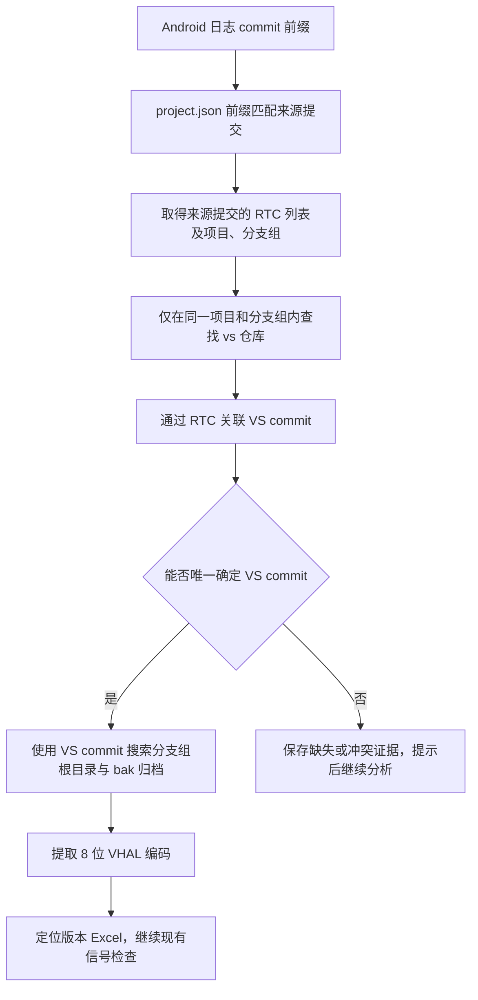

# Pipeline：经 RTC 关联 VS 提交定位 VHAL 版本

版本：v1.0 · 日期：2026-10-31 · 状态：用户已授权按稿实现，已接入共享流水线；验证记录见 session-handoff.md。

本文是 [版本与 VHAL 检查需求](pipeline-version-vhal-review.md) 第 4.2、4.3 节的增量变更。原 SOC/SCC 比对、hash 日期选择、版本编码转换及信号检查规则继续沿用。

## 1. 问题与目标

当前实现按 Android 日志中的 commit 前缀匹配 `docs/project.json`，随后直接用命中的 commit 定位版本归档。日志中的提交可能属于 `automotive-custom`，而版本归档使用 `vs` 仓库的提交身份，两者即使关联同一 RTC，commit 也不同，因此会出现“已提取 hash，但问题所属 VHAL 版本未知”。

本次目标：首次命中提交后，以其 RTC 为关联键，在**同一个项目、同一个 branches 条目**的 `vs` 仓库内查出对应 commit，再使用 **VS commit** 定位版本文件并提取 VHAL 版本。

## 2. 用户已明确的主流程

1. 从日志取得 commit 前缀，沿 `project → branches → repos → commid-rtcids-map` 匹配 `commitid` 前缀，保留现有前缀匹配规则。
2. 读取命中映射的 `rtcids`，同时保留来源项目、分支组、仓库及完整 commit。
3. 限定在该命中条目所属的项目与同一个 `branches` 条目内，查找 `repoName` 为 `vs` 的仓库。
4. 在该 VS 仓库的 `commid-rtcids-map` 中，按上述 RTC 查找对应记录，取得 VS 的完整 `commitid`。
5. 使用该 VS commit，在 `configuration/<projectName>/<branchGroupName>/` 及其 `bak/` 中定位版本归档；归档兼容 `.h` 与无扩展名格式。
6. 从归档文件名末尾提取 8 位版本编码，沿用现有转换规则，例如 `82552236 → 平台 8255 / VHAL 2.2.36`。
7. 定位该版本的 VHAL Excel，继续现有信号配置检查。只有完成文件定位与读取，才能产生相应的已验证结果。

这里的“相同 project-branches”指 JSON 中同一个项目及其同一个分支组条目，不要求不同仓库的 `branchName` 字符串相同。RTC 是提交关联标识，不是当前分析工单的 ID。

## 3. 工单 7147061892 的真实配置示例

以下链路已按当前本地 `docs/project.json` 与归档目录只读核对，可作为实现后的回归样例。

| 步骤 | 实际值 |
| --- | --- |
| 日志 hash | `82c3bd1-2026-10-20` |
| 项目 / 分支组 | `chery-8255 / t1x-sop` |
| 来源仓库 | `automotive-custom` |
| 来源完整 commit | `82c3bd19de7003f4f2de20cbf6a9a8be6ccf7de1` |
| 关联 RTC | `RTC1-3103705` |
| 同项目、同分支组的目标仓库 | `vs` |
| VS 完整 commit | `a0ffcea6b5db76730bde833e742ba01192befa6a` |
| 本地版本归档 | `configuration/chery-8255/t1x-sop/bak/a0ffcea6b5db76730bde833e742ba01192befa6a_RTC1-3103705_82552236` |
| 归档版本编码 | `82552236` |
| 预期定位的 VHAL 版本 | `2.2.36` |
| 对应 Excel | `configuration/chery-8255/vhal/vhal2.2.36/CHERY_8255_VHAL_SIGNAL_V2.2.36.xlsx` |

按本需求重新执行版本定位时，该示例应通过 RTC 找到上述 VS 归档；实际信号是否配置仍以 Excel 内容和本次待查信号为准。这里不修改该工单的既有结果，也不自动重跑工单。

## 4. 关联与异常处理规则

用户于 2026-10-31 要求按本稿实现，以下规则随该次授权执行。

| 场景 | 处理规则 |
| --- | --- |
| RTC 匹配方式 | 按 `rtcids` 数组成员完整相等匹配，保留 `RTC1-` 前缀，不做子串匹配 |
| 来源提交有多个 RTC | 用全部 RTC 搜索 VS 映射，任一 RTC 完整命中即形成候选，记录具体命中的 RTC；不按数组顺序选取 |
| 多个 RTC 指向同一个 VS commit | 对同一 VS 仓库的完整 commit 去重，保留全部关联路径后继续 |
| 一个或多个 RTC 对应多个不同 VS commit | 记为 `ambiguous`，保留全部候选并提示后继续；即使候选版本相同，也不自行选择提交 |
| 来源 commit 前缀无匹配或匹配多个条目 | 沿用当前缺失或歧义处理，不利用后续归档存在与否强行挑选来源提交 |
| 来源提交没有有效 RTC | 记录 `unknown` 与缺失原因，依赖检查记未知，继续分析 |
| 同一项目分支组没有 VS 仓库 / 有多个 VS 仓库条目 | 分别记录缺失 / 歧义，不跨项目、跨分支组借用映射 |
| VS 仓库没有对应 RTC | 记录 `unknown`；不改用其他仓库 commit 定位归档 |
| 初次命中的仓库本身就是 vs | 仍执行 RTC 关联和唯一性检查，保持同一套规则，不绕过多提交冲突 |
| VS 归档使用短 commit 前缀 | 在同一 VS 仓库全部映射提交中验证前缀唯一性，冲突时保存归档及其 commit 候选并记歧义，不只检查 RTC 命中的候选 |
| VS commit 对应归档缺失或版本冲突 | 沿用现有缺失 / 歧义提示，不回退来源 commit、当前普通 type.h 或相邻版本 |
| VS commit 唯一，但部分来源 RTC 未匹配 | 保存未匹配 RTC 的提示；可按唯一 VS commit 继续定位 |

不增加远程 Git 查询、自动同步、归档重命名或手工补造映射。当前普通 `type.h` 的兼容仍属于原文档的未确认边界，本次不隐含放开。

## 5. 持久化与前台展示

沿用现有运行目录、结果保存和详情展示链路；新增信息的具体字段名在实施阶段确定，但必须区分以下身份，不能直接把来源 commit 覆盖成 VS commit：

- 来源证据：日志 hash、文件与行号、来源项目 / 分支组 / 仓库、完整来源 commit、来源 RTC 列表。
- 关联证据：同分支组 VS 仓库及 Git 分支、VS 候选 commit、各候选命中的 RTC、最终用于定位的 VS commit、缺失或冲突原因。
- 版本证据：归档路径、8 位版本编码、VHAL 版本及 Excel 路径，沿用现有来源校验与文件内容摘要。

以上信息进入 `vhal-version-resolution.json` 和现有结构化分析结果；摘要进入 `version-vhal-check.md`、检查日志及后续模型输入。详情证据应能读出“来源 commit → RTC → VS commit → 版本归档”的完整链路，刷新与历史查看保留该链路。旧结果缺少新增证据时仍可展示，不伪造关联记录。

定位成功后，“问题所属 VHAL 版本”显示解析出的版本；失败时显示未知或冲突及具体原因。信号配置状态仍按实际检查结果生成，不因完成 RTC 关联就直接显示配置通过。

## 6. 验收条件

1. 使用第 3 节样例数据，可通过 `82c3bd1 → RTC1-3103705 → a0ffcea…` 找到 `82552236` 归档，解析为 `2.2.36`，并定位对应 Excel。
2. 来源 commit 没有归档、VS commit 有归档时仍可成功；若只存在来源 commit 的归档，不得冒充 VS 归档。
3. 同名 RTC 存在于其他项目或分支组时，不参与本次 VS 候选匹配；各仓库 Git 分支名不同不影响同一分支组内关联。
4. RTC 完整匹配，例如 `RTC1-3103705` 不命中 `RTC1-31037050`。
5. 按第 4 节规则覆盖空 RTC、多 RTC、重复映射、多个 VS commit、缺少 VS 仓库及无匹配 RTC；所有异常保存原因与候选，不能任取首项。
6. 使用 VS commit 搜索根目录和 `bak/`，兼容 `.h` 与无扩展名归档；不继续要求归档文件名以原始 Android hash 开头。
7. 正常、未知、歧义结果都能持久化；详情刷新和历史结果保留来源 commit 与 VS commit 的区别，旧结果保持兼容。
8. 版本定位成功后才进入对应 Excel 检查；定位失败不误报“信号缺少配置”，保留既有提示后继续规则。
9. 普通 Jira、Bosch Jira、飞书及共享单票 / 批量 / 周期入口采用同一关联逻辑；取消、重跑隔离、提前停止和正常结果提交门禁保持有效。

实现使用 Vitest 验证上述分支，并核对详情显示与刷新恢复。真实样例仅只读验证映射与归档，不自动重跑或改写工单。

## 7. 已采用的关联策略

按用户要求实施本稿，采用以下策略：

1. **多 RTC 关联规则**：任一 RTC 完整命中即纳入候选，多个 RTC 归并为唯一 VS commit 时继续；部分 RTC 未匹配时留提示后继续。
2. **多 VS 提交规则**：出现多个不同 VS commit 时保留全部候选、提示后继续，不自动取第一个、最新提交或同版本候选。

第 4 节其余异常沿用原有“未知 / 歧义留档并继续”的原则。
