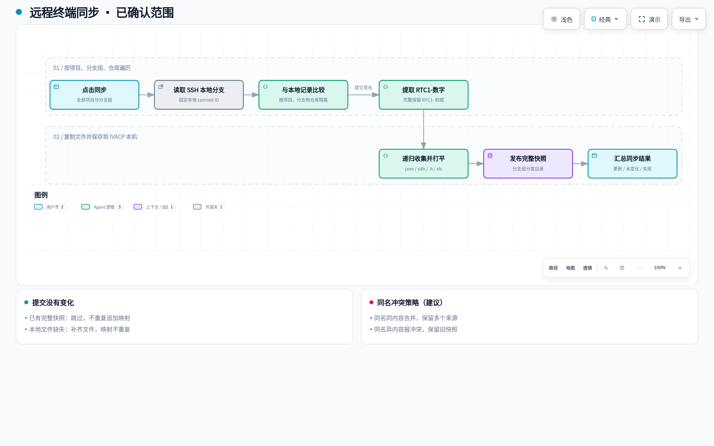
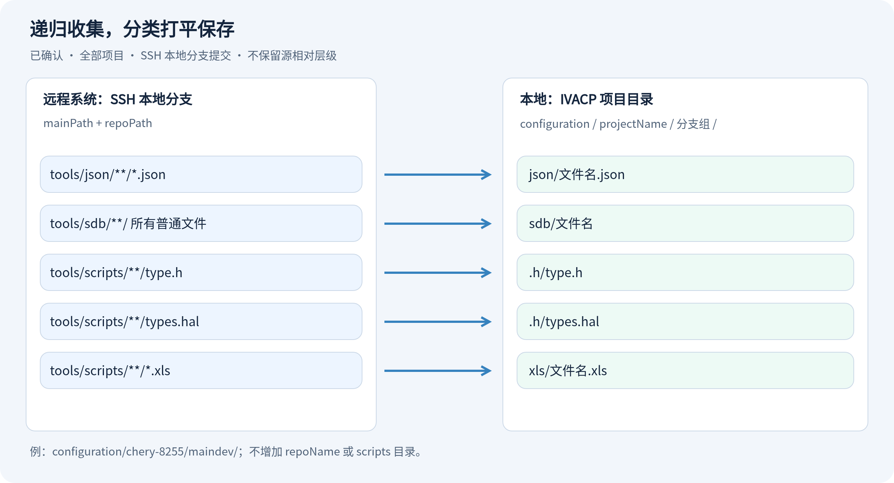

# 远程终端：提交映射与配置文件同步需求

版本：v0.2 · 日期：2026-10-29 · 状态：已按用户审核意见更新，尚未实现。

本文已纳入用户确认的同步范围、提交来源、RTC 格式、目录结构、权限及文件更新策略。剩余设计建议单独标注。现有终端、Git 操作和流水线保持当前行为；本轮只更新文档和配图。

## 1. 要解决的问题

在远程终端增加「同步」按钮，按 `docs/project.json` 的项目、分支组及仓库配置，批量取得分支最新提交，提取提交中的 RTC ID，并把指定配置文件保存到 IVACP 本机。后续可据此追溯“哪个分支、哪个提交、哪些 RTC 问题、哪一套配置文件”。
提交信息示例：

```text
[CheryIDCPro] [Vehicle] t1jfl3 T1YA vhal2.2.36 main_dev

[Description ]

RTC1-3103704

[Solution ]

[Module ] Vehicle Service

[Team ] BCSC/EPA4
```

其中的 RTC ID 为完整字符串 `RTC1-3103704`，保存时保留 `RTC1-` 前缀。

一次同步交付两类持久化结果：

| 结果 | 保存位置 | 内容 |
| --- | --- | --- |
| Commit → RTC 映射 | `docs/project.json` 中对应 repo 对象 | commit ID 与从该提交信息提取出的 RTC ID 列表 |
| 分支配置快照 | 项目根目录的 `configuration/` | JSON、SDB 目录文件、type.h、types.hal、所有 .xls 文件 |

这里的“本机”指**运行 IVACP 的服务器磁盘**，不是浏览器下载目录；远程系统指当前终端连接的白名单 SSH 目标。

## 2. 已明确的需求

1. 入口放在远程终端中，点击「同步」才执行。
2. 遍历 project.json 全部项目的全部分支组及其 repos，而非只处理当前界面选择的项目或分支。
3. 每个 repo 读取 SSH 服务器上本地 `branchName` 分支的最新完整 commit ID，从该提交标题和正文提取 `RTC1-数字` 格式的完整 RTC ID；不执行 fetch/pull。
4. repo 下新增数组字段，例如 `commid-rtcids-map`，保存多个 commit 与 RTC ID 的映射。
5. 最新 commit 与本地已同步记录相同时，不重复追加映射；变化时保存新的映射，保留历史。
6. json、sdb、scripts 均递归搜索；符合范围的文件不保留相对层级，直接归入 `configuration/<projectName>/<分支组名>/{json,sdb,.h,xls}`。不增加 repoName 或 scripts 目录层。
7. 仅管理员可启动，沿用现有登录。提交不变且文件完整则跳过；缺失补齐；变化时替换托管快照并移除旧文件。
8. 本轮仅更新需求和图解，不修改真实 `project.json`、连接远程仓库或实现同步代码。

## 3. 现有配置与名词

实际配置层级为：

```text
project.json 数组
└─ projectName                 例如 chery-8255
   ├─ mainPath                 例如 ~/workspace
   └─ branches[]
      ├─ name                  分支组名称，例如 maindev
      └─ repos[]
         ├─ repoName            例如 vs
         ├─ repoPath            相对 mainPath 的仓库路径
         ├─ origin              Git remote 名称，例如 taiji_qnx
         └─ branchName          该仓库的真实 Git 分支名
```

远程仓库目录按现有终端约定拼接 `mainPath + repoPath`；现有部分 repoPath 带前导 `/`，也按项目内相对路径处理。不能将其误判为远程文件系统根目录。

**分支组名称不等于 Git 分支名。** 例如 chery-8255 的 maindev 组中，vs 与 api-public 配置了不同的 branchName。提交比较必须按“项目 + 分支组 + repo”隔离，不能全局只按 repoName 比较。

本次确认的 configuration 目录约定见第 6 节，PRODUCT 已同步登记；这属于待开发需求，不表示现有同步功能已实现。

## 4. 使用流程与图解

[打开可缩放的同步流程图](./terminal-sync-flow.html)。流程图已按本轮确认更新；确认项汇总见第 10 节。



1. 用户连接白名单 SSH 目标，在终端点击「同步」。
2. 界面显示本次目标服务器、项目数、分支组数、仓库任务数；运行期间按钮显示「同步中」。
3. 冻结本次 project.json 配置，逐个处理项目、分支组、repo，不因用户在界面切换分支而改变正在执行的任务范围。
4. 读取 SSH 本地目标分支的最新提交并固定 commit，后续 RTC 提取和文件复制都使用它，不使用 Git origin 的最新状态。
5. 对比已同步提交：相同且文件完整则跳过；不同则准备新映射和文件快照。
6. 将同一分支组各 repo 的文件按分类打平汇总，文件准备完整且无命名冲突后，发布该分支组快照与各 repo 的已同步记录。
7. 汇总显示「更新、未变化、补齐文件、失败、不适用」及每个 repo 的结果。

图中主线展示提交发生变化时的路径；提交未变化时的跳过、补齐逻辑见图下方说明卡及第 5 节。

## 5. Commit 与 RTC 映射规则

### 5.1 最新提交的含义（已确认）

“最新 commit”取 SSH 服务器上对应仓库的**本地分支**，即 `refs/heads/<branchName>` 指向的提交。同步不执行 fetch、pull，也不以 `origin/branchName` 代替本地分支。

读取目标提交的标题和正文，并从同一个固定 commit 的目录树复制文件。工作区未提交的改动不纳入快照，不需要为读取其他分支反复 checkout。若本地目标分支不存在，明确报告失败，不能回退到当前 HEAD 或其他分支。

### 5.2 数据结构（建议，待确认）

在原 repo 对象上增加字段，其余配置保留；以下是示例对象，并非修改实际配置：

```json
{
  "repoName": "vs",
  "repoPath": "qnx/vendor/bosch/chery/idcpro/vs",
  "origin": "taiji_qnx",
  "branchName": "rb-chery-idcpro_vehicle_main_dev",
  "commid-rtcids-map": [
    {
      "commitid": "0123456789abcdef0123456789abcdef01234567",
      "rtcids": ["RTC1-3103704", "RTC1-3103705"]
    }
  ]
}
```

- `commitid` 保存完整 ID，不能只保存显示用短 ID；`rtcids` 为去重字符串数组，允许一条提交包含多个 RTC ID；完整保存 `RTC1-3103704` 这样的字符串，不转换成纯数字。
- 同一 repo 配置下，同一 commit 只保留一条映射；只记录每次同步时的最新提交，不遍历两次同步之间的所有历史提交。
- 文件快照的同步清单另存 `latestSyncedCommitId`，用于判断“当前本地快照对应哪个提交”。不能只判断某个 ID 是否曾出现在映射历史中，否则分支回退到历史提交时可能误跳过文件更新。
- 未提取到 RTC ID 时建议保存 `rtcids: []`，提示“提交中未识别 RTC ID”，继续保存 commit 和文件。
- RTC 格式已确认：大写 `RTC1-` 后接数字，匹配完整独立标识（例如 `RTC1-3103704`）。不得截取更长字母数字标识的一部分，不将其他前缀、普通数字、Change-Id、日期或版本号当作 RTC ID。重复出现只保存一次。

### 5.3 状态与处理

| 对比结果 | 映射处理 | 文件处理 |
| --- | --- | --- |
| 首次同步 | 新增最新提交映射 | 创建快照 |
| 提交未变化且本地完整 | 不修改，不重复追加 | 跳过 |
| 提交未变化但本地文件缺失 | 不重复追加 | 从相同 commit 补齐 |
| 提交变化 | 新增映射；已存在则复用 | 更新为新 commit 的快照 |
| 分支回退到已有提交 | 保留历史且不制造重复项 | 更新为回退后提交的快照 |
| 分支组文件复制失败或发生同名冲突 | 不推进该分支组发布记录 | 保留上一份完整快照，显示失败 |

## 6. 文件同步范围与目录图

所有源路径均以“该 repo、该目标分支的同一个固定 commit”为准。tools/scripts 取自 **repoPath**，不使用项目级 scriptPath 替代。

| 远程仓库内来源 | 递归复制范围 | 本地分支目录下的目标 |
| --- | --- | --- |
| `tools/json/` 及其子目录 | 所有 `.json`，不局限于 config_*.json | `json/<文件名>` |
| `tools/sdb/` 及其子目录 | 所有普通文件 | `sdb/<文件名>` |
| `tools/scripts/` 及其子目录 | 文件名为 `type.h`、`types.hal` 的文件 | `.h/<文件名>` |
| `tools/scripts/` 及其子目录 | 所有 `.xls` 文件 | `xls/<文件名>` |

**三类来源目录均递归搜索，不保留任何源相对层级。** 所有 repo 的文件合并到当前分支组对应的分类目录中，不增加 repoName 层。scripts 中仅收集原需求指定的 type.h、types.hal、.xls，不额外增加 .xlsx 或其他脚本。

`.h` 按你指定的字面量作为目录名（隐藏目录），其中存放 type.h 和 types.hal；xls 文件独立存入 `xls` 目录。不会建立 scripts 目录，也不会把 `.h` 当作扩展名占位符。



已确认目录示例：

```text
configuration/
└─ chery-8255/                     ← projectName
   └─ maindev/                    ← branches[].name
      ├─ json/
      │  ├─ config_A.json         ← 原 tools/json/a/config_A.json
      │  └─ config_B.json         ← 原 tools/json/b/deep/config_B.json
      ├─ sdb/
      │  └─ vehicle.dbc           ← 原 tools/sdb/sub/vehicle.dbc
      ├─ .h/
      │  ├─ type.h
      │  └─ types.hal
      ├─ xls/
      │  └─ VHAL_SIGNAL_CHECKLIST_s.xls
      └─ .sync-state.json         ← 建议的分支组发布清单，记录各 repo 及文件来源
```

目标路径固定为 `configuration/<projectName>/<分支组名>/{json,sdb,.h,xls}`，不含字面量 branches 层或 repoName 层。

`.sync-state.json` 属于实现建议：记录目标服务器 ID、项目/分支组身份、各 repo 的 branchName/latestSyncedCommitId、同步时间以及文件原始来源、目标文件名与校验值。文件路径已打平，来源归属仍须可追溯，不能依靠目标子目录识别 repo。

### 6.1 打平后的同名文件（补充设计建议）

递归或跨 repo 汇总可能出现相同目标文件名。建议同名且内容相同时仅保留一份，清单保留多个来源；同名但内容不同时报告冲突明细（repo、源路径、目标路径），保留上一份完整分支组快照，不以遍历顺序静默覆盖，也不擅自添加子目录或改文件名。此冲突策略为补充建议，尚未由用户单独确认。

## 7. 文件更新与失败处理（建议）

- 同步采用远程提交覆盖本地的单向快照；本地目录用于读取和分析，手动编辑可能被下次同步覆盖。
- 使用临时目录收集并核验完整文件后，再替换该分支组的现有快照；下载中断不发布半份文件。
- 新提交删除的文件，从该分支组托管的旧快照中移除；保留其他 repo 仍引用的同内容文件，不删除其他项目、分支组的文件。
- 无 tools 目录的仓库标记“不适用”，仍保存 commit/RTC 映射；部分来源缺失明确列出。预期存在但传输失败的文件属于失败，不能当成“不适用”。哪些目录、文件应强制存在，可在审核后细化。
- project.json 更新保留所有原字段及其他 repo 的历史；并发同步串行合并，避免一个任务覆盖另一个任务结果。
- 文件发布与 project.json 保存须可恢复：本地清单和配置不一致时，下一次同步先核对并修复，不能将半完成状态判为“未变化”。
- 单个分支组失败不阻断其他分支组或项目。分支组内任一 repo 读取失败、传输失败或同名异内容冲突时，建议不发布该组半成品；报告保留失败项，可重新同步重试。整个批次可以“部分成功”。

## 8. 界面与现有终端的关系

终端工作台新增「同步」按钮和任务结果面板。结果按“项目 → 分支组 → repo”展示，包含完整 commit 可复制、RTC ID、目标目录、文件数、状态和失败原因。运行中防止同一范围重复启动。

复用现有登录和白名单 SSH 连接，通过结构化任务返回进度，避免将大批文件内容灌入 PTY。普通分支切换不得改变已启动任务的范围；连接中断明确报告失败，不能让迟到响应写入新目标的目录。任务超时不应导致无关终端会话不可用。

同步会写入服务端 project.json 和 configuration，已确认仅管理员可启动，沿用现有登录，普通分析员不可启动。默认只保留当前快照和 commit/RTC 历史，不建立每个 commit 的全套文件归档，不自动修改规则组路径或启动分析流水线。

## 9. 验收场景

| 场景 | 验收结果 |
| --- | --- |
| 多项目、多分支、多 repo | project.json 全部项目和配置项均被处理，Git 分支按各自本地 branchName 解析 |
| 连续两次同步、提交未变化 | 不重复追加映射，不改写完整配置快照 |
| 两次同步间提交发生变化 | 新 commit/RTC 入库，文件与该 commit 一致，历史仍在 |
| 一个提交包含多个/重复/无 RTC ID | 提取完整 RTC1-数字标识，去重或记录空数组 |
| 多层来源目录中包含不同文件 | 递归收集并打平，最终只出现在 json/sdb/.h/xls 分类目录 |
| 同名文件来自多个子目录或 repo | 按补充建议：同内容去重，异内容报告冲突并保留旧快照 |
| 本地文件被删、commit 未变化 | 补齐缺失文件，不重复写映射 |
| 分支回退或强制更新 | 以本次读取的 commit 为准，不把历史命中当成已同步 |
| 某个来源目录不存在 | 显示缺失/不适用明细，符合审核后的必需文件规则 |
| 单个 repo 失败、断线或文件传输中断 | 按补充建议保留整个分支组旧快照，其他分支组可成功，报告可追溯 |
| 本地分支与 origin 状态不同 | 使用 SSH 服务器本地分支，不发起 fetch/pull |
| 普通分析员尝试启动同步 | 界面不可启动，服务端也拒绝 |
| 多用户同时同步、界面中途换项目 | 不丢历史、不混写任务，结果保持原目标身份 |
| 服务重启后再次读取 | project.json 映射与本地快照仍存在并可核对 |

## 10. 本轮已确认的产品选择

| 编号 | 已确认内容 |
| --- | --- |
| A | 涵盖 project.json 全部项目、全部分支组及 repos |
| B | 最新 commit 取 SSH 服务器本地分支，不 fetch/pull |
| C | RTC ID 完整保存 `RTC1-3103704` 格式，保留前缀 |
| D | 目录为 `configuration/<projectName>/<分支组名>/{json,sdb,.h,xls}`，无 repoName 层 |
| E | 提交不变且完整则跳过；缺失补齐；变化时替换托管快照并移除旧文件 |
| F | json、sdb、scripts 均递归收集，按分类打平，不保留相对层级 |
| G | 管理员可启动，沿用现有登录 |

待进一步审核的补充设计只有打平后的同名冲突策略，以及由此采用的分支组完整发布边界，见第 6.1、7 节。其余结构化记录、恢复清单和缺失源文件提示属于实现建议。当前仅更新需求及图解，尚未开始同步功能实现。
