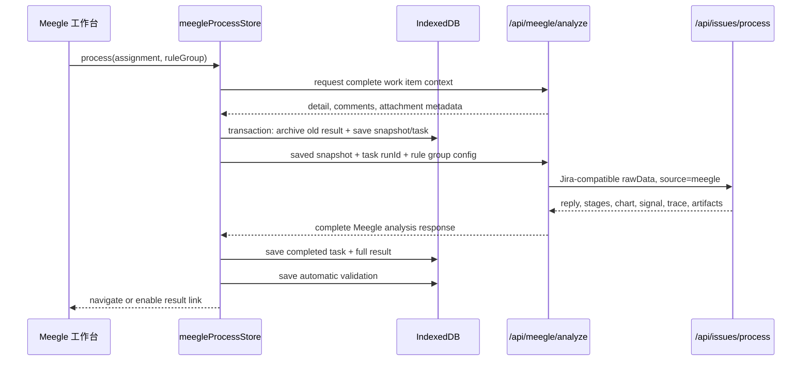

# 飞书项目处理结果生命周期设计

## 背景

当前飞书项目工作台可以将工作项分配到规则组并调用完整分析管线，但完成后仅在 `MeegleAssignment.result` 保存一段结论文本。图表、信号摘要、处理阶段、复核、校验、历史与回填状态均未持久化，完成卡也无法进入结果详情页。

本设计为飞书项目建立独立的结果生命周期和详情链路。Jira 现有表、store、路由和页面行为保持不变；飞书链路复用共享分析算法及可复用展示组件，但不把飞书记录写入 Jira 的 snapshot/task/result 表。

## 目标

- 完成卡可进入独立飞书结果详情页，刷新后仍可查看完整结果。
- 详情页同时展示原始工作项内容、处理过程、分析结果、图表、信号摘要和流水线产物。
- 支持 AI 复核、人工通过、人工改判、一致性校验和历史版本。
- 支持将可编辑评论和选定 CAN 时序图回填到飞书项目。
- 支持查询并执行飞书项目工作项状态流转。
- 分析、评论回填和状态流转的失败可分别重试，且不会丢失已完成结果。

## 非目标

- 不改变 Jira 详情页、Jira IndexedDB 表和 Jira 回填语义。
- 不引入后端数据库、登录、云同步或团队协作。
- 不重新实现分析模型、日志解析、CAN 绘图或证据校验算法。
- 本轮工作台只处理飞书项目 `issue` 类型；接口仍显式传递并校验 `workItemTypeKey`，不使用隐式硬编码。
- 不自动选择或执行状态流转；用户必须在回填预览中明确选择。
- 不在本轮实现负责人变更。详情页显示当前负责人，但回填只处理评论、图片和状态流转。

## 用户流程

1. 用户在飞书工作台将工作项拖入规则组并开始处理。
2. 系统通过 `/api/meegle/context` 获取工作项详情、评论和插件附件元数据；成功后在同一 IndexedDB transaction 中归档旧结果、保存完整快照并创建飞书处理任务。
3. `/api/meegle/analyze` 接收已保存的快照数据，再调用共享 `/api/issues/process` 管线。
4. 系统在运行中显示粗粒度任务阶段；成功后保存并展示共享管线返回的完整阶段明细，失败后保留快照和错误信息。
5. 完成卡显示“查看结果”，点击进入 `/meegle/issues/[workItemId]/result?assignmentId=...`。
6. 用户查看工单、处理过程、结论、图表、日志产物、历史版本和原始数据。
7. 用户执行 AI 复核或人工复核；人工改判内容作为最终可回填结论。
8. 用户在回填预览中编辑评论、决定是否附带时序图，并可选择一个可用状态流转。
9. 系统先回填评论与图片，再执行用户选择的状态流转，分别记录每一步结果。

## 页面设计

采用已确认的 A 布局。

### 页面结构

- 顶栏：返回工作台、工作项 ID、标题、飞书项目来源标识。
- 左栏“工单内容”：项目、状态、负责人、优先级、创建时间、描述、评论和附件摘要。
- 右栏“处理过程”：采集票据、解析附件、提取信号、生成结论、保存产物等阶段状态。
- 右栏页签：分析结果、流水线日志、历史版本、原始数据。
- 分析结果：结论、复核状态、CAN 图表、信号摘要和一致性校验。
- 后处理：飞书评论预览、图片开关、可用状态流转及各步骤执行状态。

### 状态表现

- `running`：上下文采集与请求准备期间显示客户端粗粒度阶段；共享分析请求执行期间显示“分析管线执行中”并禁用重复启动。管线完成后再展示服务端返回的完整阶段明细，不承诺实时流式阶段更新。
- `failed`：显示失败阶段和错误，可从同一快照重试。
- `completed + pending review`：允许 AI 复核、人工通过或人工改判。
- `approved` 或具有人工正确结论的 `rejected`：允许进入回填预览。
- 评论已回填、流转未执行或失败：保留“评论已回填”，仅允许重试流转。
- 已全部完成：显示评论 ID、回填时间和最新飞书状态。

## 组件边界

### 页面与组件

- 新建飞书结果路由和页面容器，按 `assignmentId` 与 `workItemId` 加载独立数据。
- 新建 `MeegleResultDetail` 负责数据装配、页面状态和动作编排。
- 从 Jira `IssueDetail` 中提取不含数据源文案和动作的展示组件，例如结论、图表、校验摘要与历史列表。Jira 和飞书容器各自传入数据和事件，不互相依赖 store。
- 保留现有 `MeegleIssueDetail` 的即时查看能力，但分析入口统一调用新的 Meegle process store，避免产生第二套临时结果状态。
- `MeegleRuleGroupLane` 完成后显示结果入口；重新分析会归档当前结果后创建新任务。

### Store

新增 `meegleProcessStore`，职责包括：

- 从 IndexedDB 加载 assignment 对应的最新 snapshot、task、result 和历史。
- 创建快照和任务，调用 `/api/meegle/analyze`，保存完整响应。
- 管理运行中、复核中、校验中、回填中和流转中的 UI 状态。
- 执行人工复核并保存飞书专用复核字段。
- 调用共享 review/validation 算法适配器，但将运行记录写入飞书专用表。
- 调用飞书回填与 workflow API，并分别更新评论和流转状态。

`meegleAssignmentStore` 只负责看板分配和摘要状态。assignment 新增并持久化 `workItemTypeKey`（本轮为 `issue`）、`latestResultId` 与 `latestTaskId`，确保刷新后仍能用完整身份启动处理或打开详情；不再以 `result` 文本作为详情数据源。旧 `result` 字段保留一版迁移兼容，只用于数据库升级时生成最小历史结果，随后不再写入。

## 数据模型

Dexie 升级到新版本，新增以下独立表。

### `MeegleIssueSnapshot`

- `id`
- `assignmentId`
- `ruleGroupId`
- `workItemId`
- `workItemTypeKey`：本轮必须为 `issue`
- `workItemName`
- `projectKey`
- `projectName`
- `stateName`
- `rawData`：工作项详情、描述、评论、附件元数据和来源字段
- `createdAt`

索引：`id, assignmentId, workItemId, ruleGroupId, createdAt`。

### `MeegleProcessTask`

- `id`
- `snapshotId`
- `assignmentId`
- `ruleGroupId`
- `status`：`pending | running | completed | failed`
- `stage`：沿用共享处理阶段枚举
- `stages`：共享管线返回的阶段说明
- `mode`
- `elapsedMs`
- `createdAt`
- `completedAt`
- `error`

索引：`id, snapshotId, assignmentId, ruleGroupId, status, createdAt`。

### `MeegleProcessResult`

- `id`
- `processTaskId`
- `snapshotId`
- `assignmentId`
- `workItemId`
- `replyText`
- `model`
- `reviewStatus`：`pending | approved | rejected`
- `aiReviewVerdict`：`unknown | pass | fail`
- `aiReviewReason`
- `aiReviewedAt`
- `manualReviewedAt`
- `manualCorrectResult`
- `errorReason`
- `chartImage`
- `signalSummary`
- `traceData`
- `ticks`
- `artifactRef`：服务端生成的非绝对路径产物定位信息
- `commentStatus`：`not_started | uploading | commenting | succeeded | failed`
- `commentId`
- `commentedAt`
- `commentError`
- `transitionStatus`：`not_selected | pending | succeeded | failed`
- `transitionId`
- `transitionName`
- `transitionedAt`
- `transitionError`
- `createdAt`

索引：`id, processTaskId, snapshotId, assignmentId, workItemId, reviewStatus, commentStatus, createdAt`。

### `MeegleAnalysisHistory`

重新分析前归档当前结果的不可变摘要，包括来源 snapshot/task/result ID、结论、复核字段、评论状态、状态流转结果、结果时间和归档时间。图表和大型 trace 数据不复制，历史详情通过来源 result 读取；删除 assignment 时保留历史，除非用户明确执行清理。

### `MeegleValidationRun` 与 `MeegleValidationCheck`

字段结构与 Jira 校验记录保持一致，但外键指向 `MeegleProcessResult.id`，避免混用两套结果 ID 和 store。校验算法提取为接收统一 `ValidationInput` 的纯函数，两个 store 分别负责持久化。

## 分析数据流

`/api/meegle/context` 接收 `projectKey + workItemTypeKey + workItemId`，负责获取并规范化工作项详情、评论和插件附件元数据。上下文获取成功后，store 在一个 transaction 中归档尚未归档的旧结果并创建新 snapshot/task；获取失败时不归档旧结果、不创建 snapshot，assignment 保持原有可查看结果及可重试状态。归档按 source result ID 幂等。`workItemTypeKey` 不是 `issue` 时返回明确的不支持错误。

`/api/meegle/analyze` 接收 snapshot、`workItemTypeKey` 和当前 task ID 作为 `runId`，并完整透传共享管线的 `replyText`、`model`、`mode`、`stages`、`elapsedMs`、`chartImage`、`signalSummary`、`traceData`、`ticks` 和 `artifactRef`。无附件、拒绝和完整附件三条返回路径使用同一响应形状。

## 流水线日志与产物

共享处理 API 继续将 `pipeline.log`、`stages.json`、各阶段 Markdown、信号文件和最终回复写入日志目录。Jira 保持现有目录规则；只有 `source=meegle` 且提供 `runId` 时，写入该 issue 目录下不可变的运行级子目录。`runId` 必须等于服务端校验通过的 task ID，只允许安全文件名字符。

- 共享管线返回一个服务端生成的 `artifactRef`，包含 group、车型、issue key 和 run ID 对应的稳定、非敏感标识，不向浏览器暴露绝对文件系统路径。
- 每次重新分析创建新的 task/run ID 和独立产物目录；历史记录的 `artifactRef` 永远指向该次运行，不得回退到“最新 issue 目录”。图表 URL也必须包含运行级路径，因此旧历史图不会被新运行覆盖。
- 新增只读产物 API，按 `artifactRef` 返回允许展示的文件清单，并按白名单读取文本或 JSON 文件。
- 白名单包含 `pipeline.log`、`stages.json`、`pipeline-metrics.json`、`step*.md`、`extract.md`、`signals*.json`、`evidence-*.json` 和 `final_reply*.md`。
- 路径解析必须限制在项目日志根目录内，拒绝 `..`、绝对路径和符号链接越界。
- 大文件按明确上限截断并在响应中返回 `truncated: true`；二进制附件不通过该 API 返回。

## 复核、校验与学习样本

- AI 复核继续调用 `/api/issues/review`，请求中使用 `meegle-{workItemId}` 作为 issue key，并传入 Meegle 快照、结果构建的分析上下文及该结果的 `artifactRef`。review API 对 Meegle 请求校验 `artifactRef` 后只读取该次 run 的白名单日志，不回退到 issue 最新目录。AI 结果写入 `aiReviewVerdict`、`aiReviewReason` 和 `aiReviewedAt`，只作为人工判断依据，不改变 `reviewStatus`，也不能独立解除回填门槛。
- 人工通过将 `reviewStatus` 更新为 `approved` 并记录 `manualReviewedAt`。
- 人工改判将 `reviewStatus` 更新为 `rejected`，记录 `manualCorrectResult`、`errorReason` 和 `manualReviewedAt`，并写入现有 `IssueReviewSample` 与 `LearningMemory`。两者是共享模型学习资产，也是独立 Meegle 持久化边界的唯一例外；key 使用 `meegle-{workItemId}`，避免与 Jira issue key 冲突。
- 一致性校验复用当前结构化证据与时间戳算法，结果写入 Meegle 专用 validation 表。
- 校验是辅助信息，不阻断回填。只有人工通过，或人工改判且填写了正确结论，才允许回填。

## 飞书回填

新增 `/api/meegle/comment`：

1. 校验 `projectKey`、`workItemTypeKey=issue`、`workItemId`、`resultId`、评论正文和可选图表路径。
2. 若携带图表，确认路径位于该 result 的运行级图表目录，调用 `meegle attachment +upload <path> --resource-type 14 --project-key ... --work-item-id ...`。
3. 从上传响应取得图片 URL 与 `file_token`，将图片 Markdown `<!--token-->` 追加到评论正文。
4. 在评论正文末尾追加不可见幂等标记 `<!-- analyzer-result:{resultId} -->`。每次执行 `comment add` 前，无论首次提交、自动重试还是手动重试，都先查询评论列表并查找该标记；找到后直接返回已有 comment ID，否则调用 `meegle comment add --project-key ... --work-item-id ... --content ...`。
5. 返回 `commentId`、图片上传信息和时间。

所有 CLI 调用使用参数数组方式执行，不拼接 shell 字符串；服务端设置超时并解析结构化 JSON。错误响应不包含凭据、完整命令或本地绝对路径。

评论回填与状态流转是两个独立步骤：

- 评论成功后立即持久化 `commentStatus=succeeded`，即使后续流转失败也不重复评论。
- 状态流转前通过 `/api/meegle/workflow?projectKey=...&workItemTypeKey=issue&workItemId=...` 刷新可用 transitions。workflow GET 和 POST 均强制接收快照中的 `projectKey` 与 `workItemTypeKey`，不得使用固定环境变量或隐式类型替代请求所属项目。
- 用户选择 transition 后调用现有 workflow POST；成功时记录 transition ID、名称和最新状态。
- transition 已失效时刷新列表并提示重新选择，不自动改用其他 transition。

## 错误处理与恢复

- 页面启动时将超过合理时长仍为 `running` 的任务标记为中断失败，允许重试。
- 分析失败保留 snapshot、task、阶段和错误；重试创建新 task，不覆盖失败记录。
- 结果写入采用 Dexie transaction，同时更新 result、task 和 assignment 引用，防止完成卡指向不存在的结果。
- 图表上传失败时不创建评论，并保留可重试错误。
- 评论创建成功但客户端响应中断时，后续任意提交都会通过 result ID 隐藏标记找到已有评论，并将本地状态修正为成功，避免重复回填。
- 状态流转失败不回滚已创建评论。
- 飞书详情刷新失败时仍展示 snapshot 中的原始内容，并提示当前在线状态可能过期。

## 兼容与迁移

- Dexie migration 为已有 `completed + result` assignment 创建一条最小 snapshot/task/result，使旧完成卡可查看历史结论；图表、阶段和日志显示“旧记录未保存”。
- 未完成 assignment 不迁移结果，只保持原状态。
- 新版本成功处理后不再写 `MeegleAssignment.result`。
- Jira 表和数据不参与迁移。

## 测试策略

### 单元测试

- Meegle assignment 到 snapshot 的转换，包括评论、附件和 source 字段。
- `workItemTypeKey` 在 context、snapshot、analyze、附件和 workflow 契约中保持一致，非 `issue` 请求被拒绝。
- 独立任务的成功、失败、重试和重新分析归档。
- 旧 assignment 迁移为最小结果。
- 结果复核状态、校验运行和历史只写入 Meegle 表；人工改判产生的共享 `IssueReviewSample` 与 `LearningMemory` 是唯一例外。
- 评论 Markdown 图片 token 组装、路径校验和 CLI 参数生成。
- 评论成功而流转失败时的部分成功状态。
- artifact 路径白名单、截断和越界拒绝。
- 两次重新分析生成不同运行级 artifactRef，旧日志和图表不会被覆盖。

### API 测试

- `/api/meegle/analyze` 在三类附件模式下完整透传响应。
- `/api/meegle/comment` 的无图、带图、上传失败和评论失败路径。
- workflow transition 列表、成功流转和失效 transition。

### UI 测试

- 完成卡可导航到独立详情页。
- 刷新后恢复完整结果、当前页签和后处理状态。
- 工单内容、处理阶段、结论、图表、日志、历史和原始数据可见。
- 未复核结果不能回填；人工改判时回填正确结论。
- 评论成功后只重试失败的状态流转。

### 回归验证

- Jira 分析、详情、复核、校验、回填和状态流转测试保持通过。
- 飞书工作台拖放分配与 IndexedDB 刷新持久化保持通过。
- TypeScript、目标 ESLint 和生产构建通过。

## 完成标准

- 新处理和迁移后的旧完成卡都可打开结果详情。
- 页面刷新后工单、任务、结果、复核、校验、历史和回填状态仍存在。
- 完整分析产物不再被 `/api/meegle/analyze` 丢弃。
- 可查看流水线阶段和白名单日志产物。
- 飞书评论可回填可编辑结论及可选 CAN 图，并可独立执行状态流转。
- 评论与流转的部分成功状态准确且可恢复。
- Jira 现有行为无回归。
- 产品、架构、工作流、时序图和 session handoff 文档同步更新。