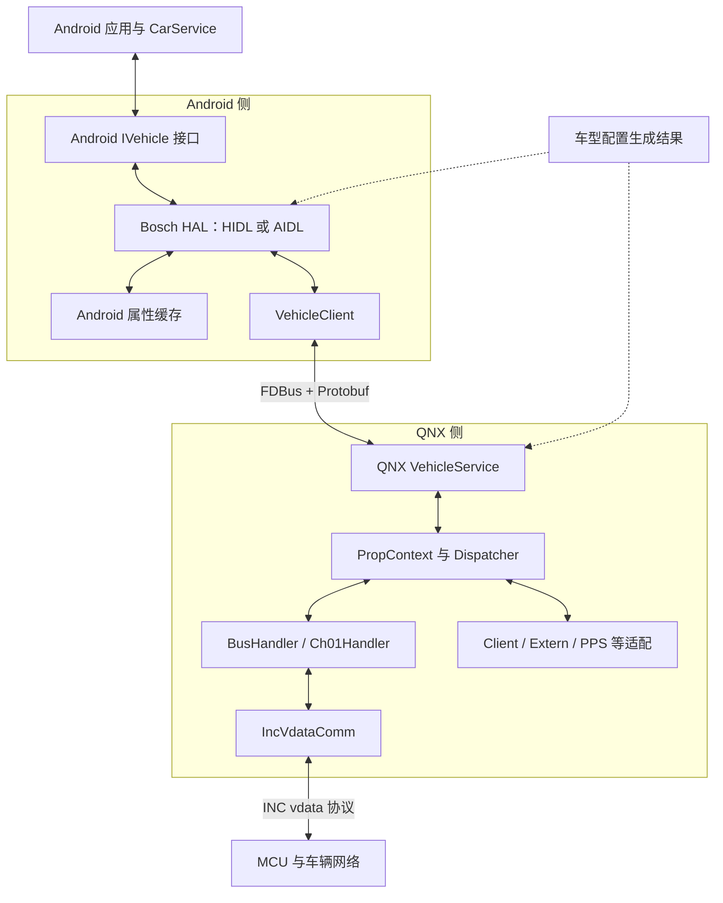
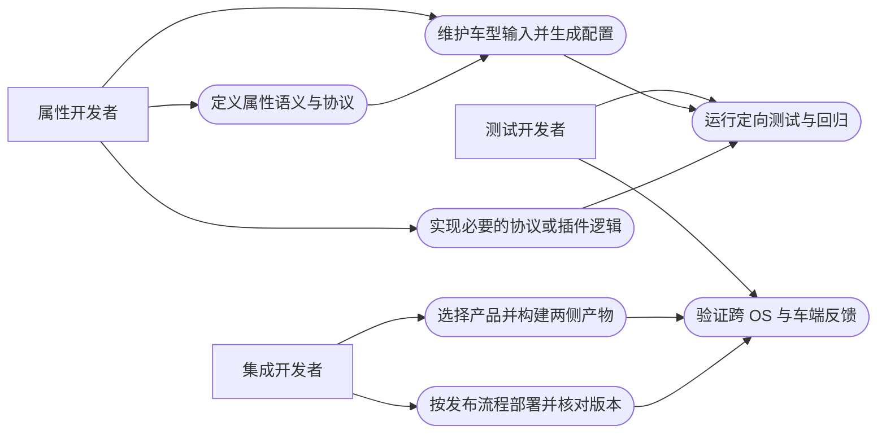

# 01 从零认识系统与仓库

[返回目录](README.md)

## 1. 先用一句话理解

这套系统把车辆侧的信号转换成稳定的「车辆属性」，由 QNX VehicleService 负责协议接入、车型映射与路由，再通过 FDBus 交给 Android BoschVehicleHal，最终由 Android 车辆接口提供给上层。

反方向上，上层写属性会经过 HAL、跨系统通信和 QNX 路由，最终进入相应的车端发送路径。不同属性可以走不同的总线、客户端或扩展插件，不是所有属性都走 CAN。

这里的 VehicleService 是 Bosch QNX 服务，不是 Android CarService，也不是 Android HAL 服务入口中同名的 C++ 文件。

## 2. 必备术语

| 名称 | 零基础解释 | 本项目中的边界 |
|---|---|---|
| ECU / MCU | 车辆电子控制单元 / 微控制器 | 提供或消费信号；其固件不在本手册的主要源码范围内 |
| CAN / CAN FD | 车辆总线及扩展数据帧形式 | 帧 ID、位布局和属性 ID 是不同概念 |
| DBC | 描述 CAN 消息、信号位置与物理换算的文件 | 是配置生成输入，不是运行时 Android 接口 |
| 属性 Property | 用 ID、区域、状态和值描述车辆能力 | 隔离底层信号细节，但仍要遵守单位和语义 |
| areaId | 属性对应的区域，例如座位或车窗 | GLOBAL 常用 0；不能对所有属性都写 0 |
| QNX | 实时操作系统 | 运行本项目 VehicleService 和车端通信适配 |
| HAL | Hardware Abstraction Layer，硬件抽象层 | 向 Android 暴露标准化车辆接口 |
| HIDL / AIDL | Android 接口定义机制 | 两条 VHAL 实现分支，不是 FDBus 的编码格式 |
| FDBus | 跨进程通信中间件 | 服务发现、invoke、订阅和广播；具体跨 OS 网络部署需查整车集成 |
| Protobuf | 结构化消息序列化格式 | 约定属性、命令和状态；它本身不负责传输 |
| CMake / Soong | QNX 侧 / Android 侧主要构建机制 | buildCentral 调度 CMake；Android 使用 Android.bp 和 Go hook |
| STR | Suspend To RAM，挂起到内存 | 两侧有各自生命周期逻辑，不能合并成一个状态变量 |
| Mock / Stub | 测试替身 | 单测能验证软件行为，不等于 ECU 或实车验证 |

## 3. 系统分层图

下图是逻辑依赖与双向数据通道，不表示所有节点在同一线程，也不承诺每次读取都穿透到总线。Android 上层应用和 CarService 是平台概念，本次未检查其实现。



实际边界依据：[QNX 服务入口](../../VehicleService/src/VehicleMain.cpp#L55)、[HIDL 服务入口](../../../../../../qcom_la/lagvm/LINUX/android/vendor/bosch/common/hal/automotive/vehicle/2.0/service/VehicleService.cpp#L31)、[Android FDBus 上线处理](../../../../../../qcom_la/lagvm/LINUX/android/vendor/bosch/common/hal/automotive/vehicle/2.0/default/impl/vhal_v2_0/VehicleClient.cpp#L332)。

## 4. 工作区全景

以下是主要工程目录，不是每个生成文件的逐项清单。`qnx` 与 `qcom_la` 同属当前 `workspace`；从任意文件夹构建前必须确认当前目录。

```text
workspace/
  qnx/
    buildCentral/                     构建编排入口，不是服务源码仓库
      mk                              Shell 入口
      tools/buildCentral/             Python 构建控制器和规则
      project/build/                  工程配置入口
      workspace/                     当前仅见 Readme.txt，不承载服务源码
      external/                      构建依赖目录
      output/build/                  中间构建树
      output/log/                    构建日志
      output/stage/                  部分目标的安装暂存区
    bosch-qnx/platform/vehicle-service/
      VehicleService/                公共服务、SDK、协议与插件框架
      gtest/                         公共单元测试
      demo/                          客户端示例
      tools/                         表格解析、配置生成等工具
      docs/vehicle-system/           本说明书
    vendor/bosch/chery/idcpro/
      vs/                            车型配置、客户插件与客户测试
      api/                           客户 Protobuf 接口
      buildCentralProject/           chery/idcpro 构建配置
  qcom_la/lagvm/LINUX/android/
    hardware/interfaces/automotive/vehicle/
                                        AOSP HIDL/AIDL 接口、公共管理层与测试
    vendor/bosch/common/hal/automotive/
                                        Bosch 公共 HIDL/AIDL HAL 实现
    vendor/bosch/chery/idcpro/hal/automotive-custom/
                                        客户类型定义、车型池与配置生成
```

### 六个编辑器根目录分别负责什么

| 根目录 | 应该在这里找什么 | 不要误认为 |
|---|---|---|
| `vehicle-service` | QNX 服务实现、公共测试、SDK、协议工具 | Android VehicleHalManager 的实现仓库 |
| `vs` | Chery 客户端适配、车型配置输入与生成输出 | 独立替代公共 VehicleService 的服务 |
| `api` | 客户接口 proto 和链接合并脚本 | Android Binder 接口定义 |
| `automotive-custom` | 客户 HAL 类型、配置池、JSON、转换器 | Bosch HAL 的全部业务逻辑 |
| `vehicle` | AOSP IVehicle、HIDL manager、AIDL 公共硬件接口和测试 | 量产产品必然启动的默认服务 |
| `automotive` | Bosch HIDL/AIDL 实现、FDBus 适配和 STR | 仅有一种版本的 BoschVehicleHal |

工作区以外仍有必要依赖：FDBus、Protobuf、psis、INC、QNX SDK、Android 产品配置与 MCU。手册会说明接口边界，但不冒充这些依赖的完整开发手册。

## 5. 一个属性的最小模型

可以把属性值理解为下列概念元组，而不是把它当作实际 C++ 结构声明：

```text
(propertyId, areaId, status, timestamp, typedValue)
```

配置则回答：这个属性是什么类型、能否读写、适用于哪个区域、值域和初始值是什么、变化模式如何、通过哪个 flow 接收或发送。

| 字段或概念 | 必须问的问题 |
|---|---|
| ID | 是 HAL 属性 ID，还是 CAN 消息 ID？两端 enum 一致吗？ |
| 类型 | FLOAT、INT32、向量、STRING、BYTES 是否匹配实际载荷？ |
| 区域 | 请求的 area 是否在该属性的配置中？ |
| 权限 | READ / WRITE / READ_WRITE 是否允许当前操作？ |
| 模式 | STATIC、ON_CHANGE、CONTINUOUS 是否符合预期？ |
| 单位 | 是 km/h 还是 m/s？是否已经做过缩放？ |
| 状态 | 是默认值、真实有效值、不可用还是错误？ |
| 时间戳 | 来自采样、接收还是定时重发？不能一概当作 ECU 采样时间 |

## 6. 开发者用例图

这是用 Mermaid 表达的用例视图，并非严格 UML 用例语法。目的是说明角色和交付物，而非运行时调用关系。



## 7. 推荐学习顺序与验收

| 阶段 | 阅读内容 | 自测问题 |
|---|---|---|
| 第 1 阶段 | 本章和仓库结构 | 能指出 QNX 服务、Android HAL、车型输入各在哪吗？ |
| 第 2 阶段 | QNX 章节 | 能解释 PropContext、BusHandler 和 dispatcher 的分工吗？ |
| 第 3 阶段 | Android 章节 | 能区分本地 get、异步 set、Android 订阅和 FDBus 订阅吗？ |
| 第 4 阶段 | 配置与车速例子 | 能从属性 ID 找到 CAN 消息、信号和单位吗？ |
| 第 5 阶段 | 构建测试章节 | 能说明输出目录、工具链、生成副作用和真实测试结果吗？ |
| 第 6 阶段 | 排障章节 | 能逐段证明数据在哪一层停止，而不是先改超时吗？ |

下一章：[02-qnx-service.md](02-qnx-service.md)。