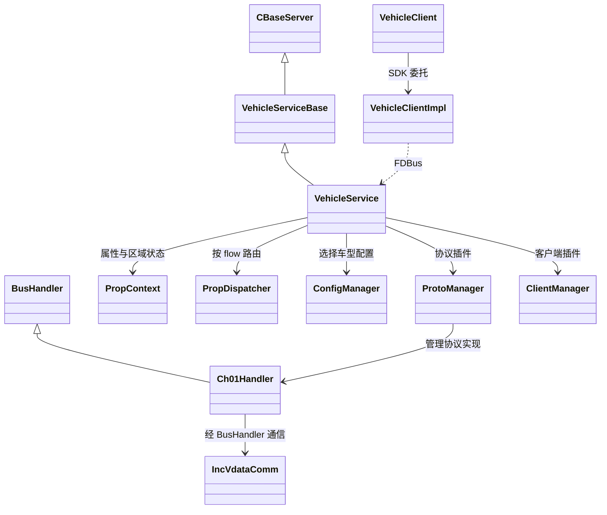
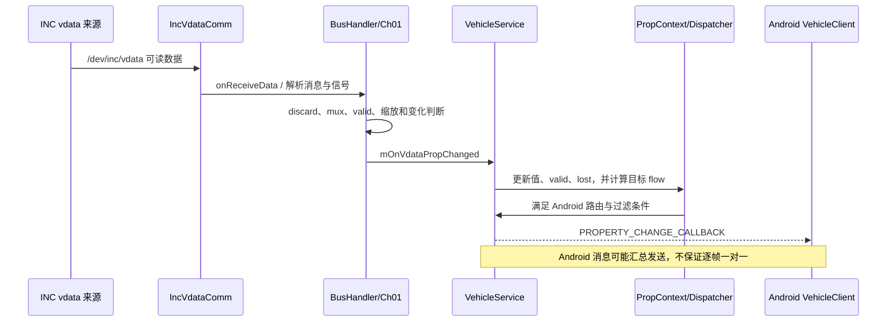
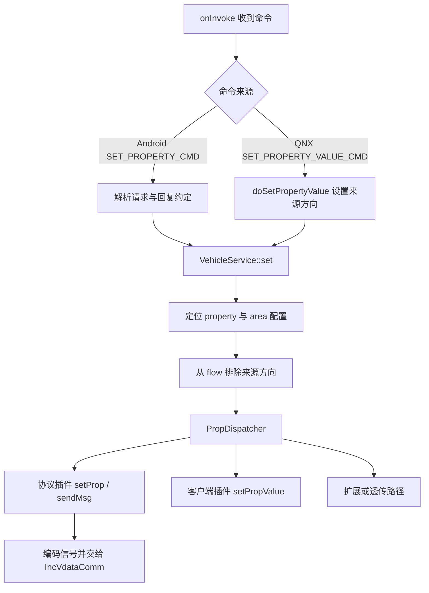
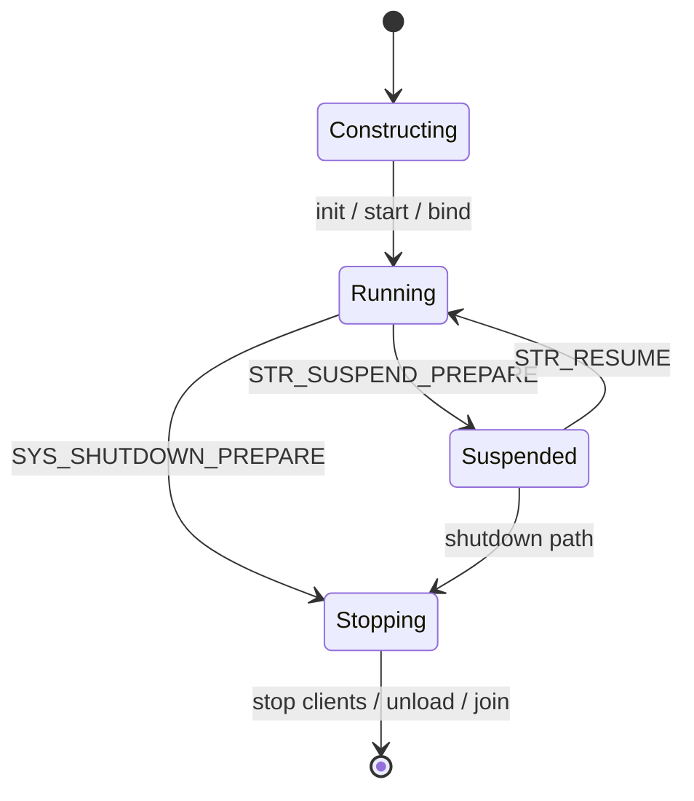

# 02 QNX VehicleService 的实现

[返回目录](README.md)

## 1. 目录与职责

| 目录 | 主要职责 | 阅读锚点 |
|---|---|---|
| `VehicleService/src` | main、服务端、属性上下文和 QNX 客户端 SDK | [VehicleMain.cpp](../../VehicleService/src/VehicleMain.cpp#L6) |
| `VehicleService/inc` | 公共类型、配置抽象、核心接口 | [VehicleService.h](../../VehicleService/inc/VehicleService.h#L112) |
| `VehicleService/protos` | BusHandler、Ch01/02/03 与 INC 通信 | [BusHandler.cpp](../../VehicleService/protos/BusHandler.cpp#L404) |
| `VehicleService/protos/pps` | PPS 协议接入 | [构建入口](../../VehicleService/CMakeLists.txt#L138) |
| `VehicleService/plugins` | 配置、协议、客户端、工具与扩展插件管理 | [PluginManager.h](../../VehicleService/plugins/PluginManager.h#L161) |
| `VehicleService/clients` | 通用 FDBus 客户端适配 | [ClientManager.cpp](../../VehicleService/plugins/ClientManager.cpp#L20) |
| `VehicleService/config`、`extends` | 默认配置与扩展 | [可替换子目录逻辑](../../VehicleService/CMakeLists.txt#L145) |
| `VehicleService/tool` | VehicleTool CLI、客户端与协议 | [ToolMain.cpp](../../VehicleService/tool/ToolMain.cpp#L30) |
| `VehicleService/utility` | 线程、定时器、锁和日志等 | [LocalTimer.h](../../VehicleService/utility/LocalTimer.h#L115) |
| `gtest`、`demo` | 公共单测和客户端示例 | [TestMain.cpp](../../gtest/TestMain.cpp#L8) |

公共实现通过 `PKG_CFG_ROOT`、`PKG_CLT_ROOT` 等构建变量引入客户目录。因此修改当前产品行为时，必须先确认使用的是默认目录还是 `vs` 的客户实现。

## 2. 核心对象关系

下图只保留已核实的关键继承与协作关系，省略构造参数和大量成员；组合箭头不表示完整的析构所有权契约。

依据：[服务基类](../../VehicleService/src/VehicleServiceBase.h#L28)、[服务声明](../../VehicleService/inc/VehicleService.h#L112)、[Ch01 配置装载](../../VehicleService/protos/Ch01Handler.cpp#L19)、[dispatcher 初始化](../../VehicleService/src/VehicleService.cpp#L379)。Android 的 `VehicleHalManager` 不属于这里。

## 3. 启动过程

1. main 创建 `main_worker`、`statistics_worker`，启动 FDBus context 和 worker。
2. 构造 `VehicleService`。构造期间挂载尚未启用的 timer，装载配置插件并选择车型，然后调用 `init()`。
3. `init()` 加载属性上下文、默认值及可选过滤配置，清理 Android 消息缓存，建立 dispatcher。
4. 初始化 Proto、Client、Tool、Extern manager，再启动服务内部处理。
5. 构造完成后 main 才执行 `enableReconnect(true)` 和 `bind("svc://com.bosch.cm.vehicle")`。
6. 主线程周期检查 STOP 状态；退出时先删除 service，再停止、join worker，最后销毁 FDBus context。

依据：[main 顺序](../../VehicleService/src/VehicleMain.cpp#L43)、[构造与配置选择](../../VehicleService/src/VehicleService.cpp#L257)、[init 顺序](../../VehicleService/src/VehicleService.cpp#L349)。构造成功、服务绑定成功、MCU 可用和 Android 完成初始化是不同阶段。

## 4. 从车端到 Android：上行链路

`IncVdataListener` 是独立 pthread，读取 `/dev/inc/vdata`；一批可读数据处理后会调用发送 Android 汇总消息的回调。Bus 层并不是收到任何字节都直接广播：discard、mux、信号有效性、变化判断及配置缩放都会影响结果。

`handlePropChanged()` 更新当前区域数据，清除 lost、设置 valid，然后根据 flow 交给 dispatcher。dispatcher 依次提供 Proto、Client、Extern、Passthrough 处理机会；各 handler 自己检查作用范围，所以不能把顺序遍历理解为每个属性都发给全部插件。

依据：[INC 线程与读取](../../VehicleService/protos/IncVdataComm.cpp#L247)、[Bus 上行处理](../../VehicleService/protos/BusHandler.cpp#L794)、[变化集合回调](../../VehicleService/protos/BusHandler.cpp#L1092)、[属性更新](../../VehicleService/src/VehicleService.cpp#L2056)。

## 5. 从请求到车端：下行链路

Android `VehicleClient` 使用 `SET_PROPERTY_CMD`；QNX SDK 使用 `SET_PROPERTY_VALUE_CMD`。两者都能进入服务的 set/路由逻辑，但协议入口和回复处理不同。

服务端对 `SET_PROPERTY_CMD` 是否调用 FDBus `reply`，取决于属性区域配置的 reply 要求。MCU response、消息队列 dequeue、软件 API 返回和实际执行反馈也不是同一个事件。

依据：[命令分派](../../VehicleService/src/VehicleService.cpp#L964)、[条件回复](../../VehicleService/src/VehicleService.cpp#L1052)、[SDK 入口](../../VehicleService/src/VehicleService.cpp#L1399)、[set 路由](../../VehicleService/src/VehicleService.cpp#L1600)、[Bus 发送](../../VehicleService/protos/BusHandler.cpp#L1646)。

## 6. 三种容易混淆的读取

| 读取方式 | 实际读取位置 | 关键语义 |
|---|---|---|
| QNX SDK `VehicleClientImpl::getPropValue` | SDK 的 `mPropValueMap` | 返回最近收到的订阅数据；未收到可能返回 false |
| FDBus `GET_PROPERTY_CMD` | 服务 `PropContext` | 校验配置和 READ 权限，按区域组装当前值并广播响应 |
| FDBus `GET_PROPERTY_VALUE_CMD` | 通常是服务缓存 | `HW_RTCTIME` 有专门向 client 请求的例外 |

依据：[SDK 缓存读取](../../VehicleService/src/VehicleClientImpl.cpp#L213)、[服务 GET](../../VehicleService/src/VehicleService.cpp#L1281)、[特殊读取](../../VehicleService/src/VehicleService.cpp#L1418)。不要用「get 返回了数值」证明此刻 MCU 刚刚采样。

## 7. 订阅、初值与缓存

QNX SDK 的 subscribe 会先登记本地 property，再订阅 FDBus property code。服务 `onSubscribe` 遇到属性订阅时，按 area 从当前上下文读取值并立即广播。重连后 SDK 会重建已有订阅。

`PropContext` 按区域保存当前数据；初始值不一定代表有效采样。服务组装 proto 时会根据 valid 标志产生 DEFAULT 状态。`past` 是默认最多 10 条的历史快照，主要用于观察和统计，不是常规 GET 的历史数据库。

依据：[SDK 订阅](../../VehicleService/src/VehicleClientImpl.cpp#L155)、[重连](../../VehicleService/src/VehicleClientImpl.cpp#L61)、[服务订阅](../../VehicleService/src/VehicleService.cpp#L1172)、[上下文结构](../../VehicleService/inc/PropContext.h#L36)、[默认状态](../../VehicleService/src/VehicleService.cpp#L1784)。

## 8. 过滤与丢弃不是一回事

- discard 配置可使 Bus 层直接跳过特定信号。
- `USR_VEHICLE_SIGNAL_FILTER_ENABLED` 控制过滤配置和相关 timer 的启用；缺省启用。
- `openSignalFilter` 是另外一个运行时开关，不应与前者混为一谈。
- 过滤可能根据首次变化、变化幅度门槛、Android/QNX 各自的最小发送间隔决定是否立即通知。
- drop timer 可在稍后尝试发布当前值，但不保证重新读取了硬件。
- CONTINUOUS 的 Android 定时重发又是另一层机制，不等同于 QNX 过滤器。

依据：[过滤环境变量](../../VehicleService/src/VehicleService.cpp#L297)、[过滤处理](../../VehicleService/src/VehicleService.cpp#L2860)、[Bus discard](../../VehicleService/protos/BusHandler.cpp#L866)。

## 9. 线程与生命周期

必须至少区分 main、FDBus/worker、INC listener 和本地周期 timer 的执行上下文。源码出现回调、队列和锁时，要问「谁持有对象」「在哪个线程执行」「关闭时还有没有回调」。不能把整个服务想成单线程函数串。

下图为生命周期概念状态，并非源码 enum 的逐字复制：

`suspend()` 暂停协议插件，关闭相关循环 timer 并销毁 recurrent/drop timer；`resume()` 先 start，再恢复 client。LCM 的挂起、恢复通知有回写值 0 的应答路径。shutdown 通知会设置 STOP，main 才进入退出流程。

3 秒 `CCheckRespTimer` 是触发消息队列检查的周期，不等于全部写请求的超时阈值；实际超时策略在扩展插件边界。

依据：[start/resume/suspend](../../VehicleService/src/VehicleService.cpp#L819)、[stop](../../VehicleService/src/VehicleService.cpp#L902)、[SUSD 通知](../../VehicleService/src/VehicleService.cpp#L2303)、[timeout 检查触发](../../VehicleService/src/VehicleService.cpp#L52)。

## 10. 如何顺着源码学

先读 main 和 `init()`，再读一个配置对应的 `PropContext`，接着跟踪 Ch01 的 `BusHandler` 收发，最后看 SDK 与测试。不要从数千行的服务文件顶部一路读到底。

特别留意 `#if 0`：服务内旧 `subscribe/unsubscribe/get` 实现并非当前实际入口。以正在编译的 `onInvoke/onSubscribe`、`set()` 和 dispatcher 为准。

练习：在 [TestBusHandler.cpp](../../gtest/TestBusHandler.cpp#L58) 找到位提取测试，回答「位序错误」「缩放错误」「属性路由错误」分别应该在哪一层写测试。

下一章：[03-android-hal.md](03-android-hal.md)。