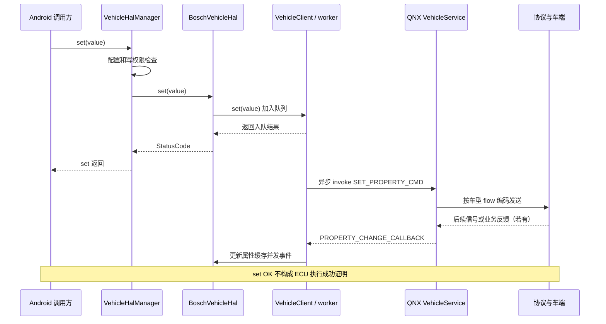
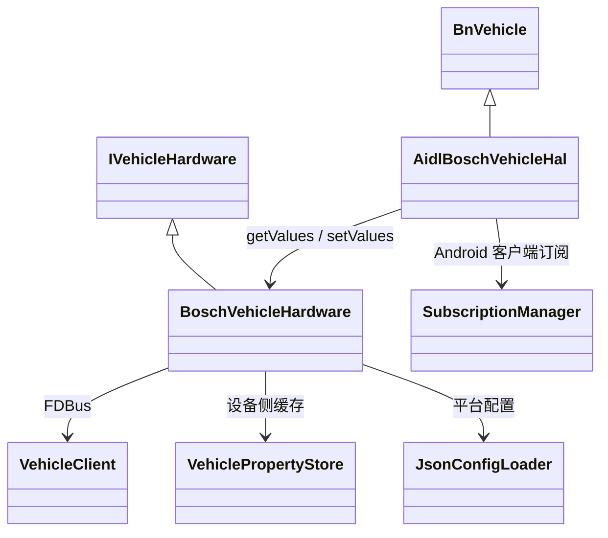

# 03 Android BoschVehicleHal 的两条分支

[返回目录](README.md)

## 1. 先确定运行的是哪条分支

工作区同时有 HIDL 2.0 和 AIDL 源码，不代表产品同时运行两套 VHAL。`VHAL_TYPE=AIDL` 控制 AIDL 编译内容；最终仍要核对产品包选择、VINTF、init rc 和运行时服务。

`FDBUS_VERSION=5_4` 选择 FDBus 库和兼容宏，不选择 HIDL/AIDL。

| 项目 | HIDL | AIDL |
|---|---|---|
| Android 接口层 | AOSP `VehicleHalManager` | Bosch `BoschVehicleHal : BnVehicle` |
| 设备实现层 | `BoschVehicleHal : VehicleHal` | `BoschVehicleHardware : IVehicleHardware` |
| FDBus 适配 | HIDL 目录的 VehicleClient | AIDL hardware 目录的 VehicleClient |
| 服务模块 | `vendor.bosch.hardware.automotive.vehicle@2.0-service` | `android.hardware.automotive.vehicle@V1-bosch-service` |
| init class | `hal` | `early_hal` |
| 本地 manifest | HIDL 2.0 | AIDL version 2 |

AIDL 模块名含 `V1`，但当前 manifest 声明 version 2，不应仅按文件名推断接口版本。HIDL/AIDL 各自声明 IVehicle 的 default 实例；它们不是同一个 Binder 名称空间下完全相同的字符串，但同一产品应明确采用哪条 VHAL 实现。

依据：[AIDL 开关](../../../../../../qcom_la/lagvm/LINUX/android/vendor/bosch/common/hal/automotive/vehicle/aidl/EnableAidl.go#L34)、[FDBus 选择](../../../../../../qcom_la/lagvm/LINUX/android/vendor/bosch/common/hal/automotive/VehicleCompileController.go#L25)、[HIDL manifest](../../../../../../qcom_la/lagvm/LINUX/android/vendor/bosch/common/hal/automotive/vehicle/2.0/service/vendor.bosch.hardware.automotive.vehicle@2.0-service.xml#L2)、[AIDL manifest](../../../../../../qcom_la/lagvm/LINUX/android/vendor/bosch/common/hal/automotive/vehicle/aidl/impl/service/vhal-bosch-service.xml#L2)。

## 2. 目录地图

```text
automotive/vehicle/
  2.0/
    default/impl/vhal_v2_0/
      BoschVehicleHal.*           HIDL vendor 实现
      VehicleClient.cpp           FDBus client、发送队列、属性回报
      BoschSTRVehicleHal.*        input/epoll 电源适配
    service/                     服务 main、Android.bp、rc、manifest
  aidl/
    EnableAidl.go                 AIDL 条件编译与依赖
    config/                      平台 JSON 配置及安装规则
    impl/
      vhal/                      BnVehicle 前端，请求和订阅管理
      hardware/                  设备抽象、属性缓存、FDBus 和 JSON loader
      service/                   Binder 服务 main、rc、manifest
      userhal/                   Android 用户相关属性处理
      obd2frame/                 OBD2 数据处理

automotive-custom/vehicle/2.0/
  types.hal                      客户属性类型
  default/impl/vhal_v2_0/
    BoschConfigLoad.*            按车型选择配置池
    include/                    生成的属性配置与车型池
    tools/configs/              车型 JSON 输入
    tools/convertor.py           JSON 到 C++ 转换
  default/protobuf/             Android 侧车辆协议

vehicle/
  2.0/                         HIDL 接口、默认实现、公共管理层及测试
  aidl/                        AIDL 接口、公共框架、配置、硬件接口及测试
  aidl_property/               属性接口定义
  proto/、tools/、vts/          辅助协议、生成工具与兼容性测试
```

## 3. HIDL 启动与读取

HIDL main 创建 `VehiclePropertyStore` 和 Bosch vendor HAL，再构造 `VehicleHalManager`。manager 初始化 HAL 时触发 `onCreate()`，装载属性、启动 FDBus client 和 STR。入口最多等待 QNX 初始化通知 4 秒，随后注册服务；超时并不会阻止注册。

常规 get：manager 校验属性存在、可读，再调用 Bosch HAL，从本地 `VehiclePropertyStore` 获取值。它不是每次都发 FDBus GET。特殊属性处理应以 get 内具体分支为准。

依据：[HIDL main](../../../../../../qcom_la/lagvm/LINUX/android/vendor/bosch/common/hal/automotive/vehicle/2.0/service/VehicleService.cpp#L31)、[manager get/set](../../../../../../qcom_la/lagvm/LINUX/android/hardware/interfaces/automotive/vehicle/2.0/default/common/src/VehicleHalManager.cpp#L111)、[vendor get](../../../../../../qcom_la/lagvm/LINUX/android/vendor/bosch/common/hal/automotive/vehicle/2.0/default/impl/vhal_v2_0/BoschVehicleHal.cpp#L168)。

## 4. HIDL 写入顺序图

以下为普通配置支持的写属性路径；电源等特殊分支还会有本地逻辑。



`VehicleClient::set()` 排队后返回 0；名字叫 `setSync()` 的内部函数当前却走异步 `invoke()` 分支，因此必须读实现，不能按名字推断同步语义。

依据：[vendor set](../../../../../../qcom_la/lagvm/LINUX/android/vendor/bosch/common/hal/automotive/vehicle/2.0/default/impl/vhal_v2_0/BoschVehicleHal.cpp#L187)、[队列及发送](../../../../../../qcom_la/lagvm/LINUX/android/vendor/bosch/common/hal/automotive/vehicle/2.0/default/impl/vhal_v2_0/VehicleClient.cpp#L227)。

## 5. AIDL 分层与请求完成



图中 `AidlBoschVehicleHal` 是为了区分同名类而使用的图示标签，真实 C++ 类名仍是 `BoschVehicleHal`。

AIDL 前端检查 request ID、属性、访问权限、区域和值域，然后交给硬件的异步请求队列。普通 get 从 `mServerSidePropStore` 读取，结果通过 callback 返回。写请求的 callback OK 也不能提升为车端执行确认：vendor 发送路径是异步的，FDBus `onReply()` 当前为空。

服务入口构造硬件时显式使用 `/vendor/etc/automotive/bosch_common/` 和 `/vendor/etc/automotive/vhaloverride/`，并启用 override。硬件无参构造器的默认路径 `/vendor/etc/automotive/vhalconfig/` 不能拿来替代实际入口的参数。

依据：[AIDL 服务入口](../../../../../../qcom_la/lagvm/LINUX/android/vendor/bosch/common/hal/automotive/vehicle/aidl/impl/service/VehicleService.cpp#L35)、[AIDL getValues](../../../../../../qcom_la/lagvm/LINUX/android/vendor/bosch/common/hal/automotive/vehicle/aidl/impl/vhal/src/BoschVehicleHal.cpp#L369)、[AIDL setValues](../../../../../../qcom_la/lagvm/LINUX/android/vendor/bosch/common/hal/automotive/vehicle/aidl/impl/vhal/src/BoschVehicleHal.cpp#L456)、[硬件写入](../../../../../../qcom_la/lagvm/LINUX/android/vendor/bosch/common/hal/automotive/vehicle/aidl/impl/hardware/src/BoschVehicleHardware.cpp#L1099)。

## 6. 两种订阅不是一对一映射

| 层次 | 订阅对象 | 行为 |
|---|---|---|
| Android API | 客户端关心的 property / area / rate | manager 管理订阅与回调分发 |
| HAL 连续属性 | 已缓存属性的周期上报 | timer 可重发旧值；新时间戳不证明新硬件采样 |
| FDBus | PROPERTY_CHANGE_CALLBACK 等消息类型 | client 上线后统一订阅并请求初始化快照 |

HIDL vendor subscribe 中逐属性 `subscribeProp()` 调用在 `#if 0` 内。AIDL `updateSampleRate()` 同样存在从 store 定时重发的机制。因此应用 subscribe 并不必然产生一次对应的 QNX 属性订阅调用。

上线的关键操作是：订阅 change、init、set-error 等通知，发送 `PROPERTY_INIT_ALL_CMD`，接收 `PROPERTY_INIT_ALL_RESP` 及之后的变化。重连会重建订阅并请求快照；AIDL 有 `info.mFirstOrLast` 条件。

依据：[HIDL subscribe](../../../../../../qcom_la/lagvm/LINUX/android/vendor/bosch/common/hal/automotive/vehicle/2.0/default/impl/vhal_v2_0/BoschVehicleHal.cpp#L267)、[上线握手](../../../../../../qcom_la/lagvm/LINUX/android/vendor/bosch/common/hal/automotive/vehicle/2.0/default/impl/vhal_v2_0/VehicleClient.cpp#L332)、[AIDL 采样率](../../../../../../qcom_la/lagvm/LINUX/android/vendor/bosch/common/hal/automotive/vehicle/aidl/impl/hardware/src/BoschVehicleHardware.cpp#L2110)。

## 7. 状态与错误传播边界

- 两侧 client 都启用重连，但服务注册成功不代表 FDBus 已连通。
- AIDL 当前 `checkHealth()` 返回 OK，不能单独拿它证明 QNX 链路健康。
- `PROPERTY_SET_ERROR_CALLBACK` 的接收代码目前重点处理 `ERROR_LOST`，不能假定 proto 所有错误枚举都已一一接到 Android。
- HIDL 的 ERROR_LOST 路径写 ERROR 状态并发普通属性事件；正式 set-error 调用处是注释。
- AIDL 对应路径生成 `SetValueErrorEvent`。它与 set 请求 callback 是不同机制。
- HIDL 有 `AP_POWER_STATE_REPORT` 离线缓存和重发；AIDL client 没有同样的缓存逻辑。

依据：[HIDL 错误处理](../../../../../../qcom_la/lagvm/LINUX/android/vendor/bosch/common/hal/automotive/vehicle/2.0/default/impl/vhal_v2_0/VehicleClient.cpp#L480)、[AIDL 错误处理](../../../../../../qcom_la/lagvm/LINUX/android/vendor/bosch/common/hal/automotive/vehicle/aidl/impl/hardware/src/VehicleClient.cpp#L259)。

## 8. STR 与 QNX 生命周期的区别

Android Bosch STR 适配监听 Linux input/epoll 中的 `KEY_POWER`。在电源 ON 条件下可产生 `AP_POWER_STATE_REQ(SHUTDOWN_PREPARE, CAN_SLEEP)`，再配合 `AP_POWER_STATE_REPORT` 更新状态。

这不是 QNX LCM 的 FDBus SUSD 通知链。HIDL `VehicleClient::suspend()/resume()` 控制的是诊断 timer，不等同于关闭或重新打开车辆总线。

依据：[STR input 处理](../../../../../../qcom_la/lagvm/LINUX/android/vendor/bosch/common/hal/automotive/vehicle/2.0/default/impl/vhal_v2_0/BoschSTRVehicleHal.cpp#L133)、[HIDL 电源分支](../../../../../../qcom_la/lagvm/LINUX/android/vendor/bosch/common/hal/automotive/vehicle/2.0/default/impl/vhal_v2_0/BoschVehicleHal.cpp#L216)、[client suspend](../../../../../../qcom_la/lagvm/LINUX/android/vendor/bosch/common/hal/automotive/vehicle/2.0/default/impl/vhal_v2_0/VehicleClient.cpp#L99)。

## 9. 车型选择

HIDL 客户配置由 Soong load hook 调转换器生成 C++，运行时 `BoschConfigLoad` 读取 `ro.vendor.oem.cfg.hut.variant.type`，超时后读取 boot property，缺省车型为 D01。

当前 VS 车型列表包含 T1YA，而 Android loader 的显式配置池选择未列出它。目录中有 T1YA 生成文件并不能证明当前运行时会选中该池。需要产品集成确认，手册不把这个差异直接定性为缺陷，也不替用户修改。

依据：[客户构建 hook](../../../../../../qcom_la/lagvm/LINUX/android/vendor/bosch/chery/idcpro/hal/automotive-custom/vehicle/2.0/default/libvehutils.go#L54)、[运行时选择](../../../../../../qcom_la/lagvm/LINUX/android/vendor/bosch/chery/idcpro/hal/automotive-custom/vehicle/2.0/default/impl/vhal_v2_0/BoschConfigLoad.cpp#L18)。

下一章：[04-property-development.md](04-property-development.md)。