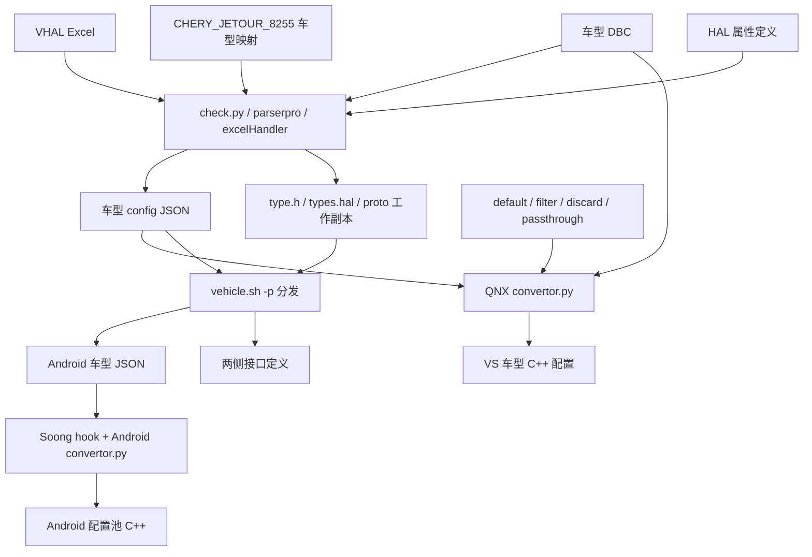
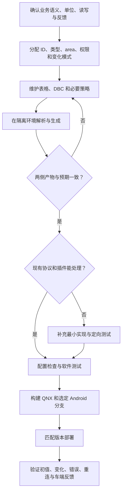

# 04 配置、协议与属性开发实战

[返回目录](README.md)

## 1. 先分清输入与产物

| 位置 | 内容 | 修改原则 |
|---|---|---|
| `vs/tools/sdb` | 车型 DBC 消息和信号 | 按经确认的车辆接口版本维护 |
| `vs/tools/vhal` | VHAL Excel 和 `types_base.hal` | 表格定义属性与信号的关系，HAL 定义提供类型基线 |
| `vs/tools/inc` | `mcu_<车型>.h` 等 MCU 标识 | 解析器读取；本次未核实上游生成来源 |
| `vs/tools/scripts` | 车型映射、wrapper、类型/proto 工作副本 | 注意脚本相对路径和跨仓库复制 |
| `vs/tools/json` | 车型配置及 default/filter/discard/passthrough | 车型 config JSON 可由表格解析生成；策略 JSON 也参与转换 |
| `vs/config/<车型>` | PropConfig、Ch01Config、ConfigPool 等 C++ | 生成产物，直接改会在下次生成时丢失 |
| `api/protobuf` | 客户 Protobuf 定义 | 与 QNX 和 Android 使用的协议保持兼容 |
| `automotive-custom/.../tools/configs` | Android 车型 JSON | 接收分发结果，再由 Android hook 转换 |
| `automotive-custom/.../include` | Android 生成的车型 C++ | 不是维护车辆信号的第一输入源 |

依据：[工具说明](../../tools/scripts/README.txt#L1)、[车型映射](../../../../../vendor/bosch/chery/idcpro/vs/tools/scripts/CHERY_JETOUR_8255.py#L8)、[C++ 配置生成](../../tools/scripts/convertor.py#L1060)。

## 2. 生成与协作关系图

这是配置生产链，不是运行时数据流。修改 Excel 不会自动改变已运行设备；必须经过解析、生成、构建、部署与运行时车型选择。

当前公共检查入口是 `check.py`，它导入 `parserpro`，在 main 中从第一个参数装载项目模块为 `prj`，按交互步骤检查 HAL、Excel、计算 ID、复制 enum 和生成属性文件。旧 `parser.py` 仍在目录中，但其独立入口与当前配置接口不匹配，不能因为文件存在就认为 wrapper 可用。

解析工具会处理空 area、默认值、向量、FLOAT 和 BYTE/BYTES，并检查信号存在性与类型/缩放兼容性。缺省或 `TBD` 值可能被转成零，因此「生成成功」并不能代替业务默认值审查。

依据：[当前检查入口](../../tools/scripts/check.py#L28)、[表格字段处理](../../tools/scripts/excelHandler.py#L314)、[旧解析入口](../../tools/scripts/parser.py#L1527)、[生成器输入](../../tools/scripts/convertor.py#L1807)。

## 3. 当前车型矩阵

VS CMake 列表为：D01、D01_HW、D01_OS_APA、T1J_FL2、T1L_FL1、T1J_FL3、T1YA、T1J_FL3_FUEL。

历史目录或文件名中出现 T1J，不足以证明它在当前 CMake variants 列表中。添加车型要同时检查车型脚本、配置生成、ConfigManager 注册、Android loader 的 variant ID 映射、构建打包和测试集合。

依据：[VS variants](../../../../../vendor/bosch/chery/idcpro/vs/config/CMakeLists.txt#L7)、[客户配置注册](../../../../../vendor/bosch/chery/idcpro/vs/config/ConfigManager.cpp#L1)。

## 4. 真实实例：T1L FL1 车速

选用 `ESP_1_VEHICLESPEEDVSOSIG_2E9`。它是厂商属性，不是标准 `PERF_VEHICLE_SPEED` 的同义名称。

| 项目 | 已核实配置 |
|---|---|
| 属性 ID | 十进制 `559955978`，十六进制 `0x2160400A` |
| HAL 属性组合 | VENDOR、FLOAT、GLOBAL |
| access / changeMode | READ / ON_CHANGE |
| useArea / area | Android_QNX / 0 |
| 初始值 / 范围 | 0.0 / 0.0 至 511.9375 |
| flow | BUS_CH01 |
| CAN 消息 | `CGW_ABS_ESP_1`，745，即 `0x2E9` |
| 信号 | `ESP_1_VehicleSpeedVSOSig` |
| factor / offset | 0.0625 / 0.0 |
| DBC 单位 | km/h |
| 写方向 | setMsgId 为 null，setSignals 为空；不能拿它做写属性实验 |

来源：[VS JSON](../../../../../vendor/bosch/chery/idcpro/vs/tools/json/config_T1L_FL1.json#L7127)、[DBC](../../../../../vendor/bosch/chery/idcpro/vs/tools/sdb/car_T1L_FL1_INF.dbc#L773)、[API enum](../../../../../vendor/bosch/chery/idcpro/api/protobuf/com.bosch.cm.platform.vehicle.proto#L1774)、[HAL enum](../../../../../vendor/bosch/chery/idcpro/vs/tools/scripts/types.hal#L21093)、[Android JSON](../../../../../../qcom_la/lagvm/LINUX/android/vendor/bosch/chery/idcpro/hal/automotive-custom/vehicle/2.0/default/impl/vhal_v2_0/tools/configs/config_T1L_FL1.json#L7127)。

### 如何理解换算

在启用对应上行计算标志的路径中，物理量按照下面的公式从原始值换算：

$$
v_{\mathrm{km/h}} = raw \times 0.0625 + 0
$$

例如教学输入 `raw = 1600` 对应 `100 km/h`。这是计算示例，不是本次采集到的车端数据，也没有在本次运行注入测试。

标准 `PERF_VEHICLE_SPEED` 使用 m/s。若业务确实要把此厂商属性转换成标准车速，需要明确转换设计，而不能直接沿用相同数值：

$$
v_{\mathrm{m/s}} = v_{\mathrm{km/h}} / 3.6
$$

实际 Bus 换算入口见 [BusHandler.cpp](../../VehicleService/protos/BusHandler.cpp#L216)。还要核对生成配置中的计算标志和上下游是否已转换，防止重复缩放。

### 怎样完整追踪它

1. 用属性名找到 VS JSON，记下 flow、area、getMsgId 和 getSignals。
2. 在 DBC 中确认消息 745 与信号，检查位布局、符号、factor、offset 和单位。
3. 在 HAL/proto 中确认 property ID 一致，不能把 `_2E9` 当属性 ID。
4. 检查生成的 Ch01 与 PropConfig 是否包含该映射，运行时是否选择了 T1L FL1 配置池。
5. 从 Bus 上行到 `PropContext`，检查 valid/lost、flow 和过滤。
6. 在 Android 初始化/变化回调后检查本地缓存，再观察应用订阅事件。

## 5. Protobuf 是跨 OS 契约

至少区分命令 `SET_PROPERTY_CMD`、初始化 `PROPERTY_INIT_ALL_CMD/RESP`、变化通知 `PROPERTY_CHANGE_CALLBACK` 和错误通知 `PROPERTY_SET_ERROR_CALLBACK`。消息编码一致，不意味着两端业务分支完全一致。

修改消息字段时要保持 wire compatibility：不复用已用 field number，不在未协调两端时改变字段类型或 enum 语义；删除字段应考虑 reserved。新增属性 enum 也需要检查两侧生成定义和配置中实际数值。

`api/merge_proto.sh` 的名称容易误导：它主要清理和重建 protobuf、variant 相关符号链接，并不是把所有 proto 文本拼成一个文件。执行前检查链接指向和相对路径。

依据：[Android proto 命令与状态](../../../../../../qcom_la/lagvm/LINUX/android/vendor/bosch/chery/idcpro/hal/automotive-custom/vehicle/2.0/default/protobuf/com.bosch.cm.platform.vehicle.proto#L23)、[链接脚本](../../../../../vendor/bosch/chery/idcpro/api/merge_proto.sh#L4)。

## 6. 新增或修改属性的完整过程

### 阶段 A：先写契约

记录名称、ID、车型、area、数据类型、长度、单位、范围、默认值、access、changeMode、读写方向、反馈属性、时序和异常状态。只写「加一个开关」不足以交付。

### 阶段 B：复用配置，必要时才加代码

已有 Bus/Ch01 路径能表达的属性，优先通过配置实现。只有协议解码、特殊状态机、外部服务交互或非通用转换确实需要新行为时，才改公共逻辑或客户插件。

### 阶段 C：生成后审查

检查 property ID、CAN ID、信号、单位、area、read/write flow、默认值、filter/discard/passthrough，以及受影响车型数量。对比 JSON 要按字段比较，不只看文件体积或时间戳。

### 阶段 D：分层验证

1. 解析和配置检查：重复 ID、缺信号、类型、区域、范围。
2. Bus 单测：位序、符号扩展、边界、mux、缩放。
3. 服务单测：缓存、来源方向、flow、过滤、默认/有效状态。
4. HAL 检查：属性注册、权限、区域、初始快照、事件、错误。
5. 集成验证：断连重连、挂起恢复、丢信号、多个订阅者。
6. 台架或实车：控制命令与实际状态反馈闭环；不可仅以 set OK 验收。

## 7. 脚本风险表

以下是源码行为说明，不是建议立即执行的命令清单。本次没有运行这些生成选项。

| 入口 | 写入副作用 / 前置条件 |
|---|---|
| `vehicle.sh -t <关键字> ...` | 可能把匹配 Excel 复制到多个车型，再检查 ID 和信号；不是只读 |
| `vehicle.sh -a <types.hal>` | 先覆盖工作副本，再调用旧 parser；当前配置接口不匹配，不能作为可用生成入口 |
| `vehicle.sh -p` | 覆盖 Android JSON、HAL 定义、QNX ConfigType 以及两侧 proto |
| `vehicle.sh -c` | 构建两侧多个模块，删除脚本目录的 output 后重新打包 |
| VS CMake 配置 | `file(REMOVE_RECURSE)` 删除各车型生成目录 |
| `vs_config_clean` | 删除时间戳，并用客户版本替换公共插件 ConfigManager 实现 |

依据：[wrapper 解析与分发](../../../../../vendor/bosch/chery/idcpro/vs/tools/scripts/vehicle.sh#L173)、[构建与打包](../../../../../vendor/bosch/chery/idcpro/vs/tools/scripts/vehicle.sh#L250)、[CMake 清理与生成](../../../../../vendor/bosch/chery/idcpro/vs/config/CMakeLists.txt#L19)。

**当前源码可见的接口不匹配：** wrapper 的 `-a` 只把 types.hal 传给旧 `parser.py`。该入口读取 `check.OLD_HAL_PATH`、`check.MAP_CAR_ROLE` 等字段，而当前 `check.py` 不导出这些模块级配置；它在 main 中装载 `prj` 并调用 `parserpro`。因此旧路径按当前接口不能完成生成，不能把它当作可用的一键命令。ECARX 是 `check.py` 独立运行时的缺省模块名，并非旧 parser 的缺省项目参数。

新的入口调用形态是 `python3 <公共工具目录>/check.py <项目模块路径> [表格版本参数] [新 HAL 文件]`，当前项目模块为 `vs/tools/scripts/CHERY_JETOUR_8255`。这只是根据参数解析给出的调用形态，不是本次验证成功的命令；工具会交互并写文件，依赖和路径必须先在受控副本中核对。当前公共 ConfigManager 有本地修改，尤其不能直接用生成流程覆盖它。

下一章：[05-build-test.md](05-build-test.md)。