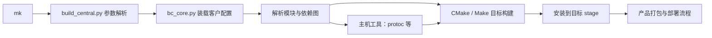

# 05 buildCentral、构建、测试与部署

[返回目录](README.md)

## 1. buildCentral 如何工作

用户指定的入口：

```text
/home/huo2wx/workspace/qnx/buildCentral
```

`mk` 向父目录寻找 external、project、tools、workspace 四个标志目录，再调用 Python `build_central.py`。控制器解析参数，`bc_core.py` 加载配置、展开客户和项目变量、处理依赖图，并调用各模块的构建规则。

显式 `-C chery -P idcpro` 时，本地实际读取：

```text
qnx/vendor/bosch/chery/idcpro/buildCentralProject/build/build_central.cfg
qnx/vendor/bosch/chery/idcpro/buildCentralProject/build/buildcentralrc
```

这是本次在 Docker 中执行列表查询确认的路径。老 Readme 中的参数名称可能落后于当前 parser，命令参数以实际脚本为准。



## 2. 当前关键模块

| 模块 | 源目录 | 直接依赖 / 关键注入 |
|---|---|---|
| `vs` | 公共 `vehicle-service/VehicleService` | protobuf、fdbus、proto-api、psis、inc_server |
| `vs-gtest` | 公共 `vehicle-service/gtest` | protobuf、fdbus、proto-api、psis-host、gtest |
| `proto-api` | 公共 `platform/api/protobuf` | 使用 protoc 工具，并引入客户 API 根目录 |
| `fdbus` | 公共 `platform/fdbus/cmake` | zip；当前客户配置使用 FDBus 5.4 相关设置 |

`vs` 注入 `PKG_CFG_ROOT=.../vs/config`、`PKG_CLT_ROOT=.../vs/clients`、`DEF_CFG_VID=20`。`vs-gtest` 还注入 `PKG_UTC_ROOT=.../vs/gtest`，所以最终测试集合同时来自公共和客户仓库。

客户 `buildcentralrc` 把 `_OEM_` 设为 `CHERY_JETOUR_8255`，用于配置生成模块选择。`arm-qnx` 是构建系统的逻辑目标名称，但当前编译器是 QNX 7.1 的 aarch64 工具链；不能看到 arm 字样就推断为 32 位二进制。

客户测试引入方式见 [客户 gtest CMake](../../../../../vendor/bosch/chery/idcpro/vs/gtest/CMakeLists.txt#L16)。

## 3. 参数速查

| 参数 | 当前含义 | 注意事项 |
|---|---|---|
| `-C chery` | 客户 | 与项目一起指定 |
| `-P idcpro` | 项目 | 确定客户配置和代码注入 |
| `-t linux` | Linux 主机目标 | 常用于单元测试，不是 QNX 可部署程序 |
| `-t arm-qnx` | 当前 QNX 产品目标 | 需要 SDK、sysroot 和相关依赖 |
| `-a` | 连依赖一起构建 | 它不接收模块名参数 |
| `vs` / `vs-gtest` | 位置参数：模块列表 | 多个模块用逗号分隔 |
| `-l` | 列模块 | 不执行编译；加载配置可能留下解释器缓存 |
| `-la <模块>` | 列依赖和顺序 | 可在编译前确认影响范围 |
| `-r <variant>` | 构建变体 | 先查询支持项，不照抄旧文档的 `-m` |
| `-c` / `-cb` | clean / clean 后 build | 有卸载、清理副作用，不作为入门第一步 |
| `-d` / `-v` / `-j N` | 调试 / 详细输出 / 并行数 | 并行数按资源选择 |

## 4. 本机环境约束

已有共享输出应继续在原 Docker 环境构建。本次只读确认容器 `6d1fcc32fc7c`（名称 `huo2wx_3594533`）处于 running 状态；容器 ID 不是可移植的项目配置，新机器应使用团队指定环境。

历史验证记录表明共享测试环境使用 GLIBC 2.31、GCC/gcov 9.4、lcov 2.0。宿主机与容器的 GLIBC 或 gcov 版本混用可能导致链接或覆盖率失败。本次未重新审计所有工具版本，因此构建前仍应查询。

```bash
docker inspect --format '{{.Name}} {{.State.Status}}' 6d1fcc32fc7c
docker exec -u huo2wx 6d1fcc32fc7c gcc --version
docker exec -u huo2wx 6d1fcc32fc7c gcov --version
docker exec -u huo2wx 6d1fcc32fc7c lcov --version
docker exec -u huo2wx 6d1fcc32fc7c ldd --version
```

宿主路径为 `/home/huo2wx/...`，当前容器工作路径为 `/export01/home/huo2wx/...`。不要因为目录看起来相同，就在宿主机对共享 output 执行 make/install。

## 5. 安全起步：查询而不是编译

下面的 Linux 列表命令已在本次执行成功：

```bash
docker exec -u huo2wx \
  -w /export01/home/huo2wx/workspace/qnx/buildCentral \
  6d1fcc32fc7c ./mk -C chery -P idcpro -l -t linux
```

输出确认 `linux/default`、`vs-gtest` 和 host stage。进一步查询示例，本次未执行：

```bash
docker exec -u huo2wx \
  -w /export01/home/huo2wx/workspace/qnx/buildCentral \
  6d1fcc32fc7c ./mk -C chery -P idcpro -la vs-gtest -t linux
```

## 6. QNX 与 Linux 测试构建

以下命令会写文件，**本次没有执行**。先确认本地修改已经保留、生成副作用可接受、编译器与现有产物一致。

```bash
docker exec -u huo2wx \
  -w /export01/home/huo2wx/workspace/qnx/buildCentral \
  6d1fcc32fc7c ./mk -C chery -P idcpro -a vs -t arm-qnx

docker exec -u huo2wx \
  -w /export01/home/huo2wx/workspace/qnx/buildCentral \
  6d1fcc32fc7c ./mk -C chery -P idcpro -a vs-gtest -t linux
```

重要：CMake 配置也可能删除并重建车型目录、替换公共 ConfigManager。不是只有 make install 才有写入副作用，详见 [配置风险](04-property-development.md)。

### 输出去哪里

| 内容 | 当前位置或规则 |
|---|---|
| 构建树 | `buildCentral/output/build/<variant>/<package>/<target>/` |
| Linux stage | `buildCentral/output/stage/host/`，本次列表查询已确认 |
| QNX stage | 客户配置指定 `qnx/qcom_qnx/apps/qnx_ap/install/aarch64le/` |
| 服务程序 | stage 下 `usr/bin/vehicleservice` |
| 工具与库 | VehicleTool、VehicleService/VehicleClient 等库，取决于目标安装规则 |
| 车型插件 | stage 下 `usr/lib/vsplugins/` |
| 测试二进制 | 当前已存在 `output/build/default/vs-gtest/linux/ut_vendor/gtestVehicleService` |
| 测试与覆盖率报告 | 安装前缀下 `lcov/gtest/` XML 和 `lcov/gtestVehicleService/` HTML |

依据：[服务构建目标](../../VehicleService/src/CMakeLists.txt#L86)、[车型插件安装](../../../../../vendor/bosch/chery/idcpro/vs/config/CMakeLists.txt#L126)、[客户测试报告命令](../../../../../vendor/bosch/chery/idcpro/vs/gtest/CMakeLists.txt#L122)。

## 7. 如何可信地运行测试

先列测试名，再选择与改动有关的用例。以下为已存在二进制的操作示例；本次只确认路径，没有执行测试。

```bash
docker exec -u huo2wx \
  -w /export01/home/huo2wx/workspace/qnx/buildCentral \
  6d1fcc32fc7c \
  ./output/build/default/vs-gtest/linux/ut_vendor/gtestVehicleService \
  --gtest_list_tests

docker exec -u huo2wx \
  -w /export01/home/huo2wx/workspace/qnx/buildCentral \
  6d1fcc32fc7c \
  ./output/build/default/vs-gtest/linux/ut_vendor/gtestVehicleService \
  --gtest_filter='*BusHandler*' --gtest_color=no
```

确认 filter 实际匹配了预期测试，不能把运行 0 个测试当成通过。定向通过后，根据改动范围运行全部测试，并记录二进制版本、退出码、测试总数、失败数与 XML。

两份 CMake 都存在 `gtest ... || echo "GTest fails but line coverage is still counted"`。因此外围构建成功不充分：必须检查 GoogleTest 摘要或 XML，最好单独执行二进制获取真实退出码。设置 `RUN_GTEST_DISABLE` 会跳过自动测试步骤，不能把这种构建结果称作测试通过。

覆盖率警告与断言失败分开看。旧 gcda、编译器/gcov 不匹配、lcov mismatch 可能影响覆盖率可信度；不要为修复覆盖率直接覆盖或清理其他人的产物。

### 测试对应关系

| 改动 | 优先测试 |
|---|---|
| 位布局、CAN FD、编码解码 | [TestBusHandler.cpp](../../gtest/TestBusHandler.cpp#L58) |
| 服务命令、路由、订阅、SUSD | [TestVehicleService.cpp](../../gtest/TestVehicleService.cpp#L364) |
| 车型配置 | [TestVehicleConfig.cpp](../../../../../vendor/bosch/chery/idcpro/vs/gtest/TestVehicleConfig.cpp#L1) |
| AVM/LCM 客户插件 | 客户 gtest 内对应 TestVehicleAvmClient / TestVehicleLcmClient |
| Android 接口兼容 | AOSP tests、AIDL tests、VTS；实际执行目标依产品环境确认 |

## 8. Android 构建

以下为 Android 标准构建方式，模块名已从 Android.bp 核实，产品 lunch 值未知，因此不编造目标。先由项目集成确认产品和 VHAL 分支。

```bash
cd /home/huo2wx/workspace/qcom_la/lagvm/LINUX/android
source build/envsetup.sh
lunch <团队确认的产品目标>

# HIDL 产品选择这一项
m vendor.bosch.hardware.automotive.vehicle@2.0-service

# AIDL 产品仅在 VHAL_TYPE 与产品配置已经正确启用后选择这一项
m android.hardware.automotive.vehicle@V1-bosch-service
```

上面包含占位符，不能整体直接粘贴执行；两条 `m` 是分支选项，不是要求两套服务一起安装。编译模块成功也不证明产品镜像已经包含它，还需核对 PRODUCT_PACKAGES、rc、manifest 和依赖库。

依据：[HIDL 模块](../../../../../../qcom_la/lagvm/LINUX/android/vendor/bosch/common/hal/automotive/vehicle/2.0/service/Android.bp#L21)、[AIDL 模块](../../../../../../qcom_la/lagvm/LINUX/android/vendor/bosch/common/hal/automotive/vehicle/aidl/impl/service/Android.bp#L48)。

## 9. 部署与验收

本工作区没有足够证据给出通用刷机命令，不能把某个开发板的复制方式当作整车发布流程。按产品授权流程准备匹配版本的服务、依赖库、车型插件、协议和 Android 镜像；保留回退包。

部署后依次检查：进程与服务注册、车型选择、FDBus 上线与初始化、属性配置、默认状态到有效状态的切换、读写和订阅、错误/断连恢复、STR、真实车端反馈。安装成功、服务在线、数据有效、控制生效是四个不同验收点。

下一章：[06-debugging.md](06-debugging.md)。