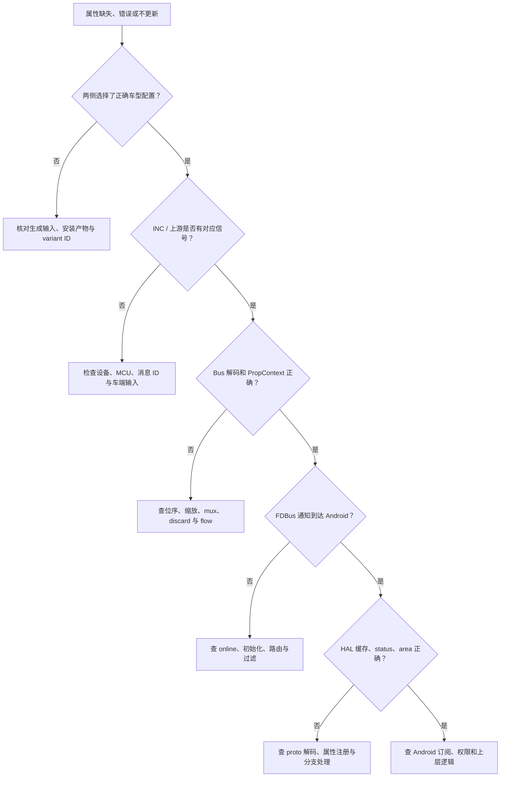

# 06 调试、排障与交付检查

[返回目录](README.md)

## 1. 先建立最小问题记录

每个问题至少记录：车型和 variant、QNX/Android 版本、HIDL/AIDL 分支、property ID、area、类型、值与单位、status、时间戳、复现操作、期望结果、实际结果，以及两侧同一时段日志。

不要只报告「HAL 没回调」。这个现象可能由配置缺失、订阅错误、信号未变化、过滤、断线、缓存默认值或上层权限造成。

## 2. 分段定位图



这是诊断活动图，不代表每种故障都必须从车端开始。已有明确日志锚点时，从最近一段向上游或下游移动。

## 3. 只读观察命令

以下设备命令为操作参考，需连接目标设备并具备调试权限；本次没有连接设备验证。Linux 主机命令、QNX 命令和 Android adb 命令不能混用。

```bash
# Android：进程、车型与日志
adb shell ps -A
adb shell getprop ro.vendor.oem.cfg.hut.variant.type
adb logcat -d -s BoschVehicleHal VehicleClient BoschVehicleHardware BoschSTRVehicle

# HIDL 产品
adb shell lshal

# AIDL 产品
adb shell service check android.hardware.automotive.vehicle.IVehicle/default
adb shell dumpsys android.hardware.automotive.vehicle.IVehicle/default --help
```

日志 tag 依编译版本可能不同；过滤结果为空时先看完整日志，不直接判定无事件。`service check` 只证明注册，不证明 FDBus 已连通。

QNX 上先用项目平台支持的进程工具（例如 `pidin ar`）确认 `vehicleservice` 与所需依赖；使用 VehicleTool 前先读本地 help 与 [CLI 参数实现](../../VehicleService/tool/ToolMain.cpp#L30)。不要未确认参数就执行写属性、停止服务或修改采样率。

## 4. 常见症状与证据

| 症状 | 先看什么 | 可区分的原因 |
|---|---|---|
| Android 找不到属性 | HAL config list、车型属性、生成配置 | 未注册、选错车型、分发遗漏、分支配置差异 |
| get 总是 0 | 初值、status、初始化事件、上行值 | DEFAULT 并非真实零值，或本地缓存未更新 |
| set 返回 OK 但未生效 | 发送队列、QNX set、Bus 编码、实际反馈 | 入队成功不等于车端执行 |
| QNX 有值但 Android 无事件 | flow、过滤、FDBus callback、Android 注册 | 不一定是总线问题 |
| 数值固定差一个倍数 | DBC 单位、factor、offset、计算标志 | km/h 与 m/s 混用、重复换算 |
| 特定座位控制无效 | area 配置和请求 areaId | 使用了 GLOBAL 0 或错误区域 |
| 订阅后只收到一次 | ON_CHANGE、信号变化与过滤 | 没变化可能是正常行为 |
| 时间戳变化但数值不变 | CONTINUOUS timer、HAL 缓存 | 重发旧值，不一定是新采样 |
| 断线恢复后仍是旧值 | onOnline、init request/response、缓存 | 重连完成与初始化完成不是一件事 |
| 挂起后 CPU/线程异常 | timer、worker、INC listener 和销毁次序 | 在活跃回调期间销毁对象或停止 owner |
| UT 构建成功但行为不对 | GoogleTest XML、失败摘要、过滤匹配数 | CMake 可能吞掉测试非零退出码 |
| GLIBC 符号版本错误 | 产物来源、链接环境、共享 stage | 宿主编译污染容器产物 |
| gcov version mismatch | gcc/gcov 与既有对象版本 | 工具链版本不一致，不必先改业务代码 |

## 5. 如何设计有效日志

调试同一属性时，两侧日志都带 property ID、area、status、值、来源方向和关键阶段；跨 OS 时间戳可能属于不同时间域，先确认同步方式，不能直接相减当端到端延迟。

使用「已收到」「已解码」「已入队」「已发送」「已收到反馈」这些明确阶段，而不是统一写「成功」。避免全量高频信号长期打印，控制采样与日志体积，不记录不必要的车辆或个人敏感数据。

## 6. 边界测试清单

- 配置：未知 ID、重复 ID、不存在 area、错误类型、向量长度、越界值、只读写入。
- 信号：零值、最大值、负值、符号位、跨字节、CAN FD 边界、mux、无效/丢失信号。
- 路由：Android/QNX 来源剔除、透传方向、客户端分支、过滤门槛和发送间隔。
- 初始化：默认值、首个真实值、初始化快照和普通变化到达顺序。
- 异步：队列积压、断线、重连、旧值、重复消息和可观察错误。
- 生命周期：挂起、恢复、停止 worker、timer detach、对象销毁时仍有回调。
- 产品：目标车型池确实选中，HIDL/AIDL 及协议版本匹配，安装文件完整。

生命周期测试尤其要保证 timer 与所属 worker 的存活顺序。已有历史测试清理经验只能证明测试隔离方式，不应被包装成已修复的生产生命周期缺陷。

## 7. 变更交付表

| 项目 | 必须留下的证据 |
|---|---|
| 需求 | 属性契约、车型范围、验收值和反馈定义 |
| 输入 | Excel/DBC/策略 JSON 的版本和差异 |
| 生成 | 两侧 ID、area、flow、默认值和输出清单 |
| 实现 | 必要的公共/客户代码修改，避免无关重构 |
| 测试 | 定向与回归结果、实际匹配数、失败数和 XML |
| 构建 | 容器、工具链、命令、目标、产物路径 |
| 部署 | 产品版本、文件组合、回退方式和权限 |
| 联调 | 初始化、事件、错误、重连、STR 和车端反馈 |

## 8. 当前明确的待确认项

1. Android 产品实际选择的 lunch 目标、VHAL_TYPE、PRODUCT_PACKAGES 和最终 VINTF 安装组合。
2. QNX/Android FDBus 跨 OS 的网络、服务发现、安全与启动依赖配置。
3. MCU 固件、INC 下层与台架实测响应时序。
4. T1YA 在 Android 当前 loader 中的运行时选择方式。
5. 旧 wrapper/parser 配置接口不匹配的处理，以及当前 check.py/parserpro 路径的依赖与实际生成验证。
6. 外部消息队列插件的实际超时阈值和业务确认定义。
7. 目标平台刷机、签名、回退和车端操作的正式流程。

这些事项不阻碍理解已核实的软件架构，但阻止我们把说明书示例宣称为「所有车型可直接执行的一键操作」。

## 9. 完成学习后的练习

1. 不修改任何代码，找到 T1L FL1 车速从 DBC 到 Android JSON 的所有关键字段。
2. 画出普通 get 与 set 的差异，说明两者何时会涉及 QNX 通信。
3. 在 TestBusHandler 中找到一个边界测试，说明它覆盖了什么、没有覆盖什么。
4. 用只读构建列表确认测试模块、依赖和 stage，而不是直接重建整个工程。
5. 为一个假想的可写属性编写验收表，明确入队成功、消息发送和车辆反馈的区别。

到这里应能独立定位代码、读懂配置、选择验证层次，并知道哪些信息必须向产品或车端负责人确认。